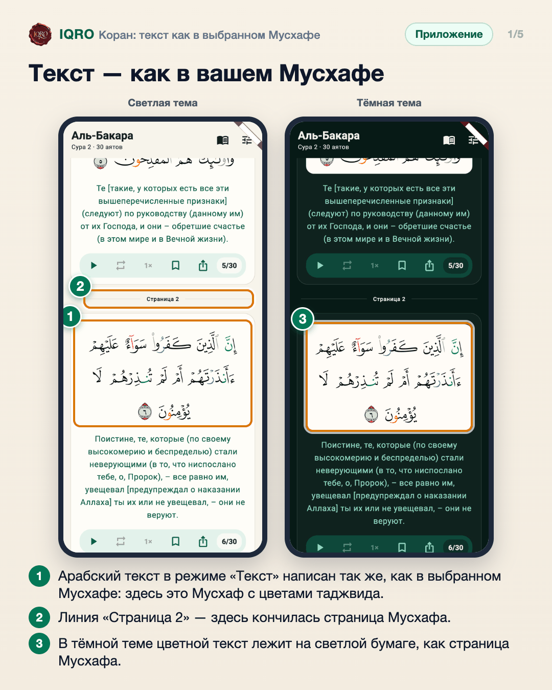
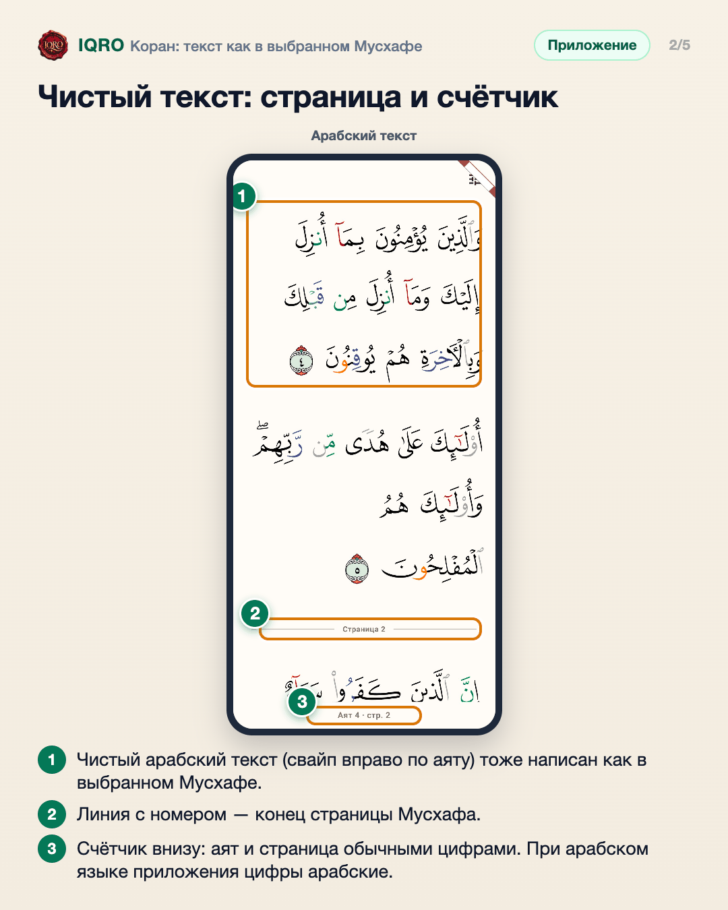
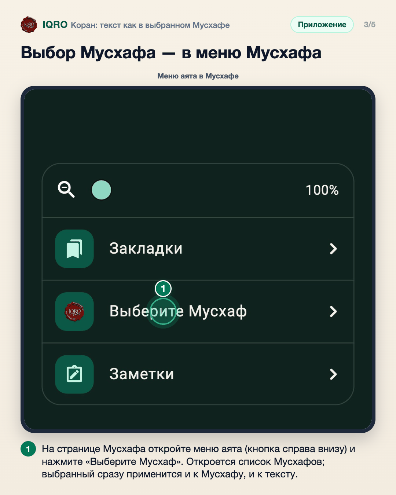
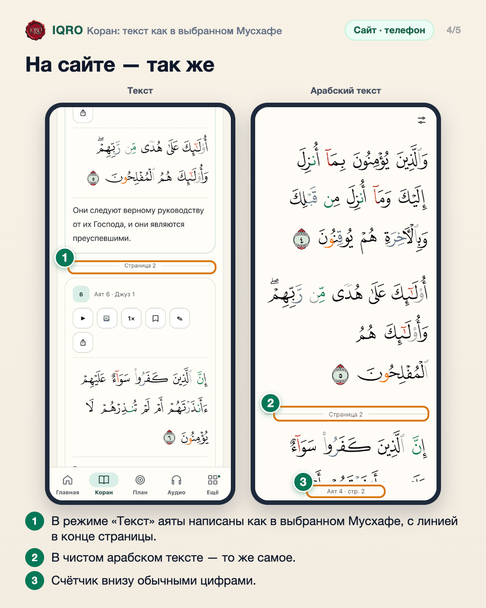
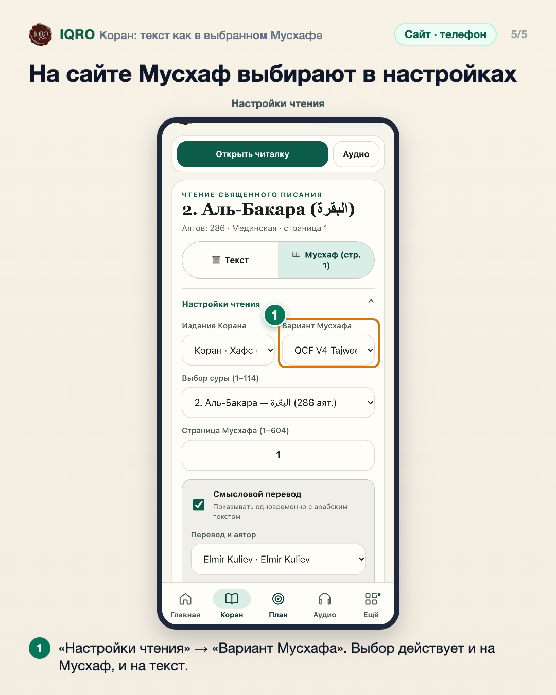

# Коран: текст как в выбранном Мусхафе

Какой Мусхаф выбран, так теперь выглядит и текст Корана: в режиме «Текст» и в чистом арабском тексте те же буквы, тот же шрифт и те же цвета таджвида. Между аятами видно, где кончилась страница Мусхафа, а счётчик внизу чистого текста показывает аят и страницу обычными цифрами.

**Где найти:** «Коран» → режим «Текст»; чистый арабский текст открывается свайпом вправо по аяту. Мусхаф выбирают на вкладке «Коран» или в меню аята на странице Мусхафа.

**Сайт и приложение:** текст, линия конца страницы и счётчик одинаковы. В приложении Мусхаф выбирают на вкладке «Коран» и в меню аята на странице Мусхафа; на сайте — в «Настройках чтения», поле «Вариант Мусхафа». У Мусхафов-картинок (сканы страниц) шрифта нет, для них текст остаётся прежним.

## Текст — как в вашем Мусхафе

Выбрали Мусхаф с таджвидом — и в режиме «Текст» аяты написаны так же, с теми же цветами. Между аятами тонкая линия показывает, где кончилась страница Мусхафа, и её номер. Страницы, которые вы уже открывали или скачали, показываются сразу в этом виде и без интернета. В приложении текст открывается сразу на нужном аяте; если страницу ещё нужно скачать, а интернет медленный, полсекунды спустя виден прежний текст, и он сменится, когда страница придёт.

## Чистый текст: страница и счётчик

В чистом арабском тексте то же самое: буквы и цвета как в вашем Мусхафе, линия в конце каждой страницы. Счётчик внизу теперь понятен всем: «Аят 4 · стр. 2». Номера аятов внутри текста остаются как в Мусхафе.

## Выбор Мусхафа — в меню Мусхафа

Сменить Мусхаф можно, не выходя из него: кнопка меню справа внизу → «Выберите Мусхаф». Прежнее место выбора — карточка на вкладке «Коран» — тоже работает. Выбор один на всё: и для страниц Мусхафа, и для текста.

## На сайте — так же

На сайте всё так же: текст и чистый арабский текст написаны как в выбранном Мусхафе, конец страницы отмечен линией, счётчик внизу — обычными цифрами.

## На сайте Мусхаф выбирают в настройках

На сайте Мусхаф выбирают в «Настройках чтения», в поле «Вариант Мусхафа». Это место не менялось, но теперь выбор меняет и вид текста.

---

Основа снимков: приложение — снимки из тестов сборки ветки claude/mushaf-variant-in-readers-55090f с настоящими страницами и шрифтами QCF V4 Tajweed (на Redmi Note 7 сборка проверена отдельно); сайт — телефон 390×844, данные iqro.forum, 10 ноября 2026.
