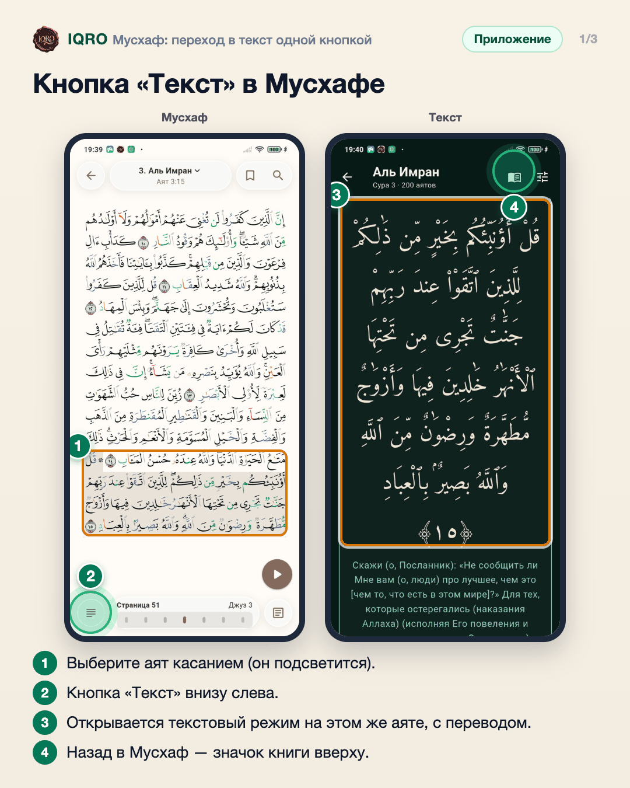
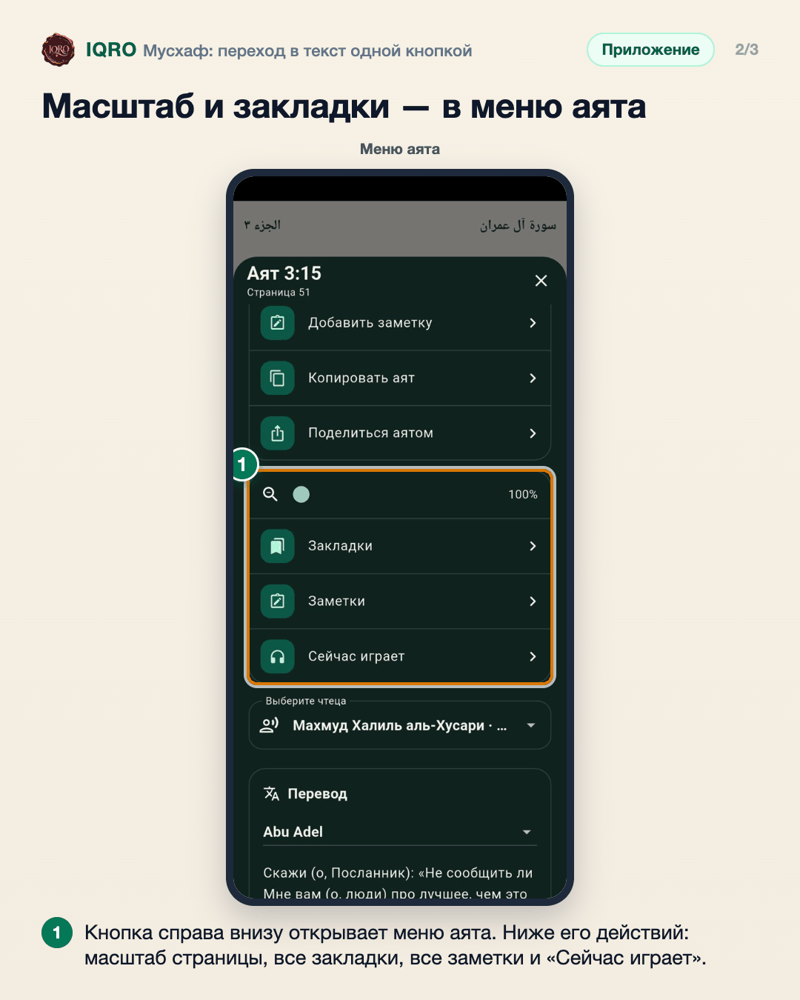
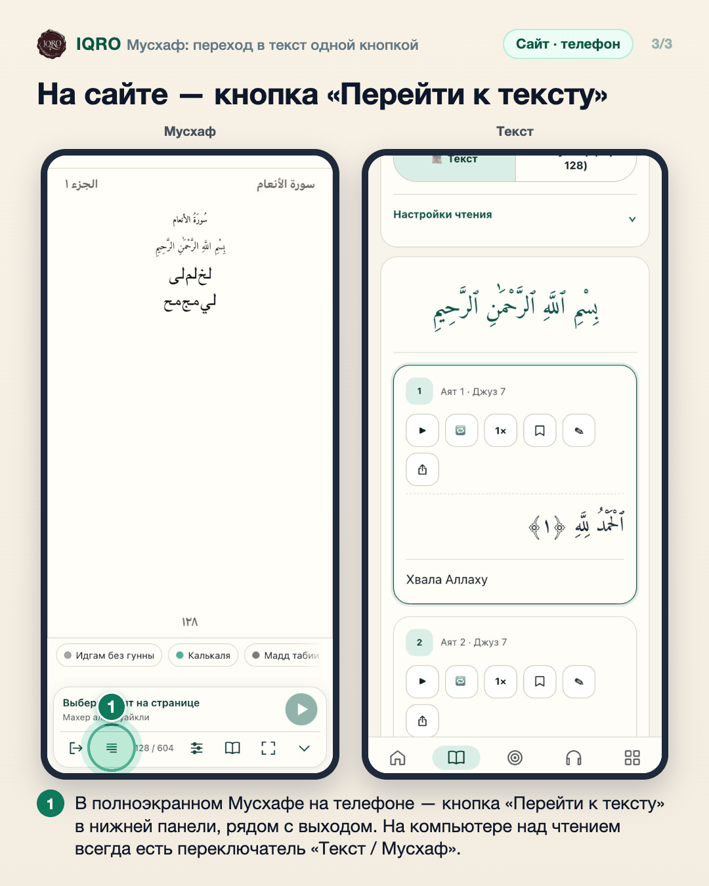

# Мусхаф: переход в текст одной кнопкой

Из Мусхафа можно сразу открыть текстовый режим на том же аяте: внизу слева теперь кнопка «Текст». Масштаб, закладки и заметки — в меню аята.

**Где найти:** «Коран» → режим «Мусхаф»: коснитесь страницы, чтобы показать кнопки.

**Сайт и приложение:** в приложении кнопка «Текст» внизу слева; на сайте в полноэкранном Мусхафе на телефоне — кнопка «Перейти к тексту» рядом с выходом, на компьютере — переключатель «Текст / Мусхаф» над чтением.

## Кнопка «Текст» в Мусхафе

Хотите прочитать перевод или тафсир того места, что открыто в Мусхафе? Коснитесь аята, затем кнопки «Текст» внизу слева — откроется текстовый режим на этом же аяте. Вернуться в Мусхаф — значок книги вверху или свайп влево по аяту.

## Масштаб и закладки — в меню аята

Раньше эти пункты были в отдельном меню «⋯». Теперь всё в одном месте — в меню аята, кнопка справа внизу. Масштаб, закладки и заметки работают и без интернета.

## На сайте — кнопка «Перейти к тексту»

На сайте так же: в полноэкранном Мусхафе на телефоне кнопка «Перейти к тексту» открывает текст на том же месте. На компьютере для этого служит переключатель «Текст / Мусхаф» над чтением.

---

Основа снимков: Redmi Note 7, сборка из main 59c9b99b, 4 ноября 2026; сайт — телефон 390×844, тестовые данные.
