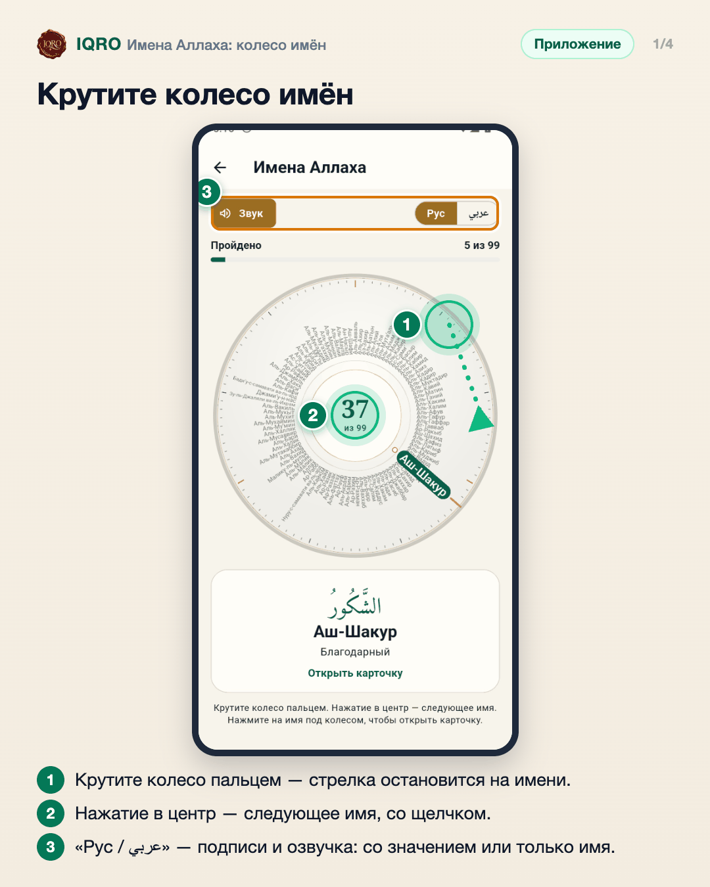
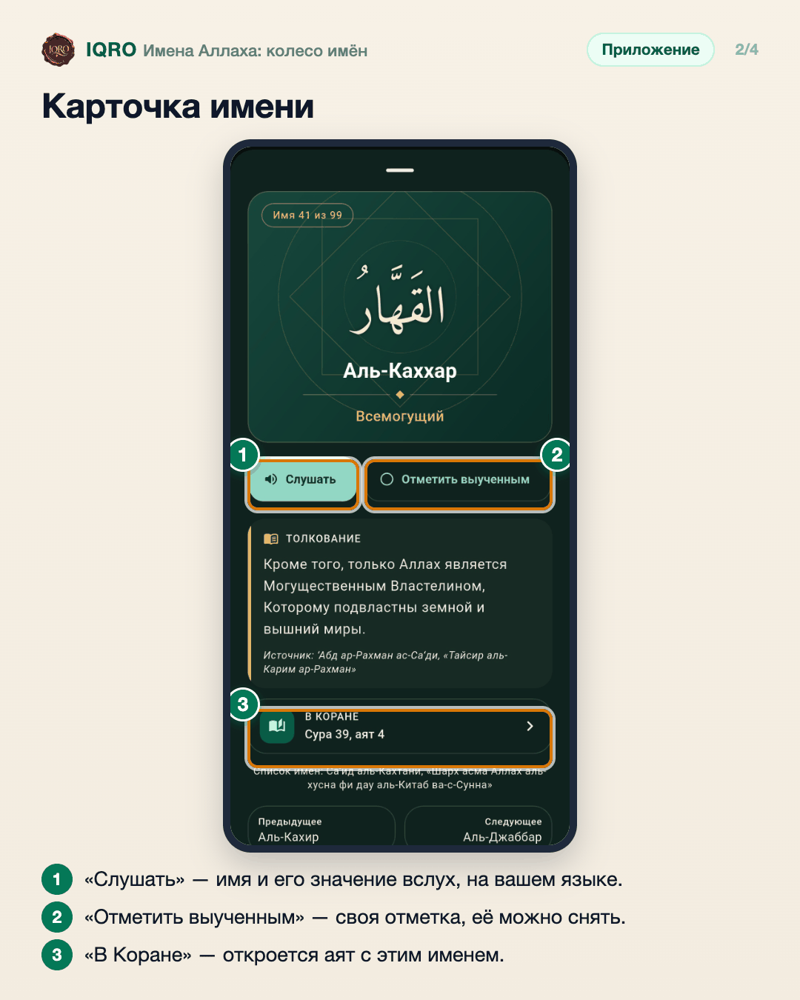
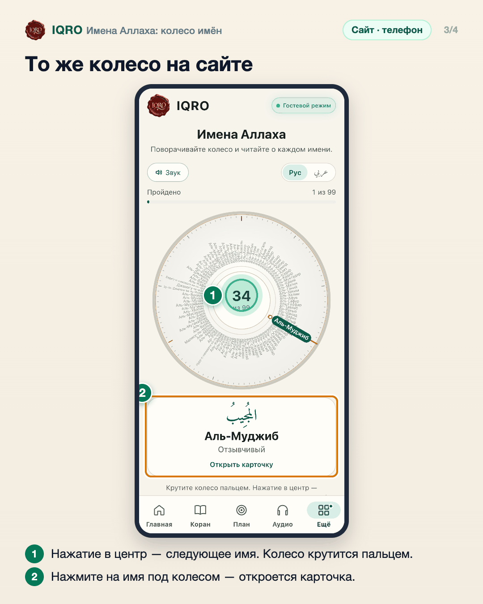
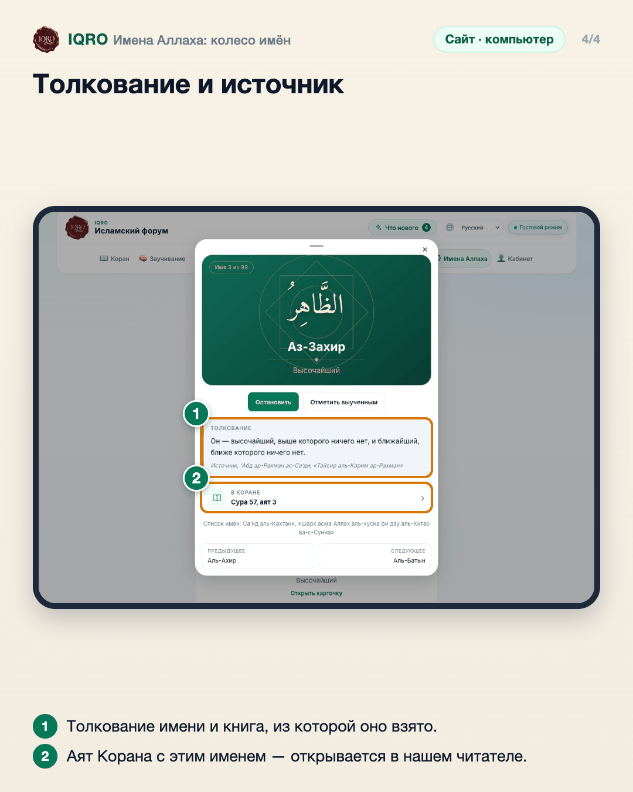

# Имена Аллаха: колесо имён

Новый раздел: прекрасные имена Аллаха на одном колесе. У каждого имени — арабское написание, значение, толкование с названием книги, аят Корана и озвучка.

**Где найти:** в приложении — «Ещё» → «Имена Аллаха»; на сайте — пункт меню «Имена Аллаха».

**Сайт и приложение:** одинаково на сайте и в приложении; в приложении колесо идёт в светлой и тёмной теме.

## Крутите колесо имён

Откройте «Ещё» → «Имена Аллаха». Колесо можно крутить пальцем или листать по одному имени нажатием в центр. Когда стрелка останавливается на имени, оно считается пройденным, и оно произносится вслух.

## Карточка имени

Нажмите на имя под колесом — откроется карточка: каллиграфия на изумрудной панели, значение, толкование и книга, из которой оно взято. Внизу — переход к предыдущему и следующему имени.

## То же колесо на сайте

На сайте iqro.forum раздел работает так же: на телефоне колесо крутят пальцем, на компьютере — мышью или стрелками на клавиатуре.

## Толкование и источник

Список имён и их порядок взяты из книги Са‘ида аль-Кахтани, толкования — из книг ‘Абд ар-Рахмана ас-Са‘ди. Каждая карточка называет свою книгу.

---

Основа снимков: приложение — телефон Redmi с тестовой сборкой и эмулятор Android, сайт — локальная копия; 12 ноября 2026, до выпуска раздела. После выпуска снимки нужно переснять на рабочем сайте.
