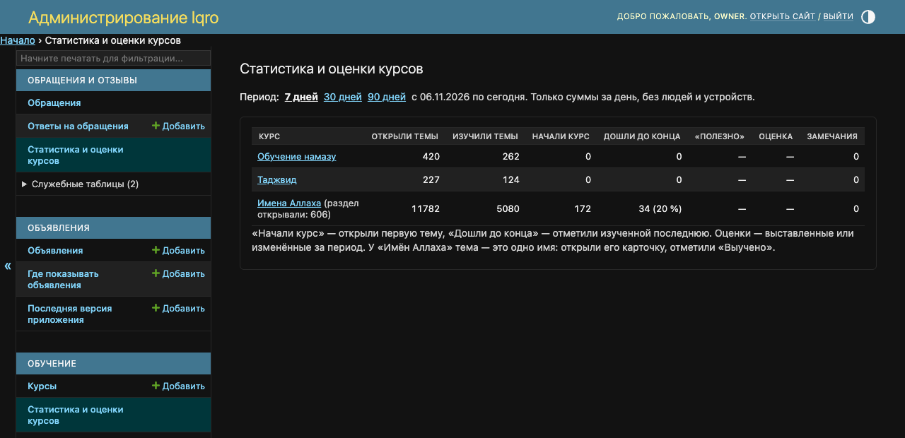
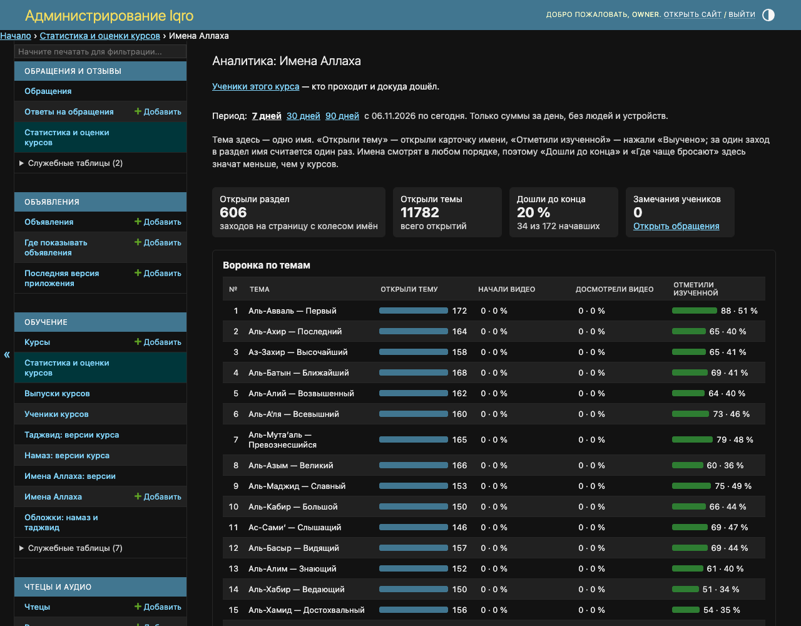
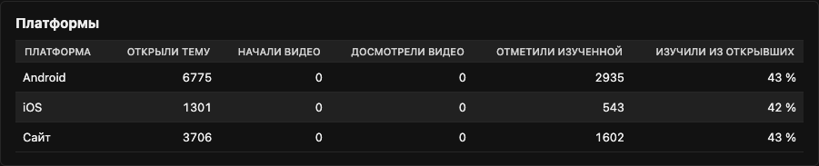
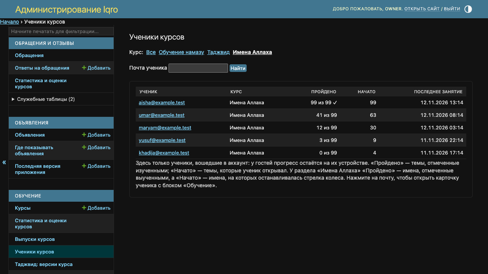

# Статистика раздела «Имена Аллаха»

Это страница для владельца и редакторов, не для постов пользователям. С 12.11.2026 «Статистика и оценки курсов» в админке считает и раздел «Имена Аллаха» — так же, как «Обучение намазу» и «Таджвид». Для пользователей «Имена Аллаха» остаются отдельным разделом: в каталоге курсов их нет.

**Где найти:** админка → раздел «Обучение» или «Обращения и отзывы» → «Статистика и оценки курсов». Та же строка есть в таблице над списком «Курсы» ([как она выглядит](../admin-courses/README.md)).

**Откуда цифры:** сайт и приложение присылают три обезличенных события: открыли раздел, открыли карточку имени, отметили имя выученным. Сервер хранит только суммы за день — без человека, устройства и адреса. Считается только опубликованный список: пока он не подписан и не опубликован, в строке будут нули. Сайт начинает присылать события сразу после обновления, приложение — со следующей версии; более ранние посещения не учтены.

Снимки сделаны на локальной копии с примерными цифрами и выдуманными учениками, не с рабочего сайта.

## 1. Строка в сводке

1. «Имена Аллаха» — третья строка, после «Обучения намазу» и «Таджвида». Период — 7, 30 или 90 дней.
2. «Раздел открывали» (в скобках у названия) — сколько раз заходили на страницу с колесом имён.
3. «Открыли темы» — сколько раз открывали карточки имён, «Изучили темы» — сколько раз нажали «Выучено».
4. «Начали курс» — открыли карточку первого имени, «Дошли до конца» — отметили выученным последнее. Имена смотрят в любом порядке, поэтому эти два столбца здесь значат меньше, чем у курсов.
5. Оценок и «Полезно» у раздела нет, там прочерк.

## 2. Аналитика по именам

Нажмите «Имена Аллаха» в сводке.

1. «Открыли раздел» — заходы в раздел за период.
2. «Воронка по темам» — каждое имя отдельной строкой, в порядке списка: сколько раз открыли его карточку и сколько раз отметили выученным. Столбцы про видео пустые: видео у имён нет.
3. За один заход в раздел имя считается один раз — даже если карточку открывали несколько раз или «Выучено» снимали и ставили снова.
4. Ссылка «Ученики этого курса» вверху ведёт к списку учеников (шаг 4).

## 3. Сайт, Android и iOS

Внизу той же страницы — откуда открывали карточки и где чаще отмечают имена выученными.

## 4. Кто учит имена

«Обучение» → «Ученики курсов» → «Имена Аллаха» в строке «Курс» (или ссылка «Ученики этого курса» со страницы аналитики). Здесь только вошедшие в аккаунт: «Пройдено» — сколько имён ученик отметил выученными, «Начато» — на скольких останавливалась стрелка колеса. Подробнее — [«Ученики курсов и их прогресс»](../admin-learners/README.md).

Статистика (шаги 1–3) считает всех, и гостей тоже, но без людей — только суммы. Список учеников (шаг 4) — это люди, но только с аккаунтом.
