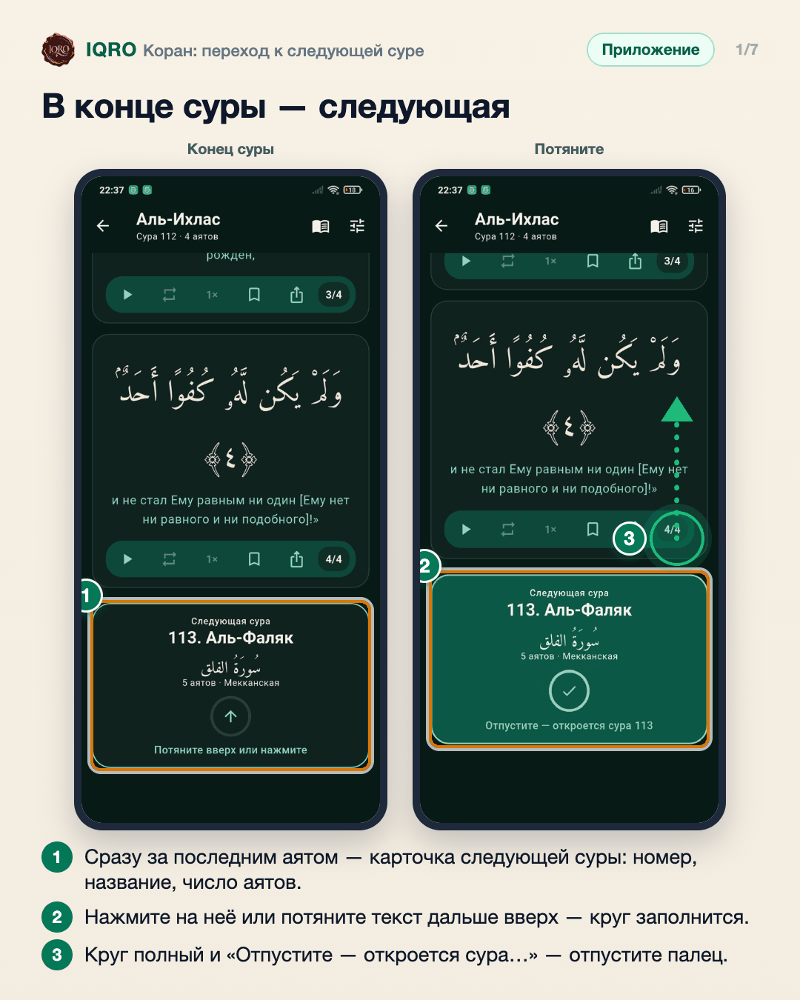
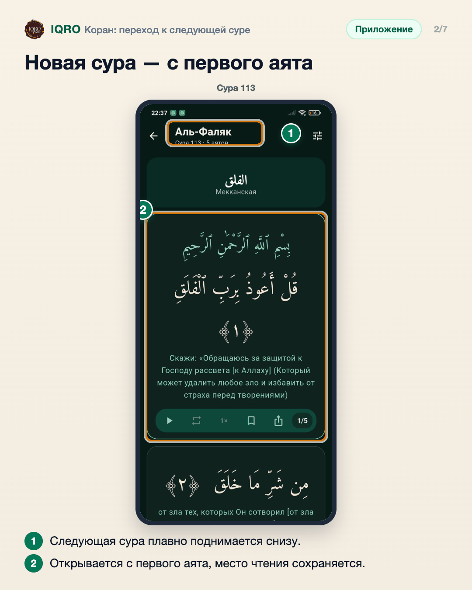
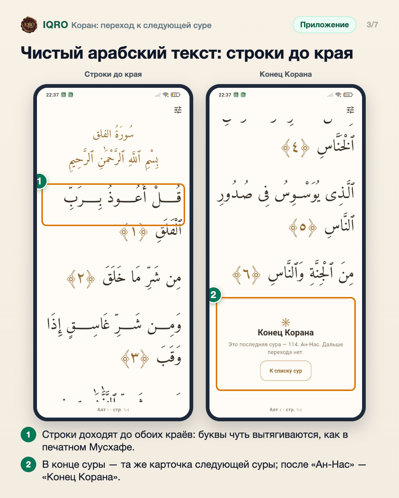
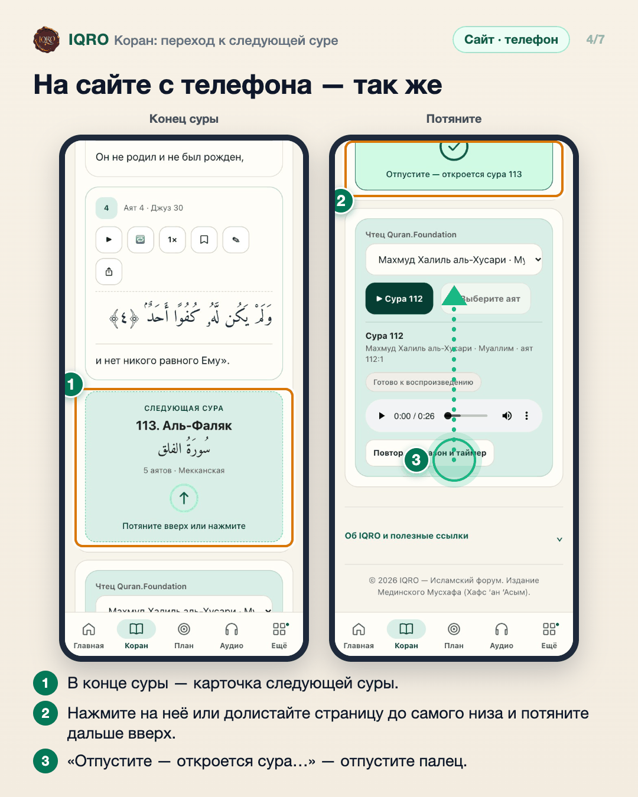
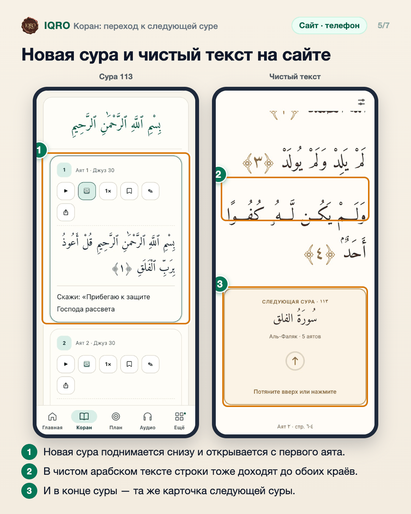
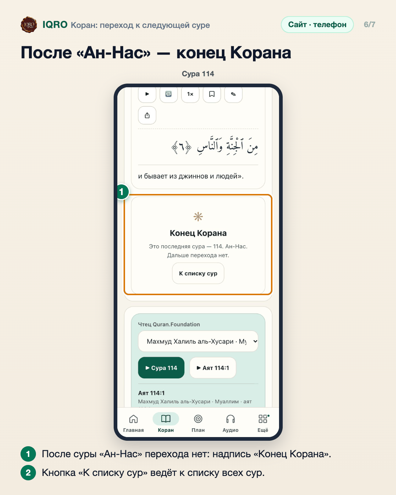
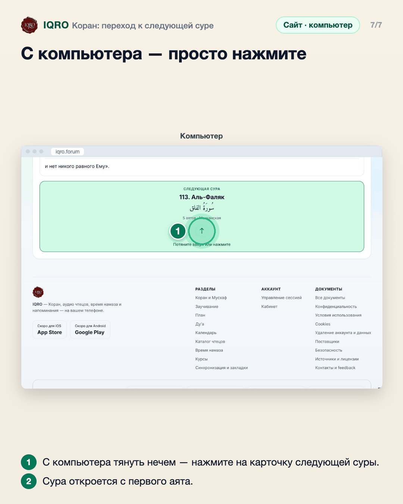

# Коран: переход к следующей суре

Дочитали суру до конца — сразу за последним аятом карточка следующей суры. Нажмите на неё или потяните текст дальше вверх: новая сура плавно поднимается снизу и открывается с первого аята. Так же и в чистом арабском тексте, где строки теперь доходят до обоих краёв, как в печатном Мусхафе. После суры «Ан-Нас» перехода нет: там «Конец Корана».

**Где найти:** «Коран» → режим «Текст» или чистый арабский текст (свайп вправо по аяту): долистайте суру до конца.

**Сайт и приложение:** работает одинаково в приложении и на сайте с телефона и планшета. На сайте с компьютера тянуть нечем — достаточно нажать на карточку.

## В конце суры — следующая

Когда сура дочитана, сразу за последним аятом появляется карточка следующей суры: её номер, название по-русски и по-арабски, сколько в ней аятов и где она ниспослана. Чтобы перейти, нажмите на карточку или просто потяните текст дальше вверх. Пока тянете, круг со стрелкой заполняется; когда он полный, появляется галочка и надпись «Отпустите — откроется сура 113». Короткое движение ничего не открывает — случайно не перескочите.

## Новая сура — с первого аята

Следующая сура плавно поднимается снизу и открывается с первого аята — листать вверх к её началу не нужно. Место чтения сохраняется как обычно, свайпы вправо и влево по аятам работают и в новой суре.

## Чистый арабский текст: строки до края

В чистом арабском тексте строки теперь заполняют ширину экрана до обоих краёв: вместо больших пробелов между словами чуть вытягиваются соединения букв — кашида, как в печатном Мусхафе. При любом размере шрифта текст перестраивается заново. Последняя строка аята остаётся обычной. В конце суры здесь та же карточка следующей суры, а после суры «Ан-Нас» — надпись «Конец Корана» и кнопка «К списку сур».

## На сайте с телефона — так же

На сайте с телефона или планшета всё так же: в конце суры карточка следующей. Нажмите на неё или долистайте страницу до самого низа и потяните ещё вверх — круг заполнится, и после надписи «Отпустите — откроется сура 113» можно отпускать. Пока страница не докручена до конца, обычная прокрутка ничего не открывает.

## Новая сура и чистый текст на сайте

После перехода страница сама встаёт на начало новой суры — первый аят наверху, листать вверх не нужно. В чистом арабском тексте (свайп вправо по аяту) строки заполняют ширину до обоих краёв, как в печатном Мусхафе, а в конце суры та же карточка: нажмите или потяните, и следующая сура поднимется прямо здесь, внизу будет «Аят ١» и её страница.

## После «Ан-Нас» — конец Корана

Сура «Ан-Нас» — последняя в Коране, поэтому вместо карточки следующей суры там надпись «Конец Корана» и кнопка «К списку сур». Так же в приложении и в чистом арабском тексте.

## С компьютера — просто нажмите

На сайте с компьютера карточка следующей суры такая же. Тянуть мышью не нужно: просто нажмите на карточку — следующая сура поднимется и откроется с первого аята.

## Для рилс и подробного рассказа

- `reels/` — кадры 9:16 (1080×1920) по порядку: обложка, по кадру на каждый экран с его шагами, финальный кадр.
- `screens/` — чистые экраны без отметок, в полном размере: из них можно делать свои анимации.
- `video/` — запись экрана телефона, без звука: как это выглядит вживую.

Заголовок для ролика: **Следующая сура — сама**. Текст за кадром — подписи к карточкам выше, по порядку.

---

Основа снимков: Redmi Note 7, сборка ветки claude/next-surah, данные iqro.forum; сайт — телефон 390×844 и компьютер 1280×820, данные iqro.forum, 5 ноября 2026.
