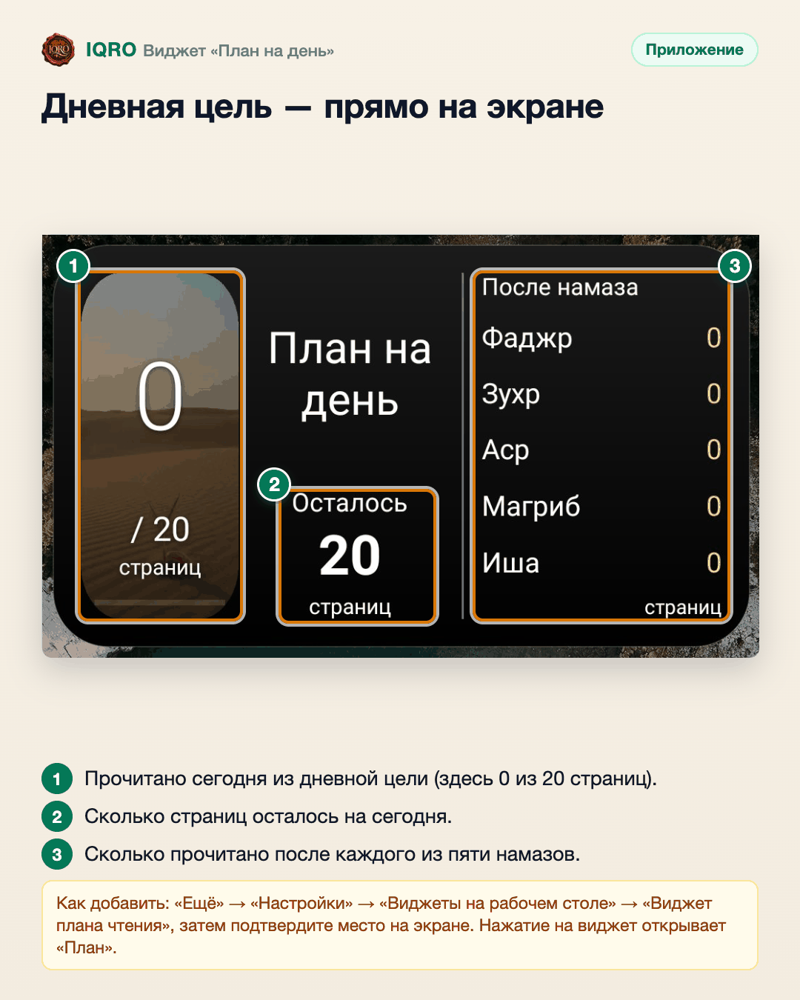

# Виджет «План на день»

Виджет на главном экране телефона показывает дневную цель чтения: сколько страниц уже прочитано, сколько осталось и сколько прочитано после каждого намаза. В полночь виджет сам переходит на новый день — открывать приложение не нужно.

**Где найти:** «Ещё» → «Настройки» → «Виджеты на рабочем столе» → «Виджет плана чтения»; или значок «Добавить виджет» на экране «План».

**Сайт и приложение:** это виджет приложения (Android и iPhone). Если телефон не предлагает поставить виджет сам: нажмите и удерживайте свободное место на главном экране → «Виджеты» → IQRO (на iPhone — «+» → IQRO).

## Дневная цель — прямо на экране

Виджет показывает дневную цель: слева — сколько страниц прочитано из нормы, в центре — сколько осталось, справа — чтение после фаджра, зухра, асра, магриба и иши. Чтобы добавить: «Ещё» → «Настройки» → «Виджеты на рабочем столе» → «Виджет плана чтения» и подтвердите место на экране. В полночь виджет сам показывает новый день.

---

Основа снимков: `docs/images/plan-widget-2026-11-04/redmi-widget-after-tap.jpg` (Redmi).
