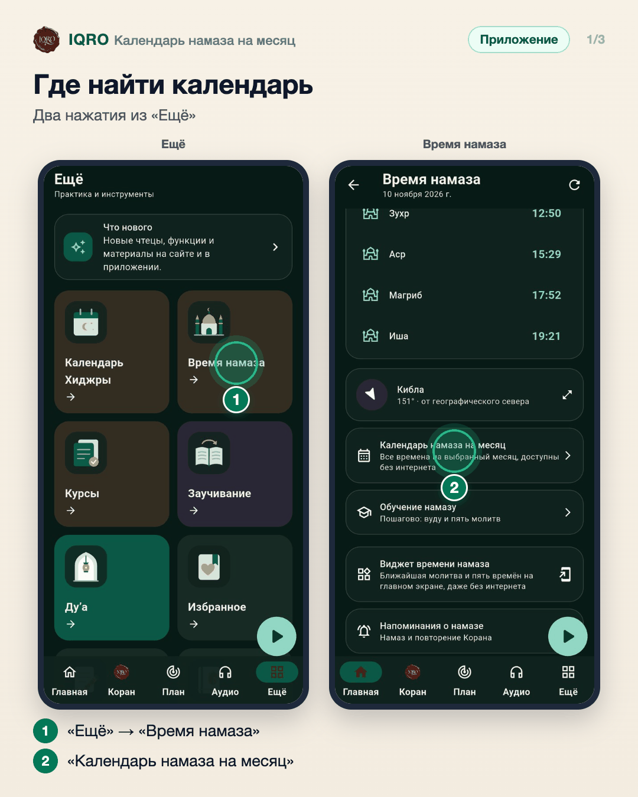
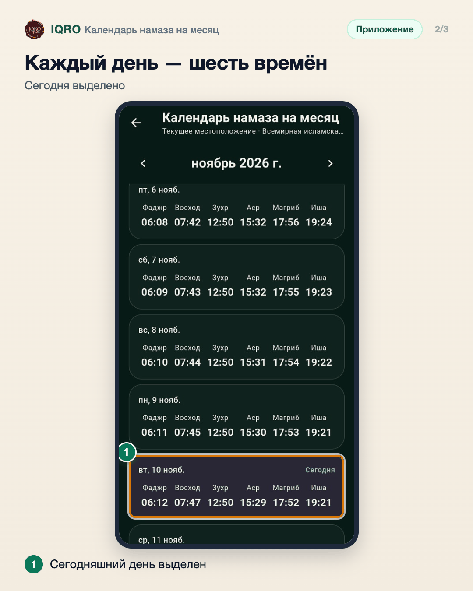
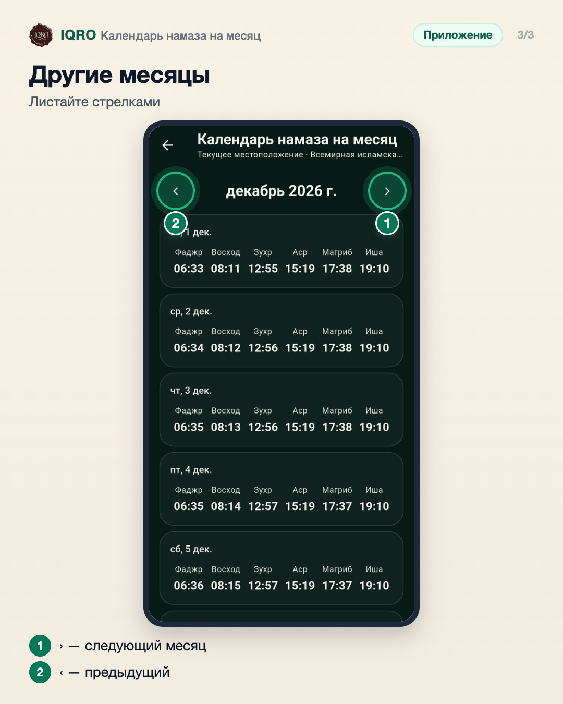

# Календарь намаза на месяц

Календарь показывает все времена намаза на месяц вперёд: фаджр, восход, зухр, аср, магриб и иша на каждый день. Сегодняшний день выделен, стрелками листаются месяцы. Времена считаются на телефоне для вашего места и выбранного метода расчёта, поэтому календарь открывается и без интернета.

**Где найти:** «Ещё» → «Время намаза» → «Календарь намаза на месяц».

**Сайт и приложение:** на сайте тот же календарь: iqro.forum → «Ещё» → «Намаз» → «Месяц».

## Где найти календарь

Откройте «Ещё» → «Время намаза». Под временами на сегодня и киблой — строка «Календарь намаза на месяц».

## Каждый день — шесть времён

Для каждого дня месяца — фаджр, восход, зухр, аср, магриб и иша. Сегодняшний день выделен цветом и подписан «Сегодня». Времена считаются на телефоне, поэтому календарь открывается и без интернета.

## Другие месяцы

Стрелка справа открывает следующий месяц, слева — предыдущий. Удобно заранее посмотреть время намаза на поездку или на Рамадан.

## Для рилс и подробного рассказа

- `reels/` — кадры 9:16 (1080×1920) по порядку: обложка, по кадру на каждый экран с его шагами, финальный кадр.
- `screens/` — чистые экраны без отметок, в полном размере: из них можно делать свои анимации.
- `video/` — запись экрана телефона, без звука: как это выглядит вживую.

Заголовок для ролика: **Время намаза на весь месяц**. Текст за кадром — подписи к карточкам выше, по порядку.

---

Основа снимков: Redmi, сборка «IQRO тест» из ветки PR #235 (вошла в main 13b0ac72), 10 ноября 2026; строка состояния телефона обрезана.
