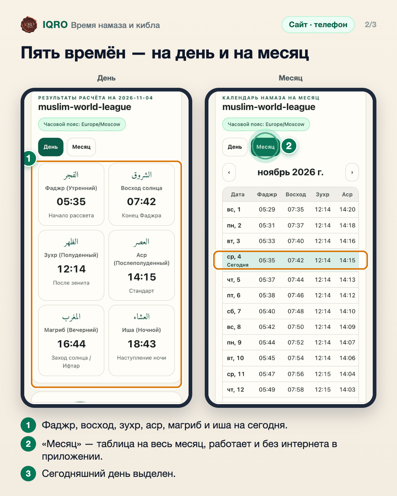
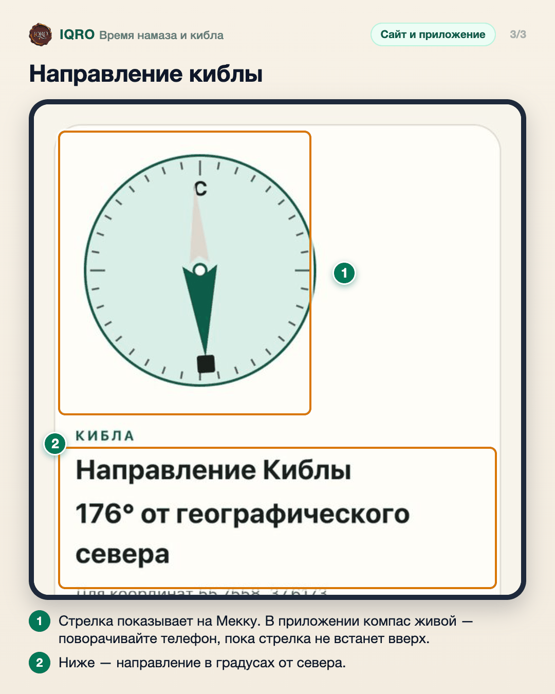

# Время намаза и кибла

IQRO рассчитывает пять времён намаза для вашего места — на сегодня и на весь месяц — и показывает направление киблы. Расчёт идёт на устройстве, координаты никуда не отправляются.

**Где найти:** сайт: «Ещё» → «Намаз» (iqro.forum/ru/prayer); приложение: экран «Намаз» и карточка на «Главной».

**Сайт и приложение:** в приложении время ближайшего намаза есть и на главной, и в виджете, а кибла — живой компас, который поворачивается вместе с телефоном. На сайте живой компас работает в браузерах телефона, где он доступен; иначе показывается направление в градусах от севера.

## Укажите, где вы

Откройте «Намаз» и нажмите «Моё местоположение» — браузер спросит разрешение. Можно и без него: выберите город в списке «Быстрый выбор города». Метод расчёта по умолчанию — Всемирная исламская лига, его можно сменить. Затем нажмите «Рассчитать расписание».

## Пять времён — на день и на месяц

Слева — времена на выбранный день: фаджр, восход солнца, зухр, аср, магриб и иша, с арабскими названиями. Кнопка «Месяц» показывает календарь намаза на весь месяц; сегодняшний день выделен, стрелками листаются месяцы.

## Направление киблы

Под расписанием — кибла. В приложении и в браузерах телефона, где доступен компас, стрелка поворачивается вместе с телефоном: держите телефон ровно и поворачивайтесь, пока стрелка не укажет вверх. Если компаса нет (например, на компьютере), показывается направление в градусах от географического севера.

---

Основа снимков: сайт iqro.forum, 4 ноября 2026 (координаты Москвы для примера).
