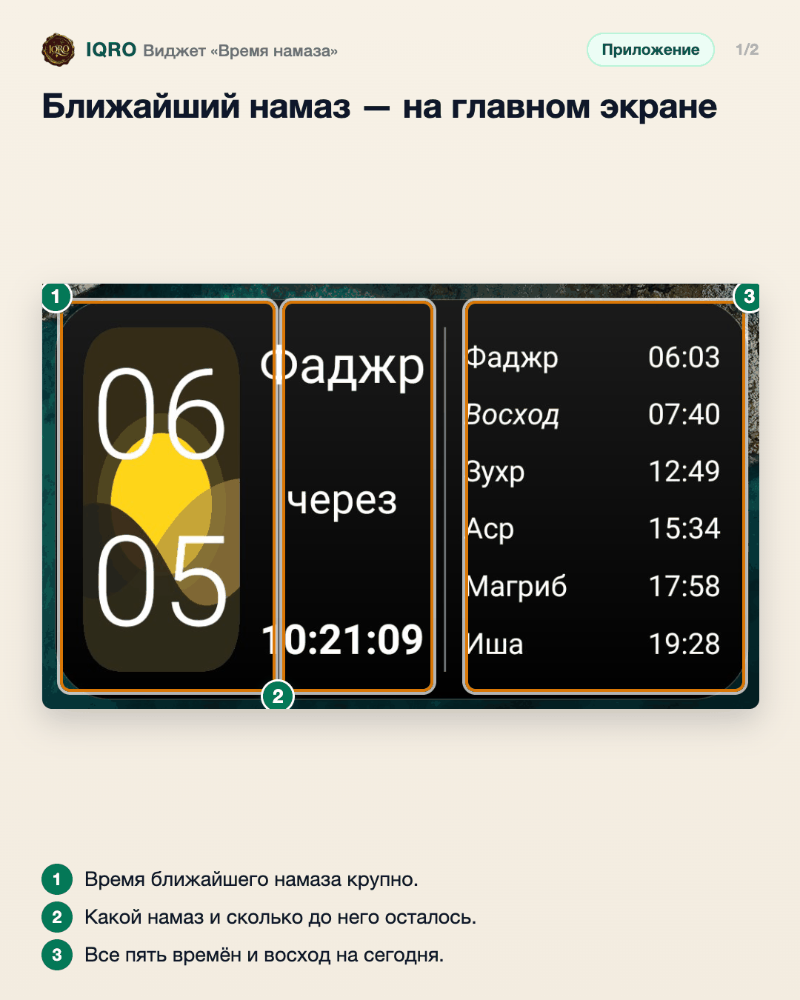
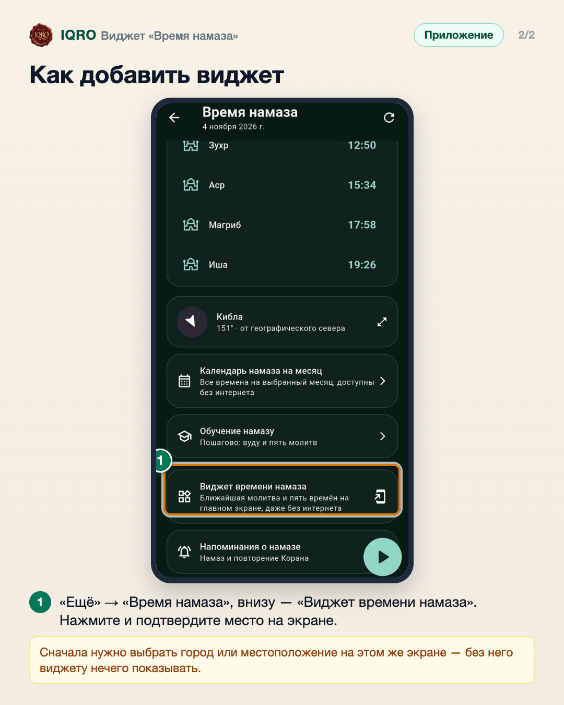

# Виджет «Время намаза»

Виджет на главном экране телефона показывает ближайший намаз с обратным отсчётом и все пять времён на сегодня. Работает и без интернета.

**Где найти:** «Ещё» → «Время намаза» → «Виджет времени намаза»; или «Ещё» → «Настройки» → «Виджеты на рабочем столе».

**Сайт и приложение:** это виджет приложения (Android и iPhone). Если телефон не предлагает поставить виджет сам: нажмите и удерживайте свободное место на главном экране → «Виджеты» → IQRO (на iPhone — «+» → IQRO).

## Ближайший намаз — на главном экране

Виджет показывает ближайший намаз и обратный отсчёт до него, а справа — фаджр, восход, зухр, аср, магриб и ишу на сегодня. Времена считаются на телефоне, поэтому виджет работает и без интернета.

## Как добавить виджет

Откройте «Ещё» → «Время намаза» и пролистайте вниз до пункта «Виджет времени намаза». Нажмите его — телефон спросит, куда поставить виджет. Если не спросил, добавьте вручную: удерживайте свободное место на главном экране → «Виджеты» → IQRO.

## Для рилс и подробного рассказа

- `reels/` — кадры 9:16 (1080×1920) по порядку: обложка, по кадру на каждый экран с его шагами, финальный кадр.

Заголовок для ролика: **Время намаза на рабочем столе**. Текст за кадром — подписи к карточкам выше, по порядку.

---

Основа снимков: Redmi, 4 ноября 2026 (виджет на главном экране и IQRO Test 1.0.4).
