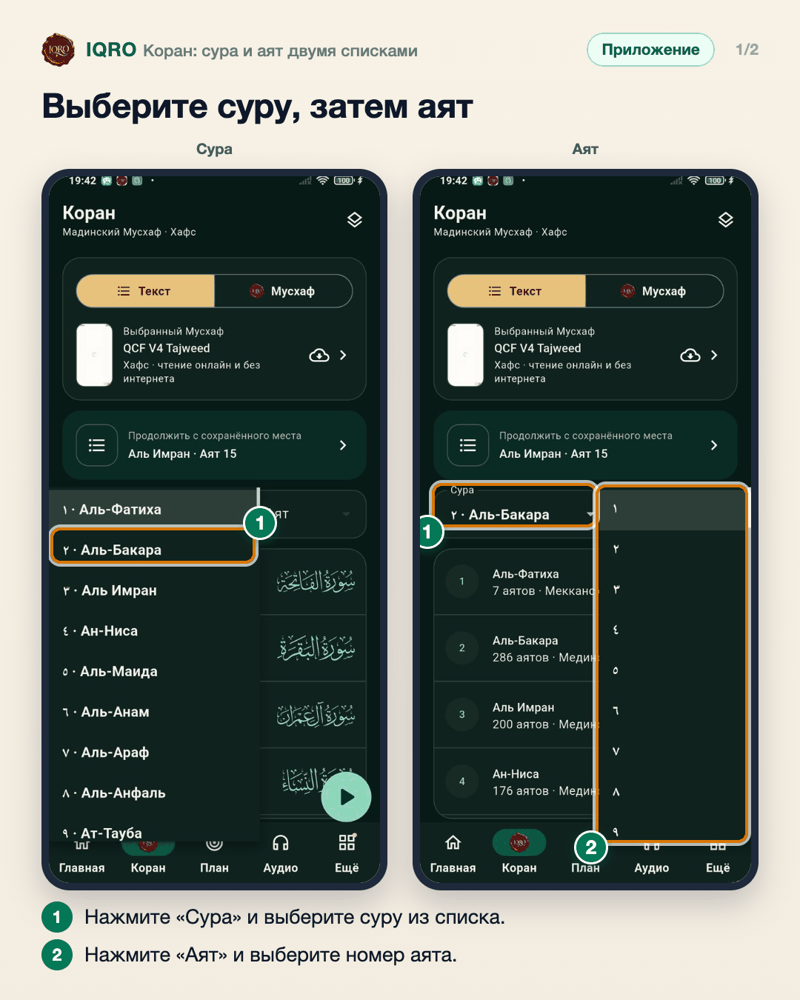
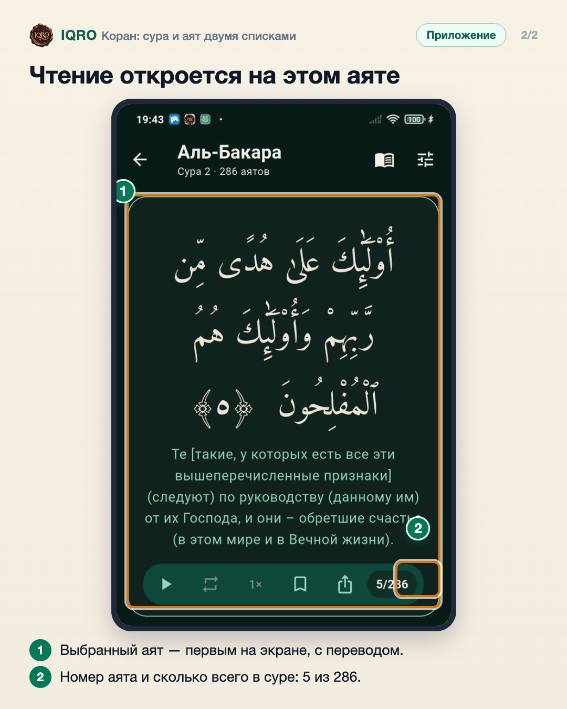

# Коран: сура и аят двумя списками

Во вкладке «Коран» можно сразу перейти к нужному месту: в одном списке выбрать суру, в другом — аят. Приложение откроет чтение прямо на этом аяте.

**Где найти:** приложение, вкладка «Коран» → поля «Сура» и «Аят» над списком сур.

**Сайт и приложение:** это приложение. На сайте в разделе «Коран» те же списки «Выбор суры» и «Аят суры» стоят над листом.

## Выберите суру, затем аят

Во вкладке «Коран» над списком сур есть два поля. Нажмите «Сура» и выберите суру — здесь «Аль-Бакара». Затем нажмите «Аят»: откроется список номеров аятов этой суры.

## Чтение откроется на этом аяте

Сразу после выбора аята открывается чтение суры с этого места: здесь «Аль-Бакара», аят 5 из 286. Ниже можно читать дальше, слушать аят, добавить закладку или поделиться.

## Для рилс и подробного рассказа

- `reels/` — кадры 9:16 (1080×1920) по порядку: обложка, по кадру на каждый экран с его шагами, финальный кадр.

Заголовок для ролика: **Нужный аят за секунду**. Текст за кадром — подписи к карточкам выше, по порядку.

---

Основа снимков: Redmi, IQRO Test 1.0.4 (сборка из main 59c9b99b), 4 ноября 2026.
