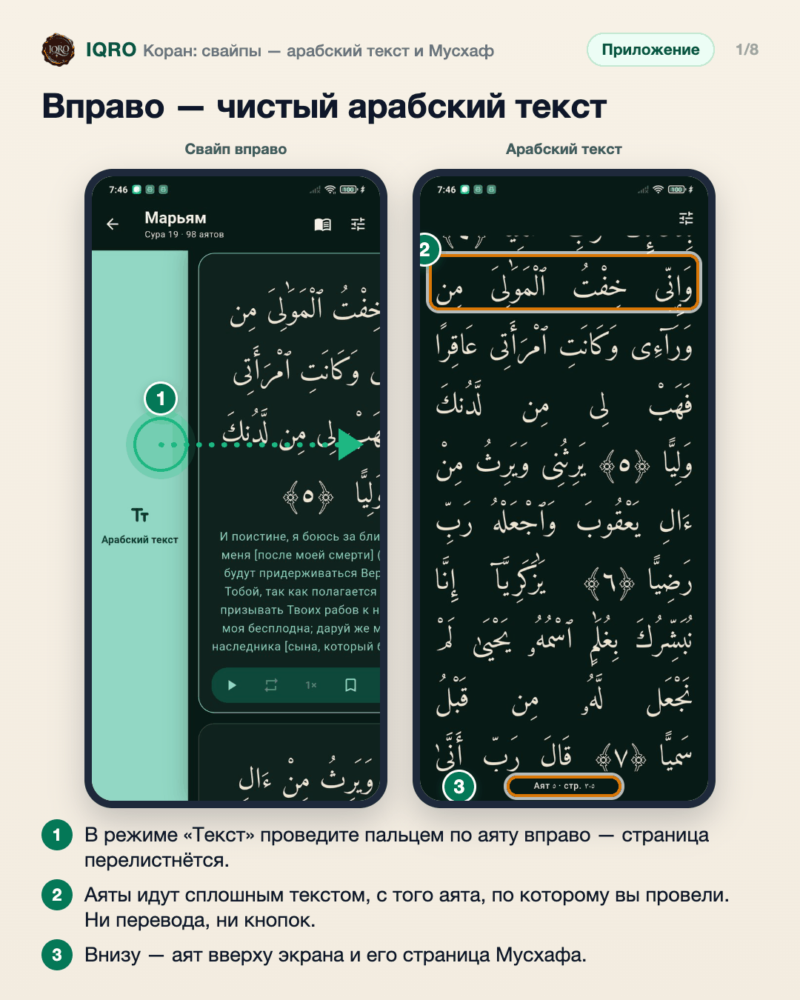
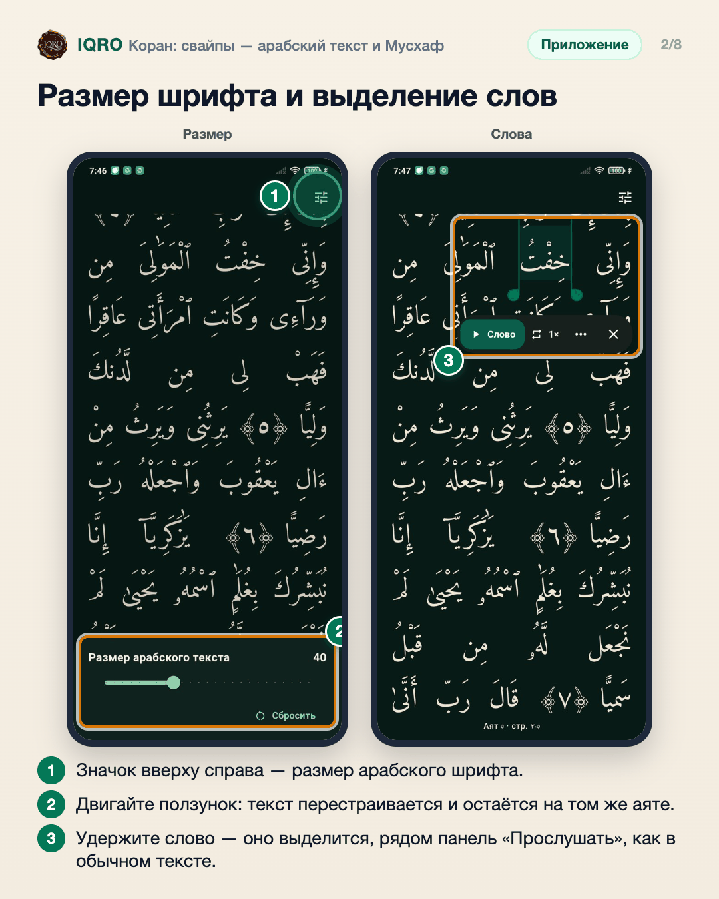
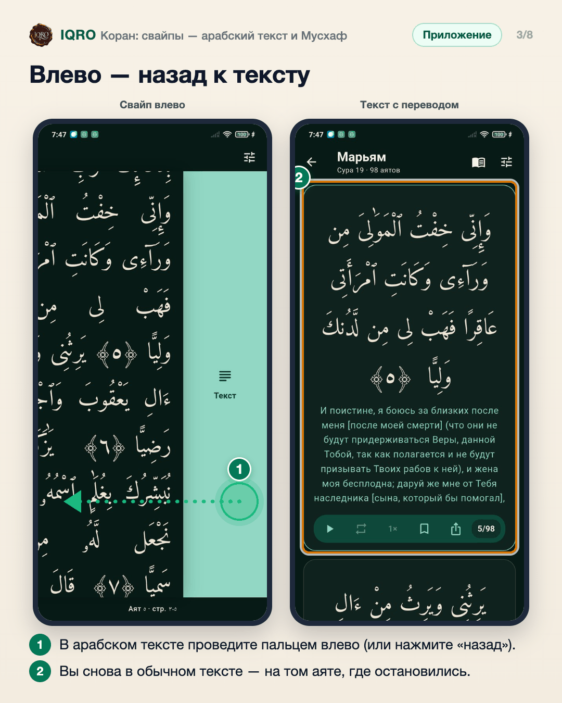
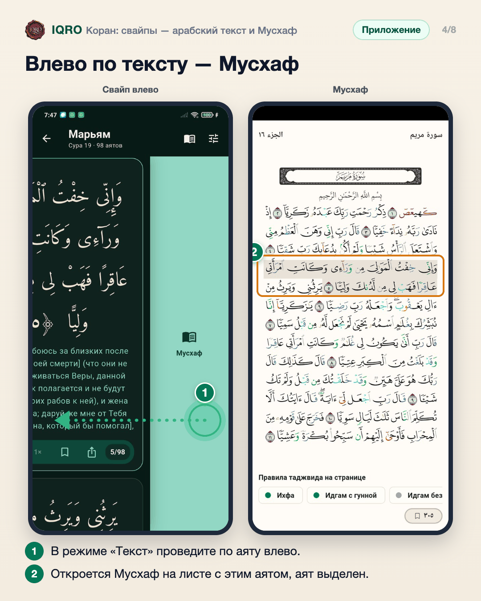
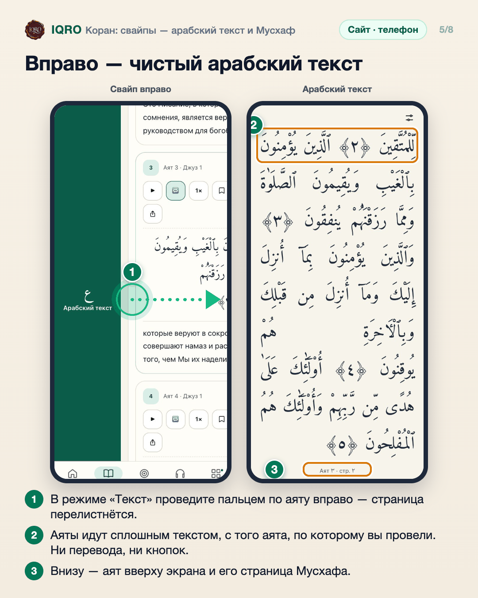
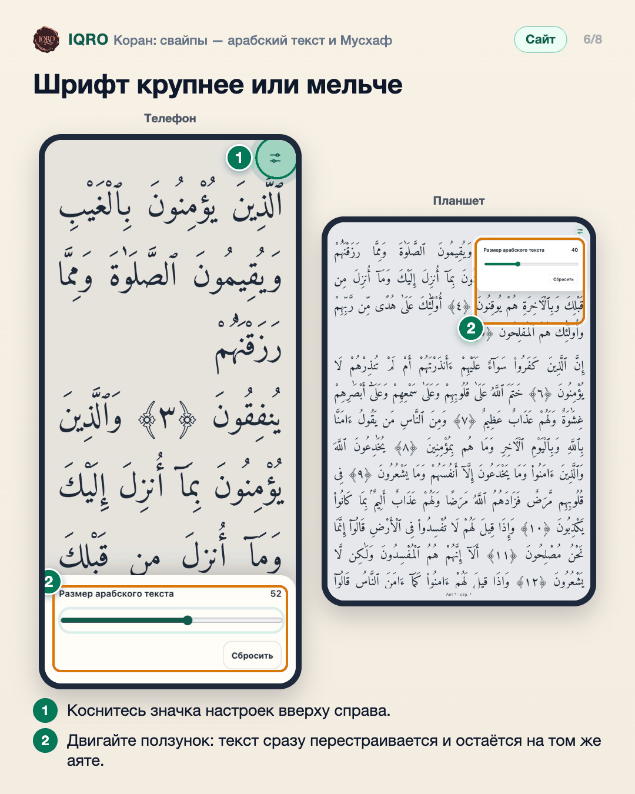
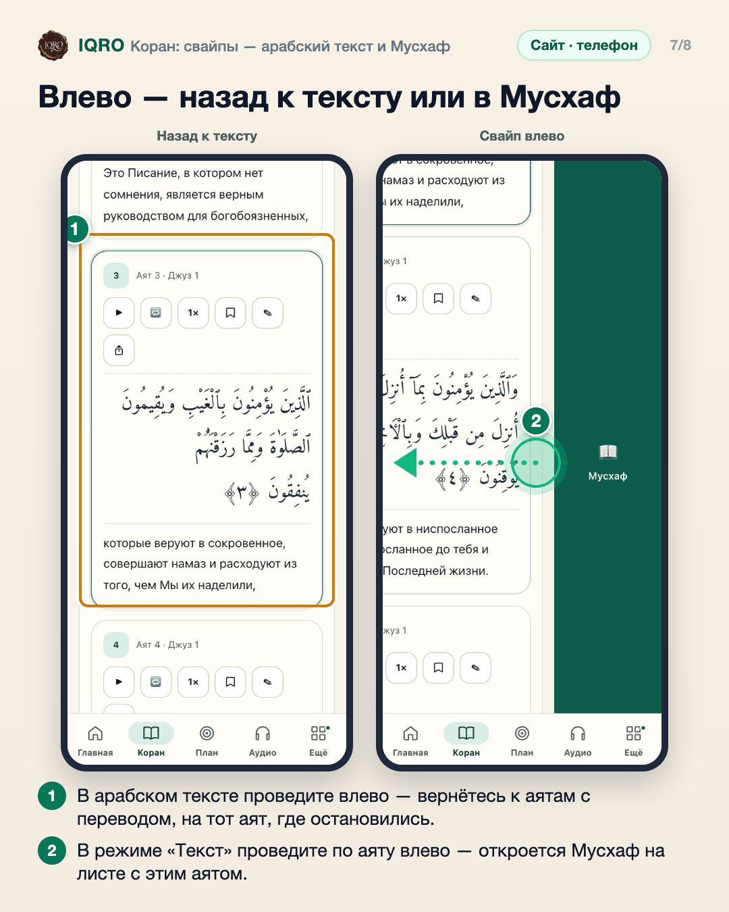
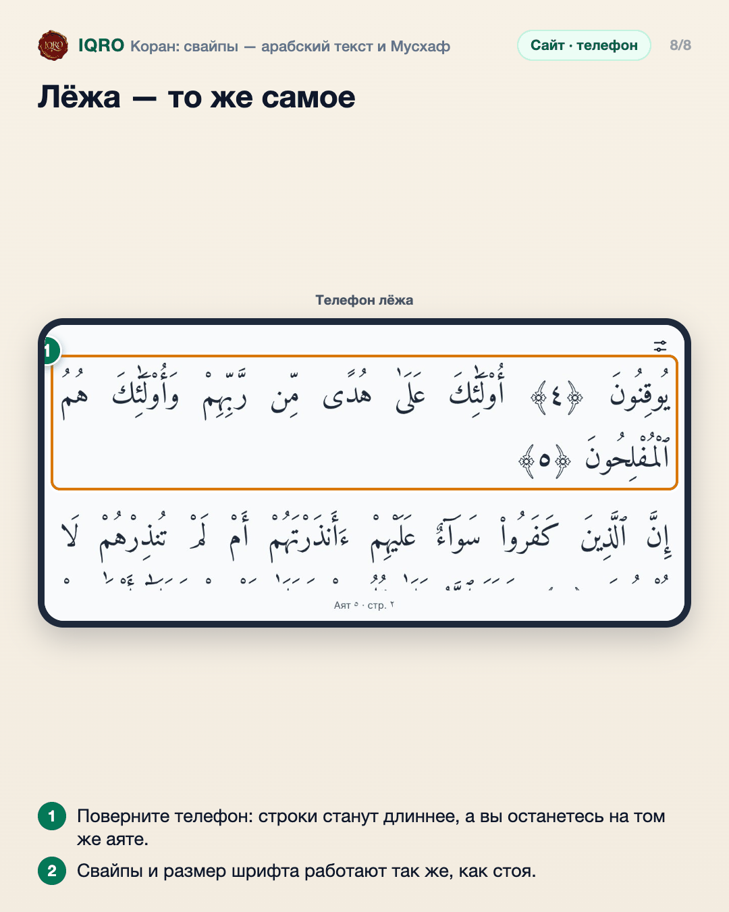

# Коран: свайпы — арабский текст и Мусхаф

В текстовом режиме Корана проведите пальцем по аяту: вправо — откроется чистый арабский текст суры крупным шрифтом, без перевода и кнопок; влево — Мусхаф на листе с этим аятом. Страница при этом перелистывается, как в книге.

**Где найти:** «Коран» → режим «Текст»: проведите пальцем по любому аяту вправо или влево.

**Сайт и приложение:** работает одинаково в приложении и на сайте с телефона или планшета, стоя и лёжа. На сайте с компьютера свайпов нет: там остаётся переключатель «Текст / Мусхаф».

## Вправо — чистый арабский текст

В режиме «Текст» проведите пальцем по аяту вправо: страница перелистнётся и откроется чистый арабский текст суры — с того аята, по которому вы провели. Перевода, тафсира и кнопок здесь нет, только арабский. Внизу видно, какой аят сейчас вверху экрана и на какой он странице Мусхафа. Листайте вверх и вниз, как обычно.

## Размер шрифта и выделение слов

Значок вверху справа — единственная настройка: размер арабского шрифта. Двигайте ползунок — текст сразу перестраивается и не уходит с аята, который вы читаете; размер запоминается и не меняет шрифт обычного текста. Слова выделяются как везде: удержите слово, потяните ручки, нажмите «Прослушать».

## Влево — назад к тексту

Чтобы вернуться, проведите по арабскому тексту влево или нажмите «назад»: страница перелистнётся обратно, и вы окажетесь в обычном тексте с переводом на том аяте, который был вверху экрана.

## Влево по тексту — Мусхаф

Свайп влево по аяту в обычном тексте открывает Мусхаф: лист перелистывается, и вы видите страницу с этим аятом — он выделен. Иконка Мусхафа вверху текста по-прежнему работает.

## Вправо — чистый арабский текст

В режиме «Текст» проведите пальцем по аяту вправо: страница перелистнётся и откроется чистый арабский текст суры — с того аята, по которому вы провели. Перевода, тафсира и кнопок здесь нет, только арабский. Внизу видно, какой аят сейчас вверху экрана и на какой он странице Мусхафа. Листайте вверх и вниз, как обычно.

## Шрифт крупнее или мельче

Значок вверху справа — единственная настройка: размер арабского шрифта. Двигайте ползунок — текст сразу перестраивается под экран и не уходит с аята, который вы читаете. Размер запоминается и не меняет шрифт в обычном текстовом режиме. «Сбросить» возвращает обычный размер.

## Влево — назад к тексту или в Мусхаф

Чтобы вернуться, проведите по арабскому тексту влево (или нажмите «назад»): страница перелистнётся обратно, и вы окажетесь в обычном тексте на том аяте, где остановились. А свайп влево по аяту в обычном тексте открывает Мусхаф на листе с этим аятом — аят на листе выделен.

## Лёжа — то же самое

Телефон и планшет можно держать и стоя, и лёжа: свайпы работают одинаково, а арабский текст при повороте перестраивается и остаётся на том же аяте.

---

Основа снимков: Redmi Note 7, сборка ветки claude/reader-swipes, данные iqro.forum; сайт — телефон 390×844, телефон лёжа 844×390 и планшет 820×1180, данные iqro.forum, 5 ноября 2026.
