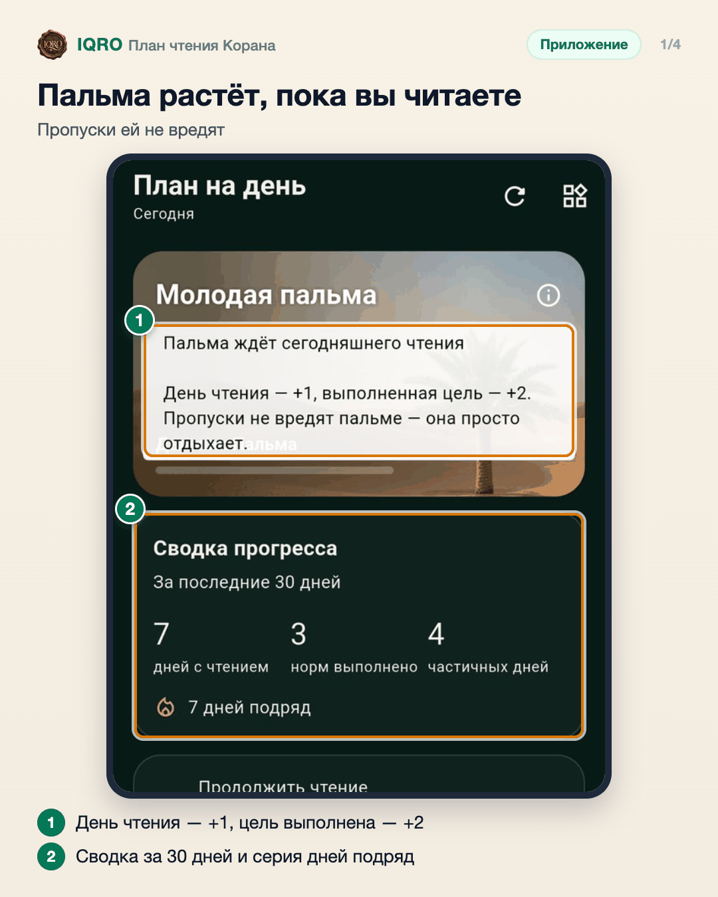
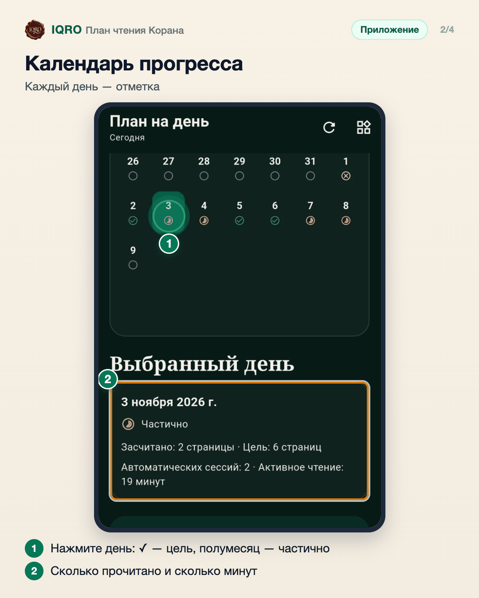
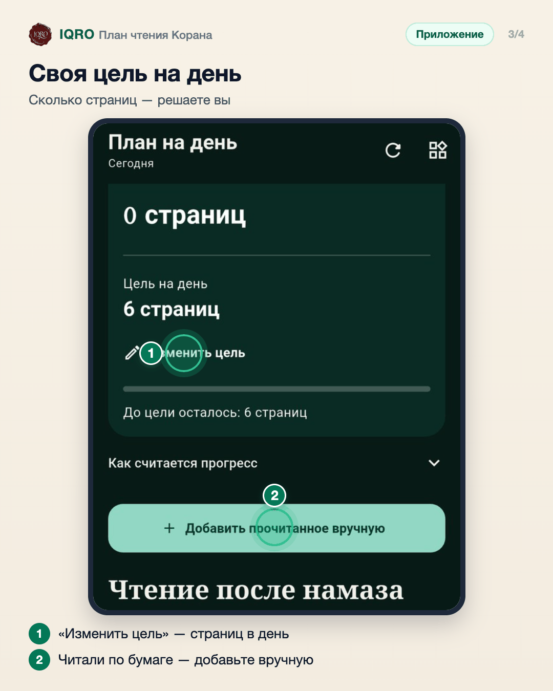
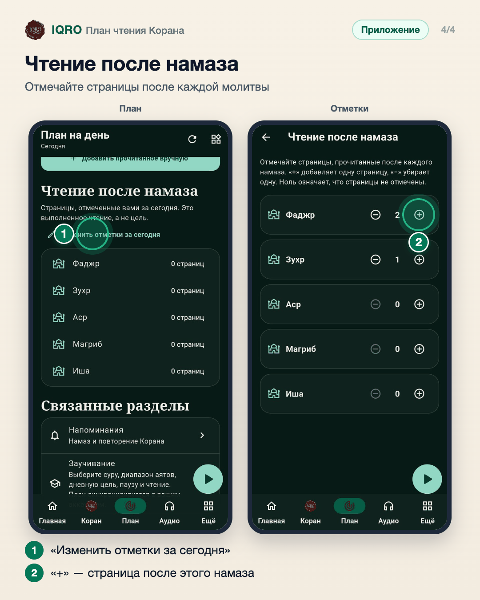

# План чтения Корана

Вкладка «План» помогает читать Коран каждый день. Вы ставите цель — сколько страниц в день, приложение само считает прочитанное в Коране и Мусхафе. Пальма растёт от каждого дня чтения, календарь показывает, какие дни цель выполнена, а отдельно можно отмечать страницы, прочитанные после каждого намаза.

**Где найти:** нижняя панель → «План».

**Сайт и приложение:** на сайте тот же план: iqro.forum → «План»; прогресс общий, если вы вошли в аккаунт.

## Пальма растёт, пока вы читаете

Вверху «Плана» — пальма. Каждый день чтения добавляет ей +1, выполненная цель — +2, и она переходит на следующую ступень. Пропуски не вредят — пальма просто отдыхает. Ниже сводка за 30 дней: дни с чтением, выполненные нормы и сколько дней подряд вы читаете.

## Календарь прогресса

В календаре отмечен каждый день: галочка — цель выполнена, полумесяц — прочитано частично. Нажмите на день, и ниже будет видно, сколько страниц прочитано и сколько минут вы читали.

## Своя цель на день

«Изменить цель» — выберите, сколько страниц читать в день. Приложение считает чтение в Коране и Мусхафе само. Читали по бумажному мусхафу — нажмите «Добавить прочитанное вручную».

## Чтение после намаза

Многие читают Коран после намаза. В «Плане» нажмите «Изменить отметки за сегодня» и нажимайте «+» у намаза, после которого читали: одна страница — одно нажатие. «−» убирает лишнее.

## Для рилс и подробного рассказа

- `reels/` — кадры 9:16 (1080×1920) по порядку: обложка, по кадру на каждый экран с его шагами, финальный кадр.
- `screens/` — чистые экраны без отметок, в полном размере: из них можно делать свои анимации.
- `video/` — запись экрана телефона, без звука: как это выглядит вживую.

Заголовок для ролика: **Читать Коран каждый день**. Текст за кадром — подписи к карточкам выше, по порядку.

---

Основа снимков: Redmi, сборка «IQRO тест» из main 9048ca87, 9 ноября 2026; строка состояния телефона обрезана. Отметки после намаза на снимке и в видео поставлены для съёмки и сразу сняты.
