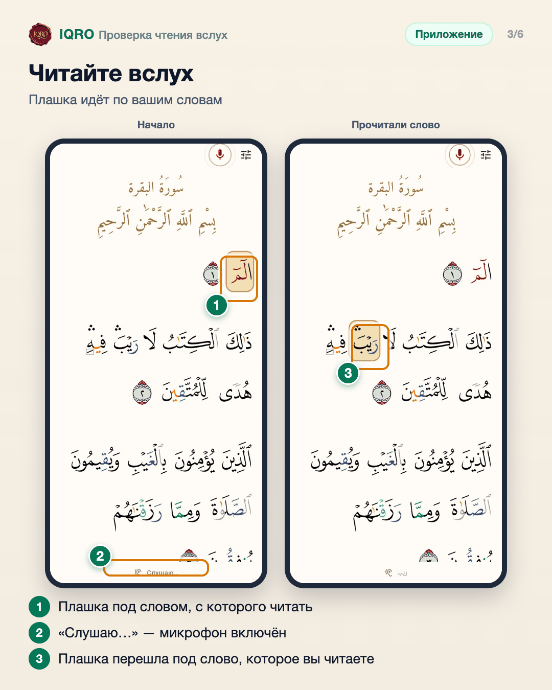
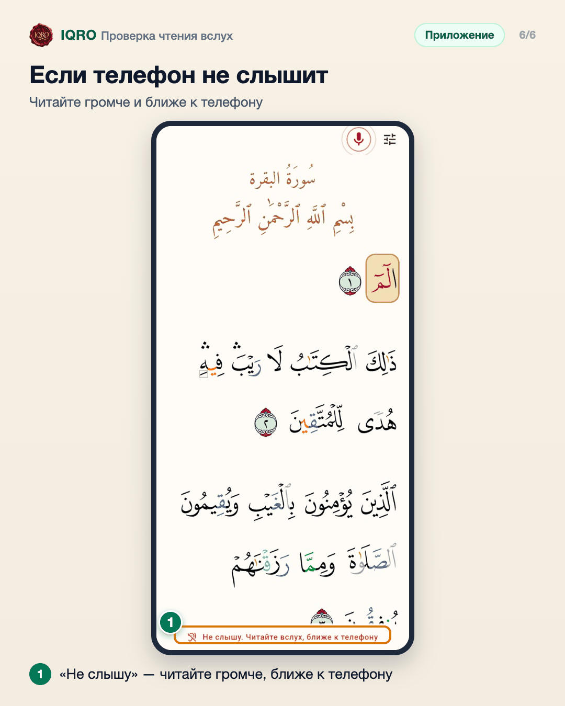

# Проверка чтения вслух

Включите микрофон на экране арабского текста и читайте вслух: под словом, которое вы читаете, появляется золотая плашка и идёт за вашим голосом. Сам текст не меняется и ничем не закрыт — буквы остаются своих цветов, в том числе цвета таджвида. Если пропустить слово, прочитать его с другой буквой или огласовкой, плашка становится красной, а телефон коротко вибрирует. Прочитали слово верно — плашка снова золотая и идёт дальше. На Android голос слушает программа в самом телефоне: звук никуда не передаётся, интернет не нужен.

**Где найти:** «Коран» → «Текст» → сура → смахните по аяту вправо: откроется чистый арабский текст. Кнопка микрофона — вверху справа. Перед первым включением приложение один раз объясняет, что происходит с голосом, и просит разрешение на микрофон.

**Сайт и приложение:** только в приложении; на сайте этой функции нет.

## Где включить

Откройте суру во вкладке «Коран» и смахните по аяту вправо — откроется чистый арабский текст. Вверху справа — кнопка микрофона. Пока вы ею не пользовались, рядом время от времени всплывает подсказка, а сама кнопка светится золотым.

## Перед первым включением

В первый раз приложение объясняет: на Android голос слушает программа в самом телефоне — звук никуда не передаётся, интернет не нужен; IQRO запись не хранит. Если на телефоне она не запустится, слушать будет служба распознавания речи Google, и тогда звук идёт к ней (на iPhone — служба Apple). Затем телефон спросит разрешение на микрофон.

## Читайте вслух

Включили микрофон — золотая плашка встаёт под слово, с которого читать: первое слово аята вверху экрана. Читайте: плашка переходит под слово, как только вы начали его произносить. Она лежит под текстом, буквы и огласовки остаются как были. Внизу видно слово, которое услышал телефон. Экран не гаснет, строка с плашкой держится около середины экрана.

## Ошибка

Пропустили слово, сказали другое, прочитали с другой буквой или огласовкой — плашка становится красной и встаёт под это слово, телефон коротко вибрирует. Так же отмечаются почти пропущенная гунна и вдвое укороченный мадд муттасыль. В чём именно ошибка, приложение не пишет. На снимке после второго аята сразу прочитан четвёртый: красная плашка под первым словом третьего.

## Перечитайте слово

Дальше плашка не пойдёт, пока вы не прочитаете отмеченное слово верно. Прочитали — она снова золотая и идёт по следующим словам. Слова из следующих строк её не переносят.

## Если телефон не слышит

Если слова не приходят 8 секунд, внизу появляется «Не слышу»: читайте громче и ближе к телефону. Чтобы читать с другого места, нажмите на нужное слово — плашка встанет под него. Вернуться назад можно и голосом: прочитайте два слова подряд из уже пройденного.

## Для рилс и подробного рассказа

- `reels/` — кадры 9:16 (1080×1920) по порядку: обложка, по кадру на каждый экран с его шагами, финальный кадр.
- `screens/` — чистые экраны без отметок, в полном размере: из них можно делать свои анимации.

Заголовок для ролика: **Проверьте своё чтение Корана**. Текст за кадром — подписи к карточкам выше, по порядку.

---

Основа снимков: Redmi Note 7, сборка «IQRO тест»: экраны кнопки и предупреждения — из ветки claude/goofy-shannon-a917b7, 18 ноября 2026; остальные — из ветки claude/recitation-read-words, 20 ноября 2026. Строка состояния телефона обрезана. Чтение для снимков проигрывалось с компьютера (запись шейха аль-Хусари). Снимок предупреждения сделан до обновления его текста.
