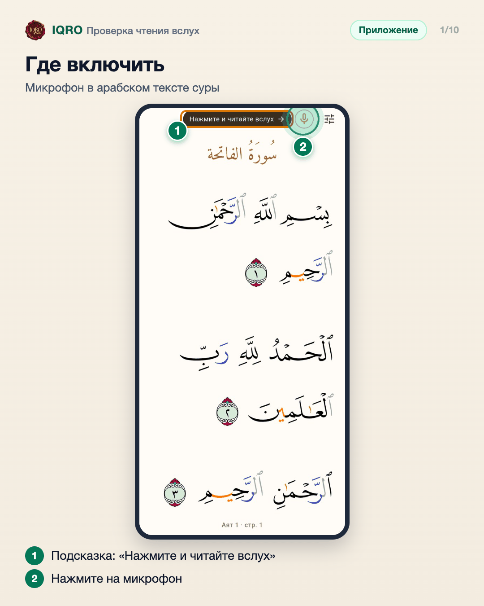
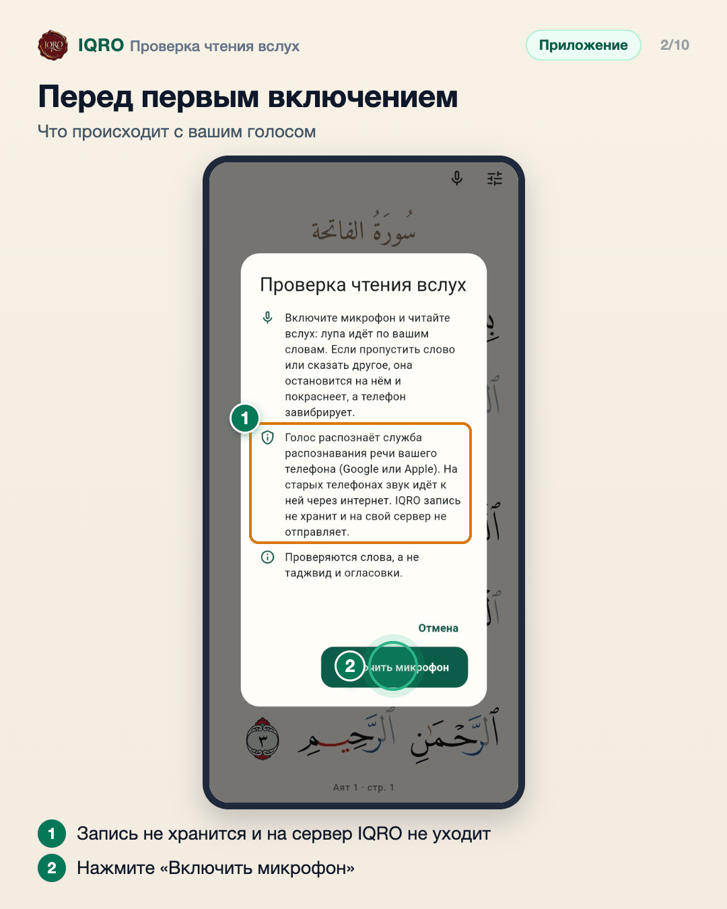
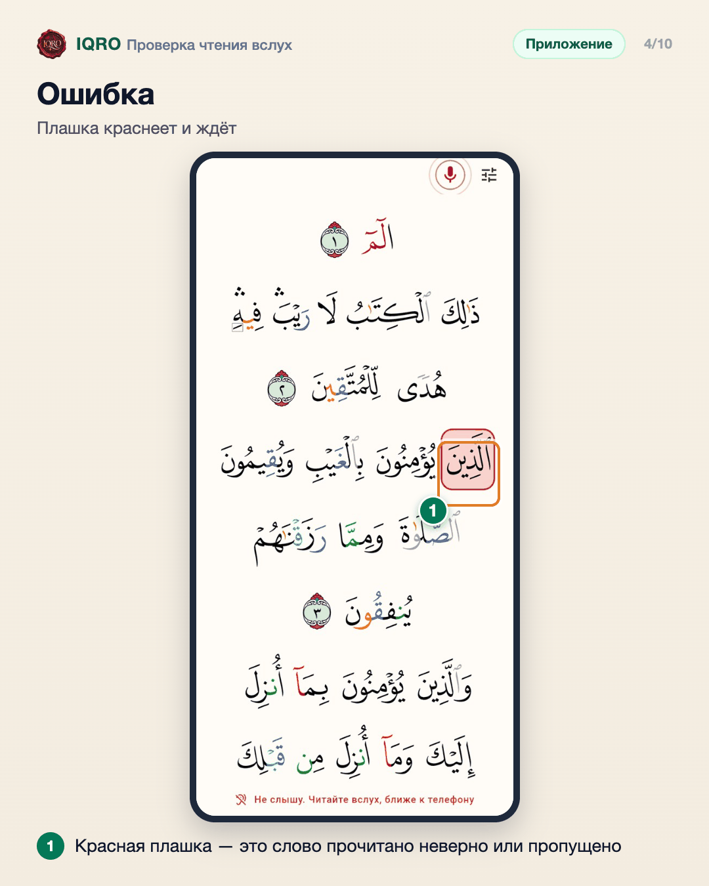
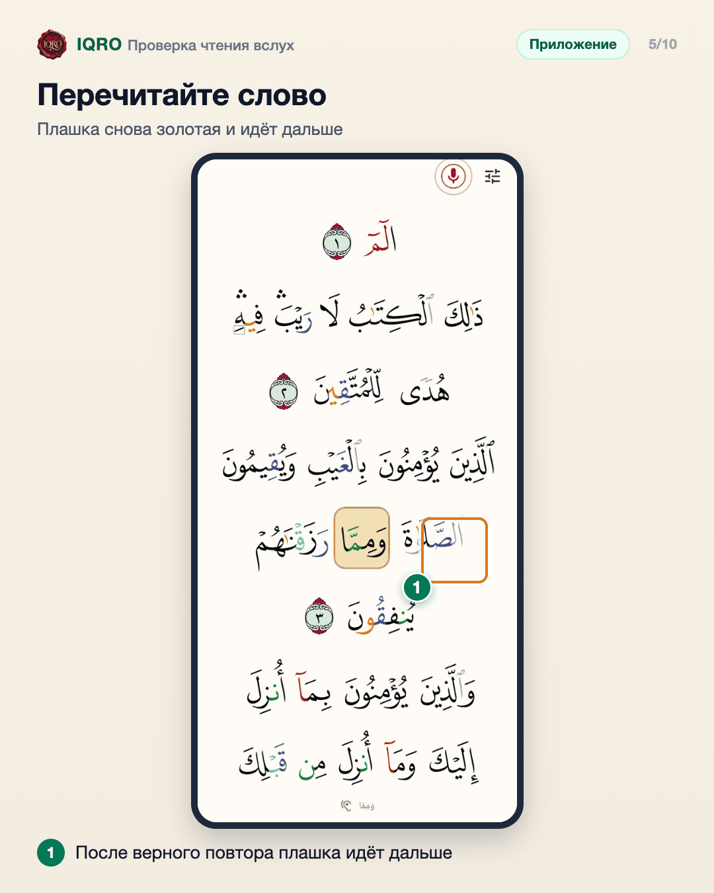
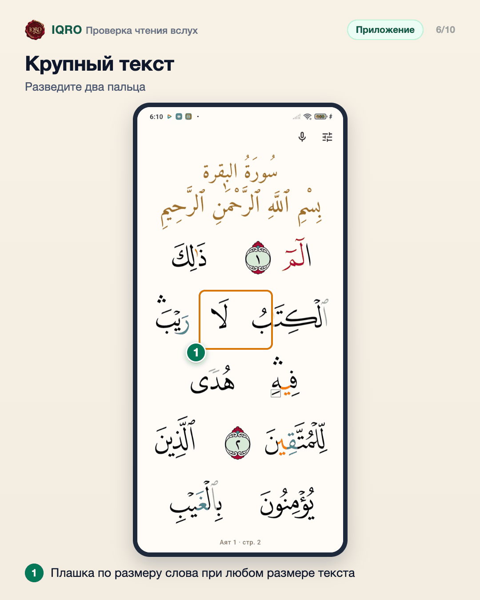
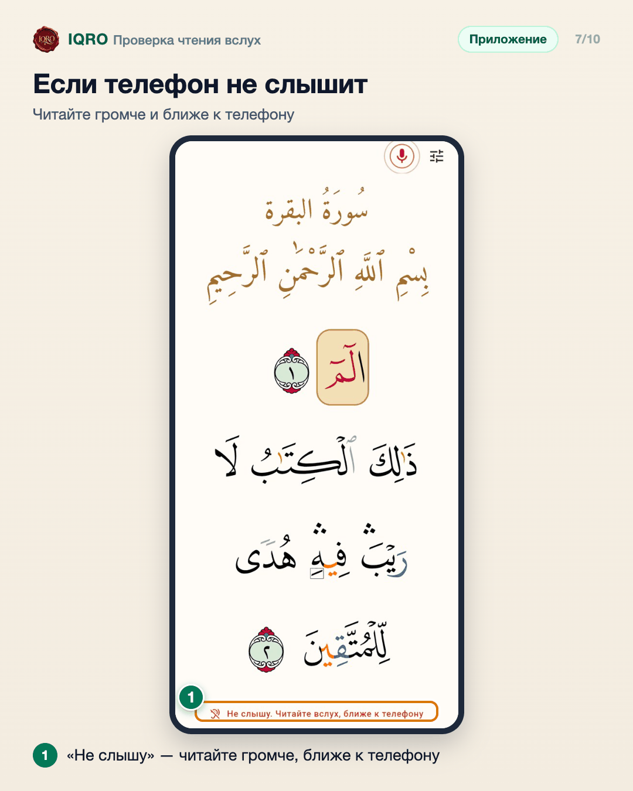
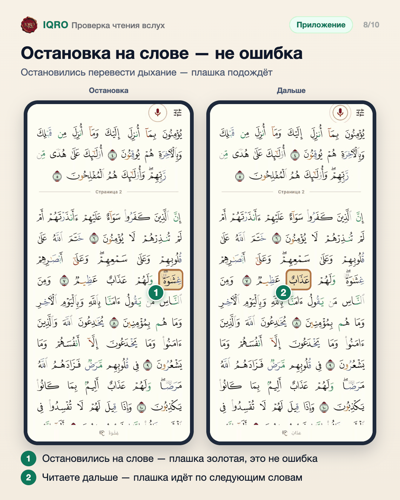
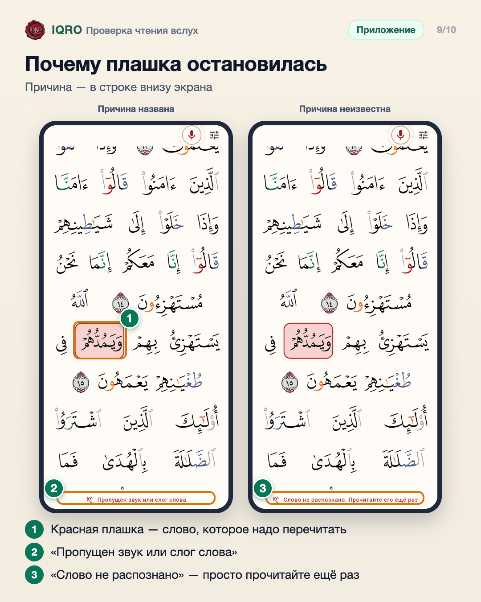
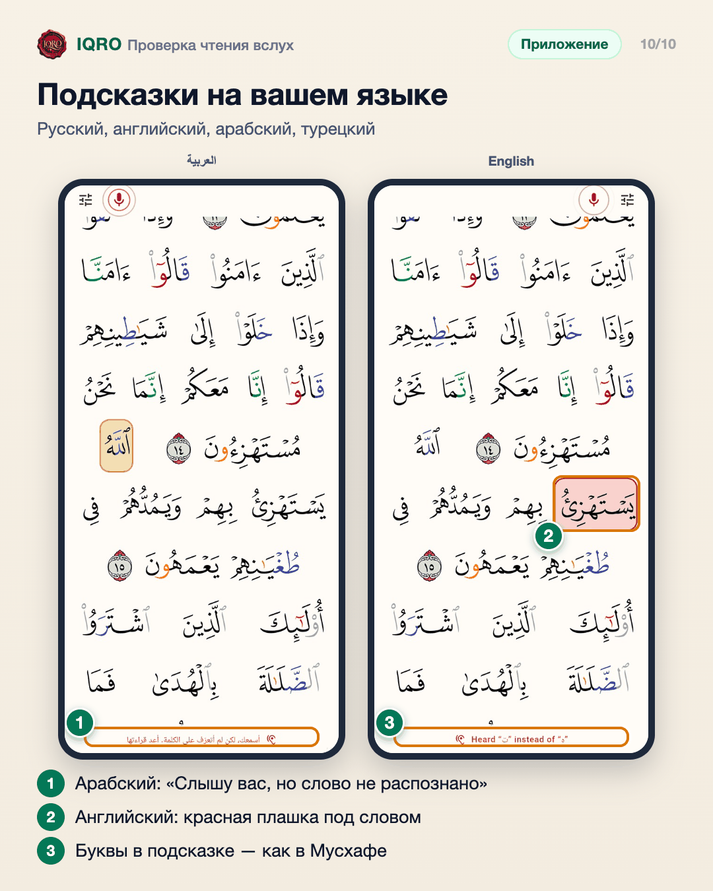

# Проверка чтения вслух

Включите микрофон на экране арабского текста и читайте вслух: под словом, которое вы читаете, появляется золотая плашка и идёт за вашим голосом. Сам текст не меняется и ничем не закрыт — буквы остаются своих цветов, в том числе цвета таджвида. Если пропустить слово, букву или слог, прочитать с другой буквой или огласовкой, плашка становится красной, телефон коротко вибрирует, а внизу написано, в чём ошибка. Прочитали слово верно — плашка снова золотая и идёт дальше. На Android голос слушает программа в самом телефоне: звук никуда не передаётся, интернет не нужен.

**Где найти:** «Коран» → «Текст» → сура → смахните по аяту вправо: откроется чистый арабский текст. Кнопка микрофона — вверху справа. Перед первым включением приложение один раз объясняет, что происходит с голосом, и просит разрешение на микрофон.

**Сайт и приложение:** только в приложении; на сайте этой функции нет.

## Где включить

Откройте суру во вкладке «Коран» и смахните по аяту вправо — откроется чистый арабский текст. Вверху справа — кнопка микрофона. Пока вы ею не пользовались, рядом время от времени всплывает подсказка, а сама кнопка светится золотым.

## Перед первым включением

В первый раз приложение объясняет: на Android голос слушает программа в самом телефоне — звук никуда не передаётся, интернет не нужен; IQRO запись не хранит. Если на телефоне она не запустится, слушать будет служба распознавания речи Google, и тогда звук идёт к ней (на iPhone — служба Apple). Затем телефон спросит разрешение на микрофон.

## Читайте вслух

Включили микрофон — золотая плашка встаёт под слово, с которого читать: первое слово аята вверху экрана или слово, на которое вы нажали. Читайте: плашка переходит под слово, как только вы начали его произносить. Она лежит под текстом, буквы и огласовки остаются как были. Внизу видно слово, которое услышал телефон. Экран не гаснет, строка с плашкой держится около середины экрана.

## Ошибка

Пропустили слово, сказали другое, прочитали с другой буквой или огласовкой, пропустили букву или слог, добавили лишнюю букву — плашка становится красной и встаёт под это слово, телефон коротко вибрирует. Так же отмечаются почти пропущенная гунна, вдвое укороченный мадд муттасыль, ясный «н» там, где он скрывается (ихфа, икляб), пропущенная калькаля и протянутый «н» при изхаре. Внизу экрана приложение пишет причину. На снимке после второго аята сразу прочитан четвёртый: красная плашка под первым словом третьего.

## Перечитайте слово

Дальше плашка не пойдёт, пока вы не прочитаете отмеченное слово верно. Прочитали — она снова золотая и идёт по следующим словам. Слова из следующих строк её не переносят.

## Крупный текст

Разведите два пальца на тексте — он станет крупнее, сведите — мельче; двойное касание возвращает обычный размер. Текст идёт сплошь, как на странице Мусхафа: следующий аят начинается в той же строке. При любом размере строки занимают экран от края до края; при крупном размере в строке два-три слова. Размер можно задать и ползунком — кнопка справа от микрофона.

## Если телефон не слышит

Если слова не приходят 8 секунд, внизу появляется «Не слышу»: читайте громче и ближе к телефону. Чтобы читать с другого места, нажмите на нужное слово — плашка встанет под него. Вернуться назад можно и голосом: прочитайте два слова подряд из уже пройденного.

## Остановка на слове — не ошибка

В середине аята можно остановиться на слове, как это делают чтецы: например, на «гишавах» в аяте 2:7. Слово при остановке звучит иначе, чем в слитном чтении, — приложение знает оба чтения, плашка остаётся золотой и ждёт. Продолжили — она идёт дальше. Слитное чтение без остановки проходит так же.

## Почему плашка остановилась

Пока слово ждёт в красном, внизу написано почему: слово пропущено; слышно одну букву вместо другой; другая огласовка; пропущен звук или слог; в слове лишний звук; гунна или мадд слишком короткие; ихфа, икляб, калькаля, изхар. Если причину назвать нельзя, приложение так и пишет: «Слово не распознано. Прочитайте его ещё раз» — и ничего не выдумывает. На первом снимке из слова «йамуддухум» выпал слог.

## Подсказки на вашем языке

Строка внизу говорит на языке приложения: русском, английском, арабском или турецком. В арабском она идёт справа налево. Буквы в подсказке показаны так, как написаны в Мусхафе: «слышно ت вместо ه». Язык меняется в настройках приложения.

## Для рилс и подробного рассказа

- `reels/` — кадры 9:16 (1080×1920) по порядку: обложка, по кадру на каждый экран с его шагами, финальный кадр.
- `screens/` — чистые экраны без отметок, в полном размере: из них можно делать свои анимации.

Заголовок для ролика: **Проверьте своё чтение Корана**. Текст за кадром — подписи к карточкам выше, по порядку.

---

Основа снимков: Redmi Note 7, сборка «IQRO тест»: экраны кнопки и предупреждения — из ветки claude/goofy-shannon-a917b7, 18 ноября 2026; остальные — из ветки claude/recitation-read-words, 20 ноября 2026. Строка состояния телефона обрезана. Чтение для снимков проигрывалось с компьютера (запись шейха аль-Хусари). Снимки кнопки и предупреждения сделаны до новой вёрстки текста и обновления текста предупреждения. Снимки остановки на слове — сборка 1.0.14 (15) из main, 20 ноября 2026, чтение шейха аль-Хусари (аят 2:7) из колонок компьютера. Снимки подсказок — сборка «IQRO тест» из ветки claude/recitation-hints (коммит 4c8f1179), 21–22 ноября 2026: записи шейха аль-Хусари с вырезанным слогом и другой аят из колонок компьютера; языки — русский, арабский, английский, турецкий (турецкий и длинные фразы — в screens/).
