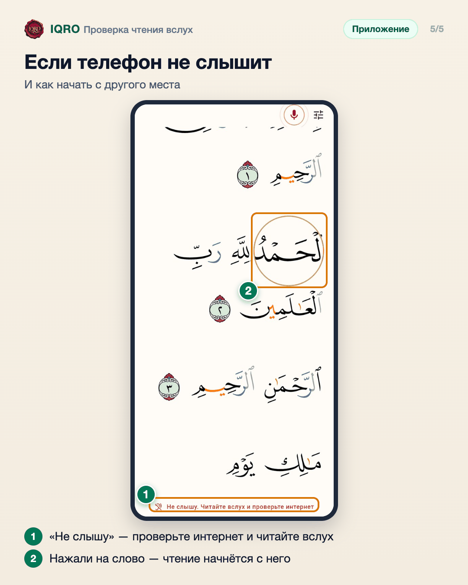

# Проверка чтения вслух

Включите микрофон на экране арабского текста и читайте вслух: круглая лупа идёт по словам, которые вы произносите. Если пропустить слово или сказать другое, лупа останавливается на нём и краснеет, а телефон коротко вибрирует. Прочитали слово верно — лупа снова золотая и идёт дальше. Так можно проверять себя при повторении выученного.

**Где найти:** «Коран» → «Текст» → сура → смахните по аяту вправо: откроется чистый арабский текст. Кнопка микрофона — вверху справа. Перед первым включением приложение один раз объясняет, что происходит с голосом, и просит разрешение на микрофон.

**Сайт и приложение:** только в приложении; на сайте этой функции нет.

## Где включить

Откройте суру во вкладке «Коран» и смахните по аяту вправо — откроется чистый арабский текст. Вверху справа — кнопка микрофона. Пока вы ею не пользовались, рядом время от времени всплывает подсказка, а сама кнопка светится золотым.

## Перед первым включением

В первый раз приложение объясняет: голос распознаёт служба распознавания речи вашего телефона (Google или Apple), на старых телефонах — через интернет. IQRO запись не хранит и на свой сервер не отправляет. Проверяются слова, а не таджвид и огласовки. Затем телефон спросит разрешение на микрофон.

## Читайте вслух

Лупа сразу встаёт на слово, с которого читать, — первое слово аята вверху экрана. Читайте: после каждого слова лупа переходит на него. Внизу видно, что услышал телефон. Экран не гаснет, текст подкручивается сам.

## Ошибка

Пропустили слово или сказали другое — лупа становится красной и встаёт на слово, которое нужно прочитать, телефон коротко вибрирует. Дальше она не пойдёт, пока вы не прочитаете это слово верно. Слова из следующих строк её не переносят.

## Если телефон не слышит

Если слова не приходят 8 секунд, внизу появляется «Не слышу»: читайте громче и проверьте интернет — на многих телефонах распознавание работает через сеть. Чтобы читать с другого места, нажмите на нужное слово — лупа встанет на него. Вернуться назад можно и голосом: прочитайте два слова подряд из уже пройденного.

## Для рилс и подробного рассказа

- `reels/` — кадры 9:16 (1080×1920) по порядку: обложка, по кадру на каждый экран с его шагами, финальный кадр.
- `screens/` — чистые экраны без отметок, в полном размере: из них можно делать свои анимации.

Заголовок для ролика: **Проверьте своё чтение Корана**. Текст за кадром — подписи к карточкам выше, по порядку.

---

Основа снимков: Redmi Note 7, сборка «IQRO тест» из ветки claude/goofy-shannon-a917b7, 18 ноября 2026; строка состояния телефона обрезана. Слова для снимков проигрывались голосом компьютера.
