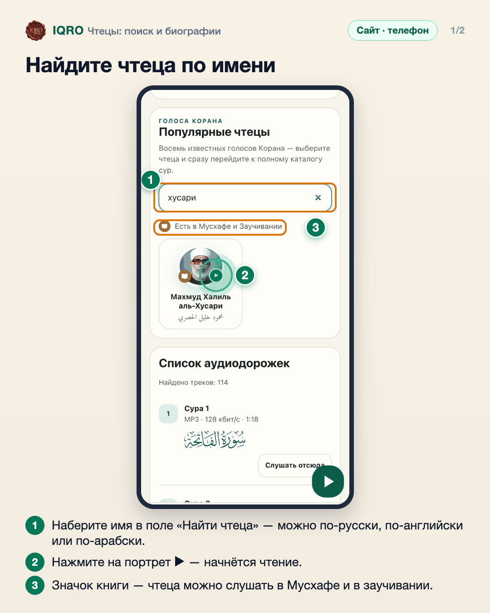
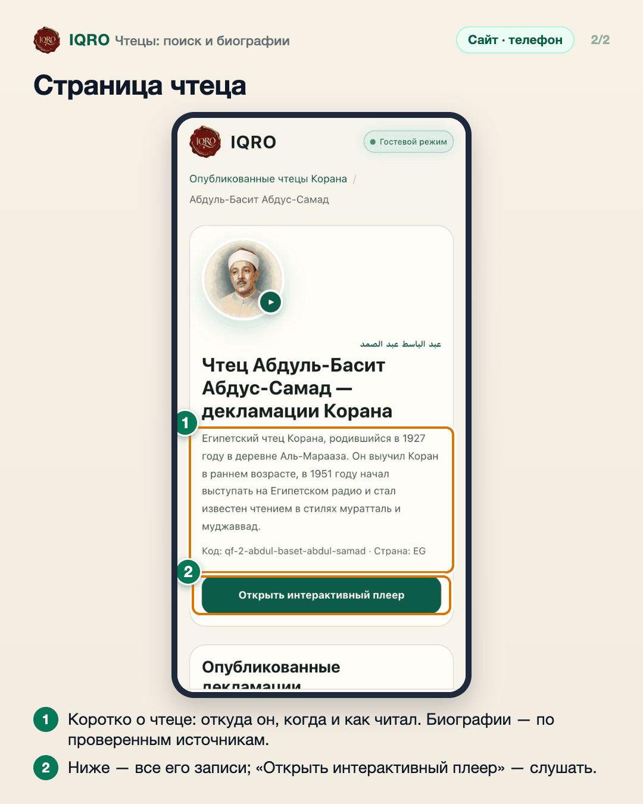

# Чтецы: поиск и биографии

Найти нужного можно по имени в любом написании — «хусари», «husary», «الحصري». У чтеца есть своя страница с портретом, короткой биографией и всеми его записями.

**Где найти:** «Аудио» → поле «Найти чтеца»; нажмите на чтеца, чтобы открыть его страницу.

**Сайт и приложение:** одинаково на сайте и в приложении. Значок книги у портрета — у этого чтеца есть разметка аятов: его можно слушать в Мусхафе и в заучивании.

## Найдите чтеца по имени

На вкладке «Аудио» наберите имя чтеца в поле «Найти чтеца». Поиск понимает разное написание: «хусари», «husary», «الحصري». Кнопка ▶ на портрете сразу включает чтение, нажатие на имя открывает страницу чтеца.

## Страница чтеца

На странице чтеца — портрет, имя по-арабски, короткая биография по проверенным источникам и список его декламаций (муратталь, муджаввад). Кнопка «Открыть интерактивный плеер» включает его чтение.

## Для рилс и подробного рассказа

- `reels/` — кадры 9:16 (1080×1920) по порядку: обложка, по кадру на каждый экран с его шагами, финальный кадр.
- `screens/` — чистые экраны без отметок, в полном размере: из них можно делать свои анимации.
- `video/` — запись экрана телефона, без звука: как это выглядит вживую.

Заголовок для ролика: **Найдите своего чтеца**. Текст за кадром — подписи к карточкам выше, по порядку.

---

Основа снимков: сайт iqro.forum, 4 ноября 2026.
