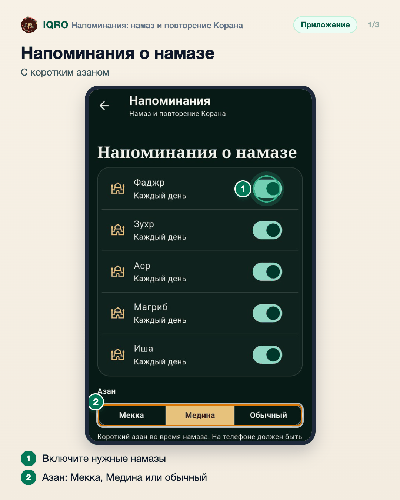
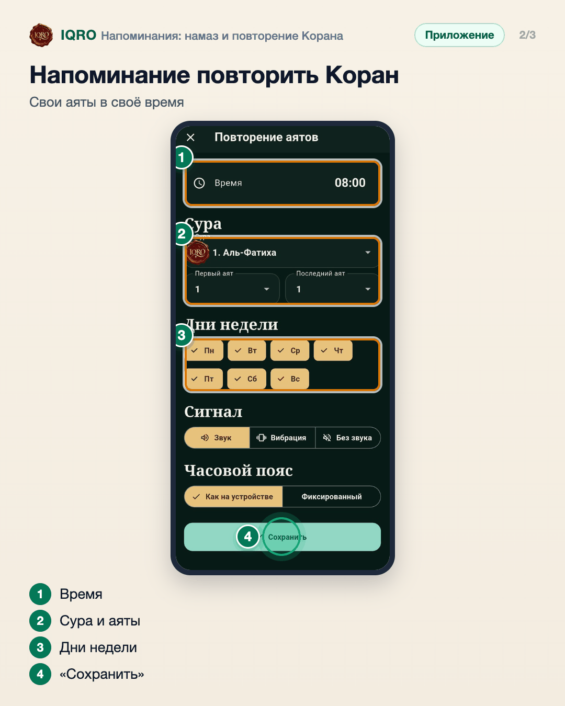
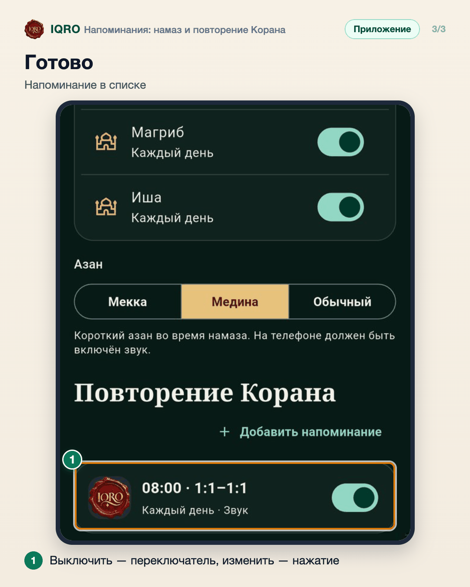

# Напоминания: намаз и повторение Корана

В «Напоминаниях» два вида: о каждом намазе — с коротким азаном Мекки, Медины или обычным сигналом — и о повторении Корана: в нужное время приложение напомнит повторить выбранные аяты. Дни недели, сигнал и часовой пояс настраиваются.

**Где найти:** «План» → «Напоминания» или экран «Время намаза» → «Напоминания о намазе».

**Сайт и приложение:** напоминания приходят только в приложении: сайт уведомлений не присылает.

## Напоминания о намазе

Включите напоминание для каждого намаза, о котором хотите знать. Ниже выберите азан: Мекка, Медина или обычный сигнал. На телефоне должен быть включён звук.

## Напоминание повторить Коран

В разделе «Повторение Корана» нажмите «Добавить напоминание». Выберите время, суру и аяты, дни недели и сигнал — и «Сохранить».

## Готово

Новое напоминание появится в списке. Переключатель выключает его, не удаляя; нажатие открывает настройки, а значок корзины в них удаляет напоминание.

## Для рилс и подробного рассказа

- `reels/` — кадры 9:16 (1080×1920) по порядку: обложка, по кадру на каждый экран с его шагами, финальный кадр.
- `screens/` — чистые экраны без отметок, в полном размере: из них можно делать свои анимации.
- `video/` — запись экрана телефона, без звука: как это выглядит вживую.

Заголовок для ролика: **Не пропустить намаз и Коран**. Текст за кадром — подписи к карточкам выше, по порядку.

---

Основа снимков: Redmi, сборка «IQRO тест» из main 9048ca87, 9 ноября 2026; строка состояния телефона обрезана. Напоминание о повторении создано для съёмки и потом удалено.
