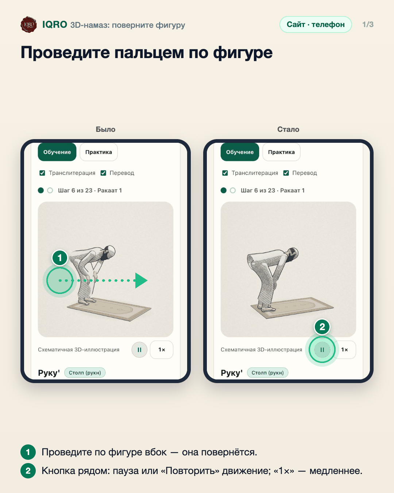
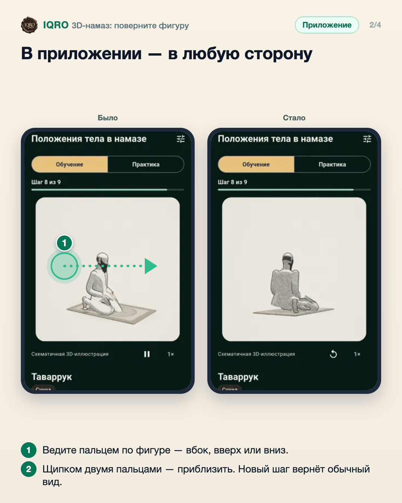
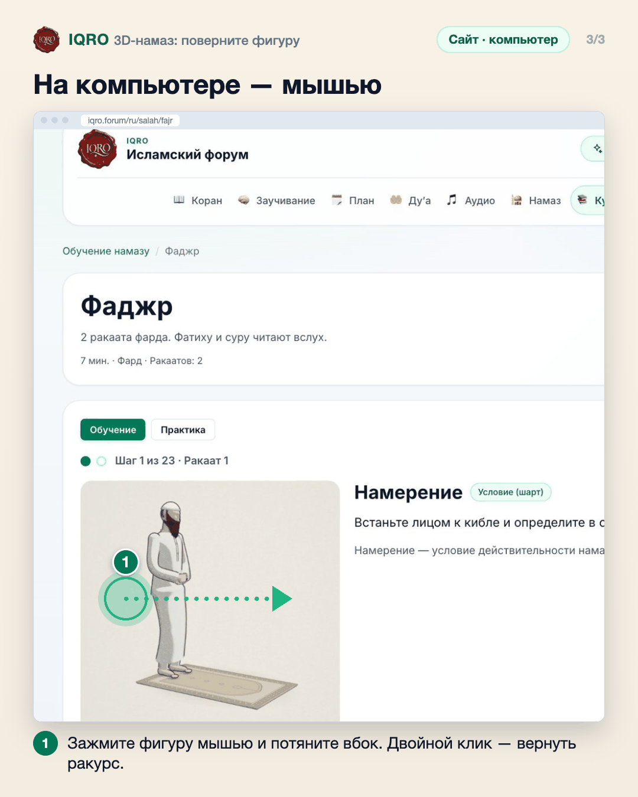

# 3D-намаз: поверните фигуру

В курсе «Обучение намазу» каждая поза — объёмная фигура. Движение проигрывается один раз, а фигуру можно повернуть и рассмотреть позу с любой стороны.

**Где найти:** «Курсы» → «Обучение намазу» → любой урок, например «Фаджр» (в приложении: «Ещё» → «Курсы» → «Обучение намазу»).

**Сайт и приложение:** на сайте фигуру поворачивают мышью или пальцем вбок, двойной клик возвращает ракурс. В приложении палец поворачивает в любую сторону, а двумя пальцами можно приблизить.

## Проведите пальцем по фигуре

Откройте урок и проведите пальцем по фигуре влево или вправо — она повернётся, и позу видно сбоку. Под фигурой — пауза/повтор движения и скорость (1×, 0,75×, 0,5×).

## В приложении — в любую сторону

В приложении фигура поворачивается пальцем в любую сторону, а щипком её можно приблизить. Здесь поза «таваррук» — её лучше видно сзади. При переходе на следующий шаг камера возвращается сама.

## На компьютере — мышью

На компьютере фигуру поворачивают мышью: зажать и потянуть влево или вправо. Двойной клик возвращает обычный ракурс.

## Для рилс и подробного рассказа

- `reels/` — кадры 9:16 (1080×1920) по порядку: обложка, по кадру на каждый экран с его шагами, финальный кадр.
- `screens/` — чистые экраны без отметок, в полном размере: из них можно делать свои анимации.
- `video/` — запись экрана телефона, без звука: как это выглядит вживую.

Заголовок для ролика: **Намаз в 3D**. Текст за кадром — подписи к карточкам выше, по порядку.

---

Основа снимков: сайт iqro.forum, 4 ноября 2026; приложение — `docs/salah/screenshots/app-redmi-tawarruk-wudu.webp`.
