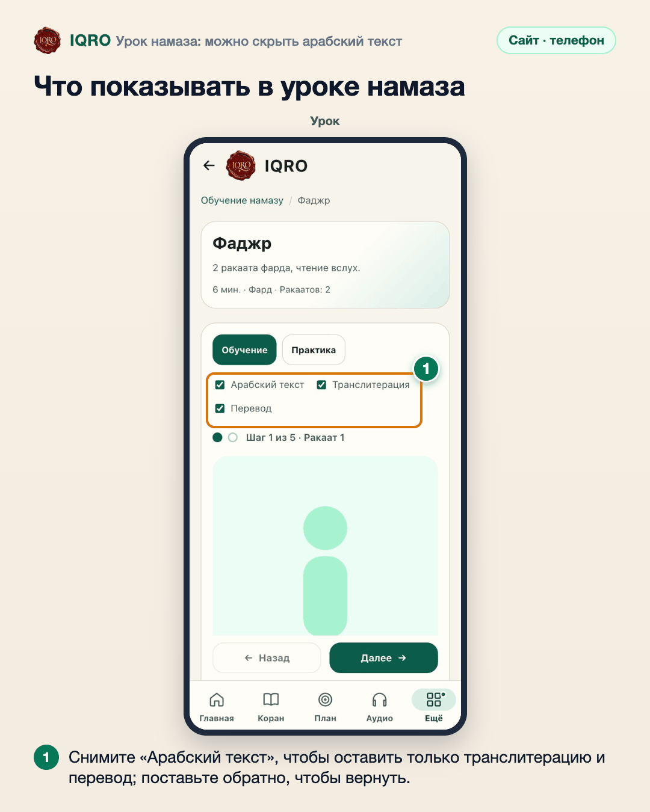

# Урок намаза: можно скрыть арабский текст

В уроке намаза на сайте появилась галочка «Арабский текст», как в приложении: её можно снять и учить по транслитерации и переводу, а потом вернуть.

**Где найти:** сайт iqro.forum: «Курсы» → «Обучение намазу» → любой урок, режим «Обучение».

**Сайт и приложение:** галочка работает одинаково. В приложении три галочки спрятаны в меню под значком настроек, на сайте стоят в строке под кнопками «Обучение» и «Практика».

## Что показывать в уроке намаза

Три галочки под кнопками «Обучение» и «Практика»: арабский текст, транслитерация и перевод. Выбор запоминается. В режиме «Практика» арабский текст показывается всегда.

---

Основа снимков: сайт — локальная сборка, телефон 390×844, тестовые данные, 17 ноября 2026.
