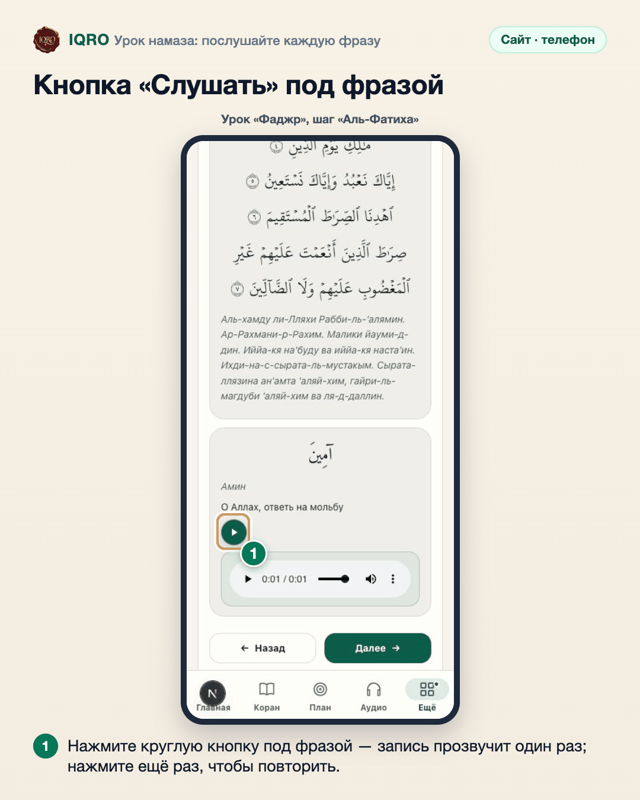

# Урок намаза: послушайте каждую фразу

В уроках намаза теперь звучат «Амин», таслим и праздничные такбиры: у каждой фразы своя кнопка «Слушать».

**Где найти:** сайт iqro.forum и приложение: «Курсы» → «Обучение намазу» → любой урок намаза.

**Сайт и приложение:** кнопка «Слушать» есть и на сайте, и в приложении, записи одни и те же. Для звука нужен интернет.

## Кнопка «Слушать» под фразой

Под арабским текстом, транслитерацией и переводом каждой фразы стоит круглая кнопка «Слушать». Теперь она есть у «Амин», у таслима и у праздничных такбиров.

---

Основа снимков: сайт — локальная сборка с новой версией курса, телефон 390×844, 20 ноября 2026.
