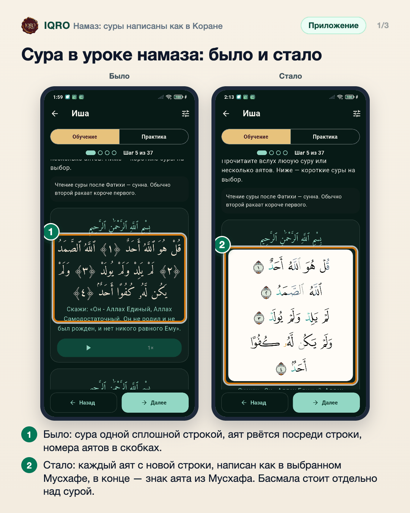
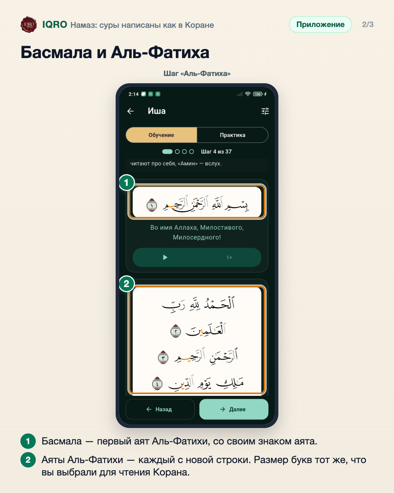
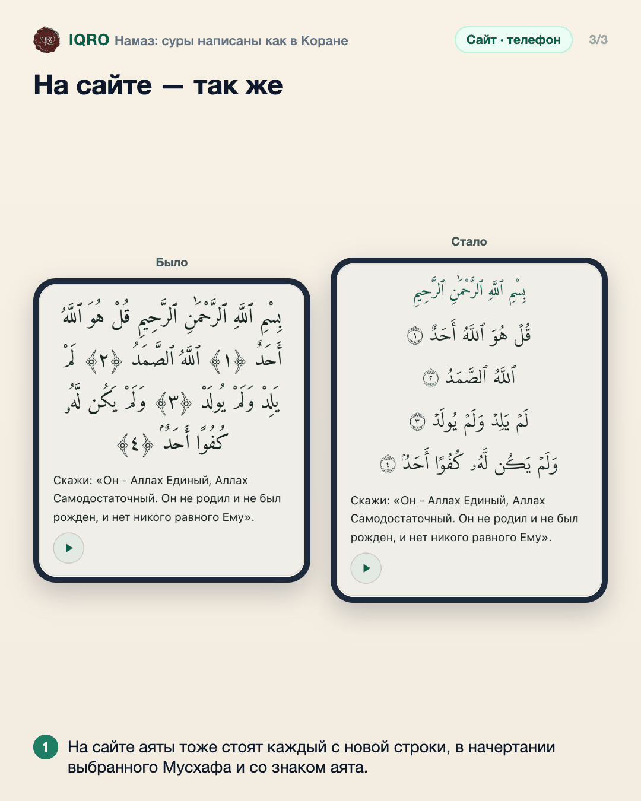

# Намаз: суры написаны как в Коране

В курсе «Обучение намазу» суры и аяты, которые читают в намазе (басмала, Аль-Фатиха, короткие суры), теперь выглядят так же, как в разделе «Коран»: каждый аят с новой строки, в начертании выбранного Мусхафа и со знаком конца аята из Мусхафа. Раньше сура шла одной сплошной строкой обычным шрифтом, а номера аятов стояли в скобках посреди строк.

**Где найти:** «Курсы» → «Обучение намазу» → урок молитвы (например, «Фаджр») → шаги «Аль-Фатиха» и «Сура».

**Сайт и приложение:** вид одинаковый. В приложении берётся Мусхаф, выбранный на вкладке «Коран»; на сайте — выбранный в «Настройках чтения» раздела «Коран» (если не выбирали — обычный мединский шрифт Хафс). У Мусхафов-картинок шрифта нет: для них и без интернета аяты пишутся обычным шрифтом Корана, но тоже каждый с новой строки. Слова намаза не из Корана (такбир, тасбих, ташаххуд, ду‘а) не менялись.

## Сура в уроке намаза: было и стало

В уроках намаза суры теперь выглядят как в Коране: каждый аят с новой строки, тем же шрифтом и с теми же цветами таджвида, что и в выбранном вами Мусхафе. В тёмной теме цветной текст лежит на светлой бумаге, как страница Мусхафа.

## Басмала и Аль-Фатиха

Аль-Фатиха в уроке написана так же, как в вашем Мусхафе. Размер арабского текста берётся из настроек чтения Корана. Перевод и кнопка прослушивания остались на месте.

## На сайте — так же

На сайте iqro.forum в уроках намаза то же самое: сура больше не идёт сплошной строкой. Какой Мусхаф выбран в «Настройках чтения» раздела «Коран», таким шрифтом написаны и аяты в уроке.

---

Основа снимков: приложение — Redmi Note 7, тестовая сборка «IQRO тест» из этой ветки, Мусхаф QCF V4 Tajweed, тёмная тема; сайт — телефон 390×844, данные iqro.forum, 12 ноября 2026.
