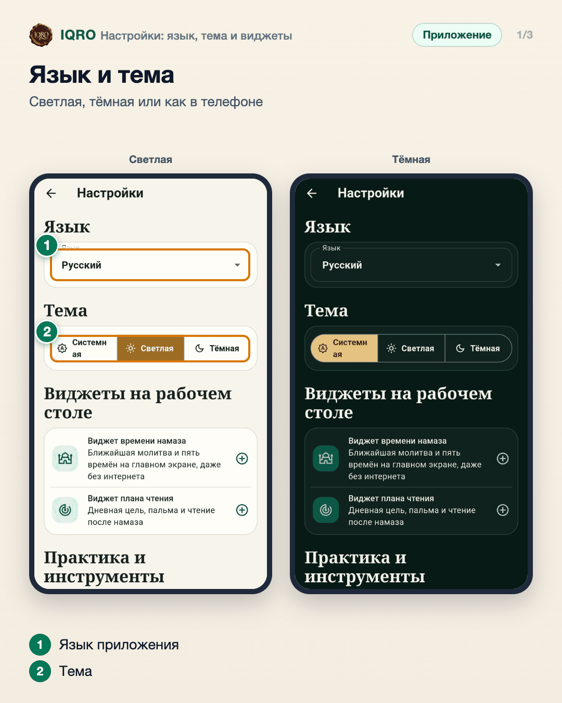
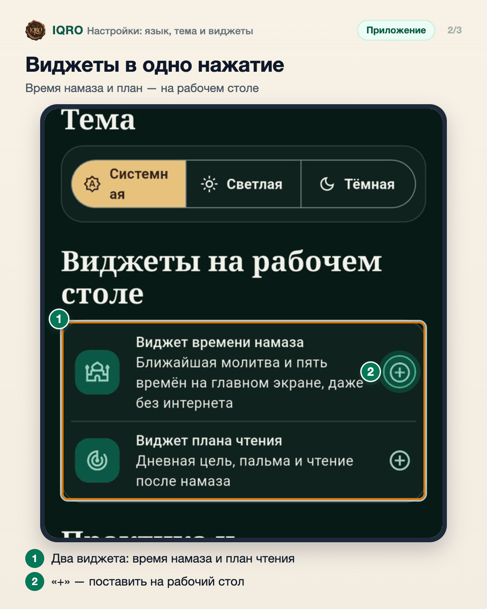
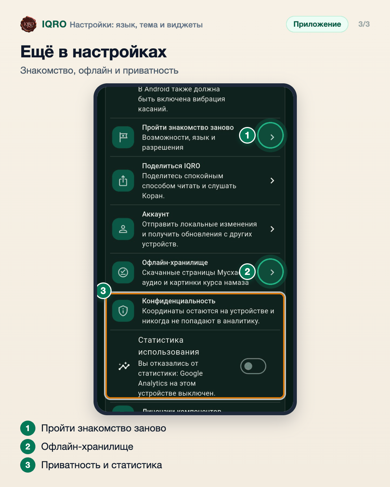

# Настройки: язык, тема и виджеты

В «Настройках» меняются язык приложения и тема — светлая, тёмная или как в системе телефона. Отсюда же ставятся виджеты на рабочий стол, можно пройти знакомство с приложением заново, посмотреть, что скачано для работы без интернета, и выключить статистику использования.

**Где найти:** «Ещё» → «Настройки» или значок шестерёнки на главной.

**Сайт и приложение:** на сайте язык и тема переключаются в шапке; виджеты есть только в приложении.

## Язык и тема

Вверху «Настроек» — язык приложения: русский, английский, арабский или турецкий. Ниже тема: «Системная» повторяет настройку телефона, «Светлая» и «Тёмная» включаются всегда.

## Виджеты в одно нажатие

В разделе «Виджеты на рабочем столе» нажмите «+» у нужного виджета — телефон предложит поставить его на рабочий стол. Виджет времени намаза работает даже без интернета.

## Ещё в настройках

«Пройти знакомство заново» — снова показать возможности и разрешения. «Офлайн-хранилище» — что скачано для работы без интернета: страницы Мусхафа, аудио и картинки курса намаза. Ниже — конфиденциальность: координаты остаются на устройстве, а статистику использования можно выключить.

## Для рилс и подробного рассказа

- `reels/` — кадры 9:16 (1080×1920) по порядку: обложка, по кадру на каждый экран с его шагами, финальный кадр.
- `screens/` — чистые экраны без отметок, в полном размере: из них можно делать свои анимации.
- `video/` — запись экрана телефона, без звука: как это выглядит вживую.

Заголовок для ролика: **IQRO под вас**. Текст за кадром — подписи к карточкам выше, по порядку.

---

Основа снимков: Redmi, сборка «IQRO тест» из main 9048ca87, 9 ноября 2026; строка состояния телефона обрезана. Тема переключена для съёмки и возвращена на «Системную».
