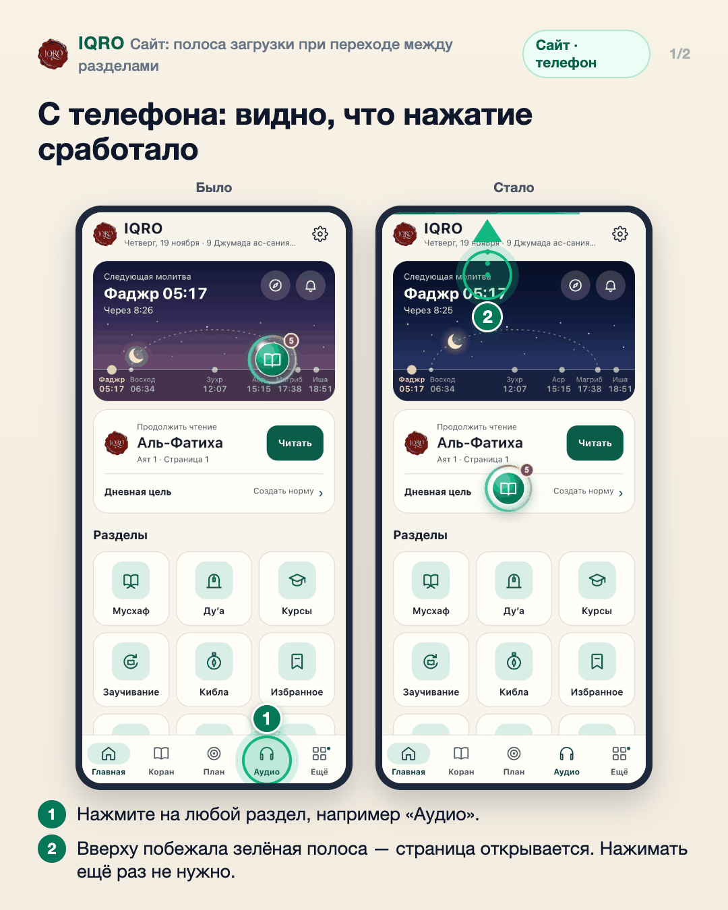
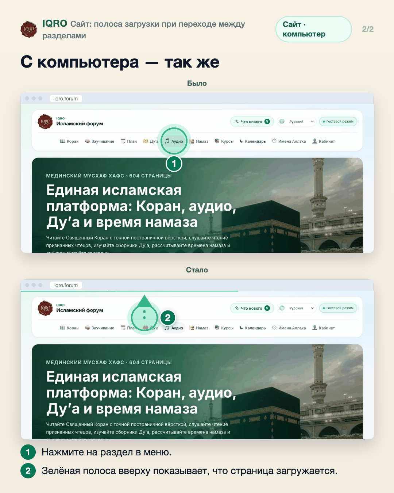

# Сайт: полоса загрузки при переходе между разделами

Нажали на раздел — вверху экрана сразу побежала тонкая зелёная полоса: сайт услышал нажатие и открывает страницу. Когда новый раздел готов, полоса исчезает. Раньше на медленном интернете после нажатия ничего не менялось, и было непонятно, сработало ли оно.

**Где найти:** сайт iqro.forum с телефона и с компьютера: любой переход — меню, нижние вкладки, плитки на главной, смена языка.

**Сайт и приложение:** это изменение только для сайта. В приложении экраны открываются сразу, полоса там не нужна.

## С телефона: видно, что нажатие сработало

Слева — как было: нажали «Аудио», а экран не меняется, пока страница не загрузится. Справа — как стало: вверху сразу появляется зелёная полоса и растёт, пока раздел открывается.

## С компьютера — так же

На компьютере полоса идёт по самому верху окна, над шапкой сайта. Она ничего не сдвигает и исчезает, как только раздел открылся.

---

Основа снимков: сайт — локальная сборка ветки claude/site-page-transition, данные iqro.forum, телефон 390×844 и компьютер 1280×820, сеть искусственно замедлена, 19 ноября 2026.
