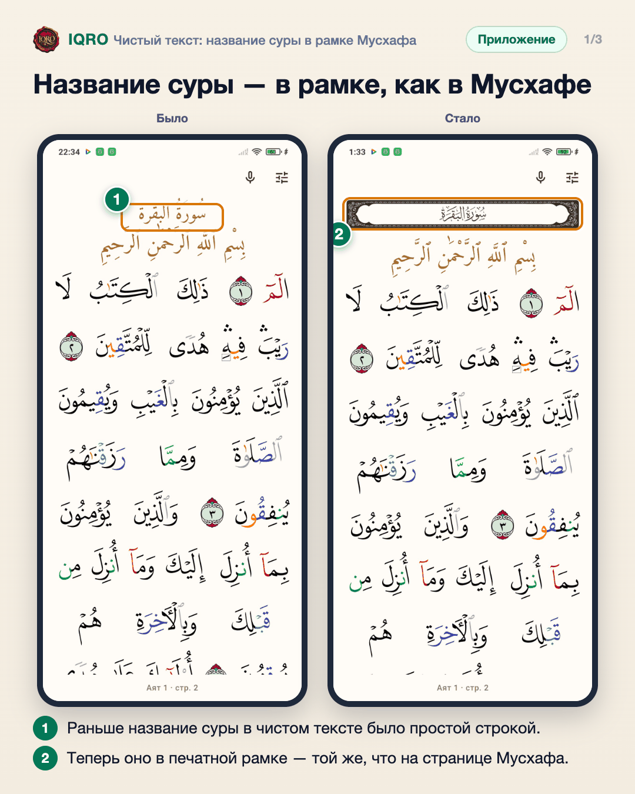
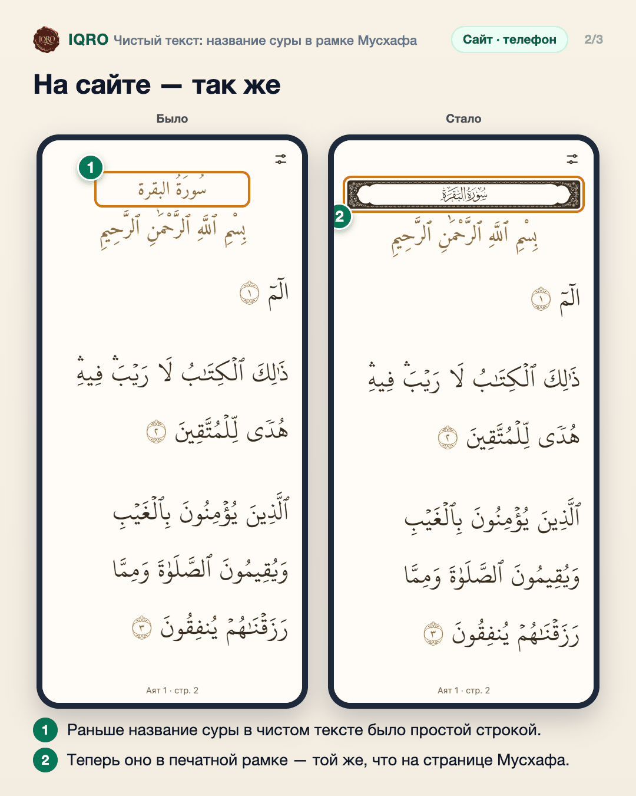
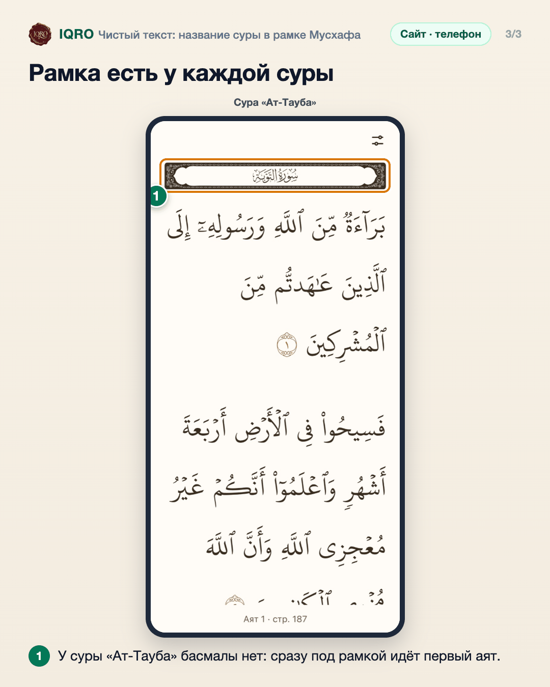

# Чистый текст: название суры в рамке Мусхафа

В чистом арабском тексте название суры теперь стоит в той же печатной рамке, что и на странице Мусхафа: узорная рамка с каллиграфическим названием. Раньше название было простой строкой.

**Где найти:** «Коран» → режим «Текст» → проведите пальцем по аяту вправо: откроется чистый арабский текст, рамка стоит в начале суры.

**Сайт и приложение:** рамка одинакова в приложении и на сайте с телефона или планшета. На сайте с компьютера чистого арабского текста нет (он открывается свайпом), там ничего не менялось.

## Название суры — в рамке, как в Мусхафе

В приложении откройте чистый арабский текст (свайп вправо по аяту): в начале суры её название стоит в узорной рамке, как в печатном Мусхафе. Басмала и текст под рамкой остались прежними. Рамка одинакова в светлой и тёмной теме.

## На сайте — так же

На сайте с телефона то же самое: в чистом арабском тексте название суры стоит в рамке Мусхафа.

## Рамка есть у каждой суры

Рамка стоит в начале каждой из 114 сур и помещается на узком экране. Она подстраивается под размер шрифта, который вы выбрали в чистом тексте.

---

Основа снимков: приложение — Redmi Note 7, «IQRO тест»: «было» — сборка 1.0.14 (15), «стало» — общая тестовая сборка 1.0.15 (16) с веткой claude/surah-frame-text-mode-0044bd, 25–26 ноября 2026 (яркость снимков выровнена: на телефоне был включён системный приглушённый экран); сайт — телефон 390×844 и 360×740, данные iqro.forum («было» — iqro.forum до правки, «стало» — та же ветка).
