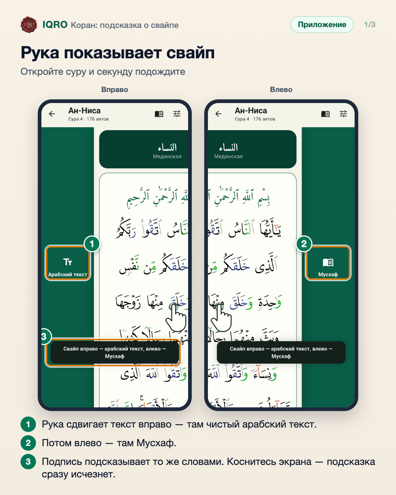
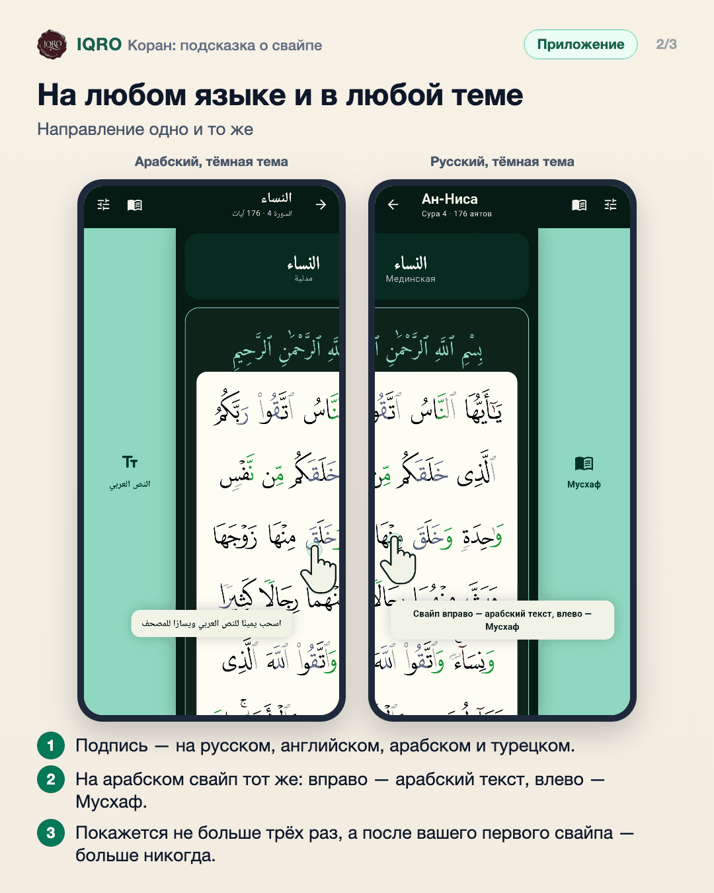
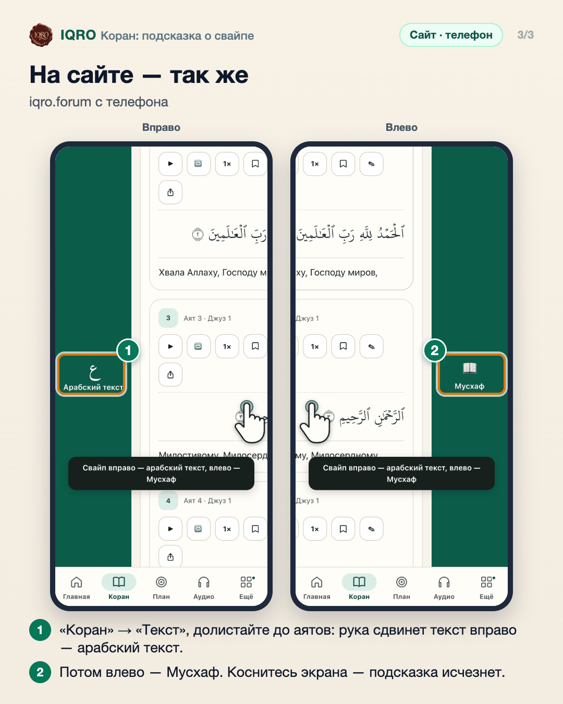

# Коран: подсказка о свайпе

В тексте Корана с переводом есть два свайпа: вправо — чистый арабский текст, влево — Мусхаф. Чтобы о них не нужно было догадываться, текст сам показывает жест: через секунду после открытия суры появляется рука, сдвигает текст вправо и влево и показывает, что там находится. Любое касание убирает подсказку. Она приходит не больше трёх раз, а после вашего первого свайпа — больше никогда.

**Где найти:** «Коран» → режим «Текст» → любая сура. Ничего включать не нужно: подсказка появится сама.

**Сайт и приложение:** работает одинаково в приложении и на сайте с телефона или планшета. На сайте подсказка появляется, когда вы долистали до самих аятов (над ними стоят настройки чтения). На сайте с компьютера свайпов и подсказки нет: там переключатель «Текст / Мусхаф».

## Рука показывает свайп

Откройте «Коран» → «Текст» → суру и секунду ничего не трогайте. Появится рука: она сдвинет текст вправо — выглянет полоса «Арабский текст», потом влево — полоса «Мусхаф», и вернёт текст на место. Так видно, что по тексту можно провести пальцем в обе стороны. Подсказка ничего не открывает и исчезает сама через несколько секунд или сразу, как только вы коснётесь экрана.

## На любом языке и в любой теме

Подсказка есть на всех четырёх языках приложения, в светлой и тёмной теме. На арабском, хотя экран зеркальный, направление свайпа остаётся прежним: вправо — арабский текст, влево — Мусхаф. Подсказка не надоедает: её видно не больше трёх раз, а как только вы сами свайпнете по тексту, она больше не появится. Если в телефоне включено «уменьшить движение», текст не двигается — рука и подпись просто стоят несколько секунд.

## На сайте — так же

На сайте с телефона или планшета подсказка такая же. Откройте «Коран», переключите на «Текст» и долистайте до аятов — рука покажет оба свайпа. С компьютера свайпов нет, поэтому и подсказки там нет: виды переключаются кнопками «Текст» и «Мусхаф».

## Для рилс и подробного рассказа

- `reels/` — кадры 9:16 (1080×1920) по порядку: обложка, по кадру на каждый экран с его шагами, финальный кадр.
- `screens/` — чистые экраны без отметок, в полном размере: из них можно делать свои анимации.
- `video/` — запись экрана телефона, без звука: как это выглядит вживую.

Заголовок для ролика: **Текст можно свайпнуть**. Текст за кадром — подписи к карточкам выше, по порядку.

---

Основа снимков: Redmi Note 7, сборка «IQRO тест» из ветки claude/swipe-hint, данные iqro.forum; сайт — телефон 390×844, сборка ветки, данные iqro.forum; 11 ноября 2026. Строка состояния телефона обрезана.
