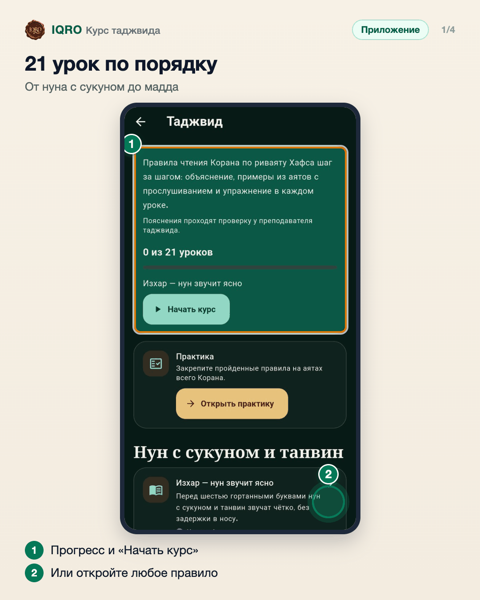
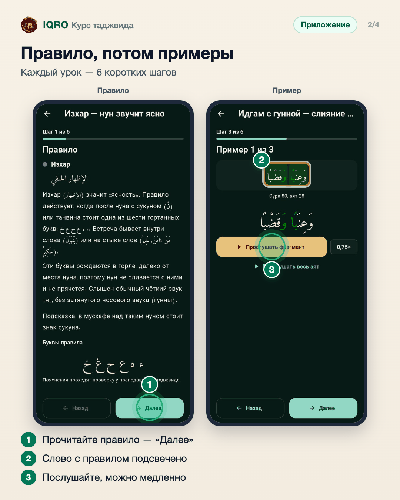
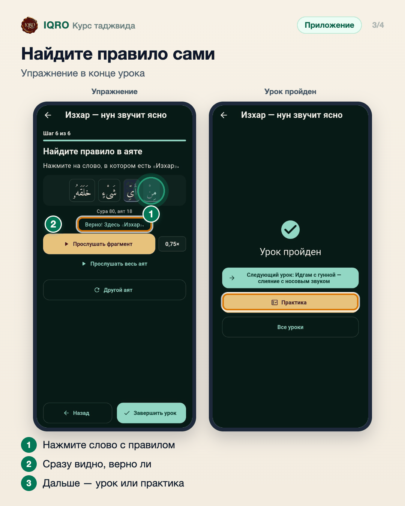
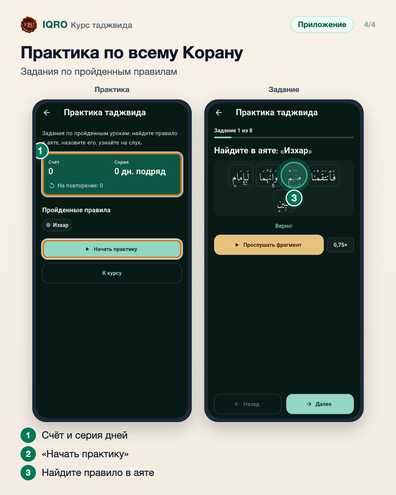

# Курс таджвида

Курс «Таджвид» — правила чтения Корана по риваяту Хафса, 21 урок по шагам. В каждом уроке: правило, как читать, примеры из аятов с прослушиванием и упражнение — найти правило в аяте. После уроков есть практика по всему Корану: задания по пройденным правилам, счёт и серия дней. Пояснения проходят проверку у преподавателя таджвида.

**Где найти:** главная → «Курсы» → «Таджвид».

**Сайт и приложение:** на сайте тот же курс: iqro.forum → «Курсы» → «Таджвид».

## 21 урок по порядку

Откройте «Курсы» → «Таджвид». Вверху — сколько уроков пройдено и кнопка, которая продолжит с того места, где вы остановились. Ниже — все правила по темам, любое можно открыть сразу.

## Правило, потом примеры

Сначала правило и как его читать. Потом три примера из аятов: слово с правилом подсвечено цветом, его можно прослушать — в том числе медленно, на скорости 0,75×.

## Найдите правило сами

В последнем шаге урока нажмите на слово, в котором есть правило. Приложение сразу скажет, верно ли, и даст послушать это место. Потом — «Завершить урок».

## Практика по всему Корану

В «Практике» задания строятся только по тем правилам, которые вы уже прошли: найти правило в аяте, назвать его, узнать на слух. Счёт и серия дней показывают, как часто вы занимаетесь.

## Для рилс и подробного рассказа

- `reels/` — кадры 9:16 (1080×1920) по порядку: обложка, по кадру на каждый экран с его шагами, финальный кадр.
- `screens/` — чистые экраны без отметок, в полном размере: из них можно делать свои анимации.
- `video/` — запись экрана телефона, без звука: как это выглядит вживую.

Заголовок для ролика: **Таджвид по шагам**. Текст за кадром — подписи к карточкам выше, по порядку.

---

Основа снимков: Redmi, сборка «IQRO тест» из main 9048ca87, 9 ноября 2026; строка состояния телефона обрезана.
