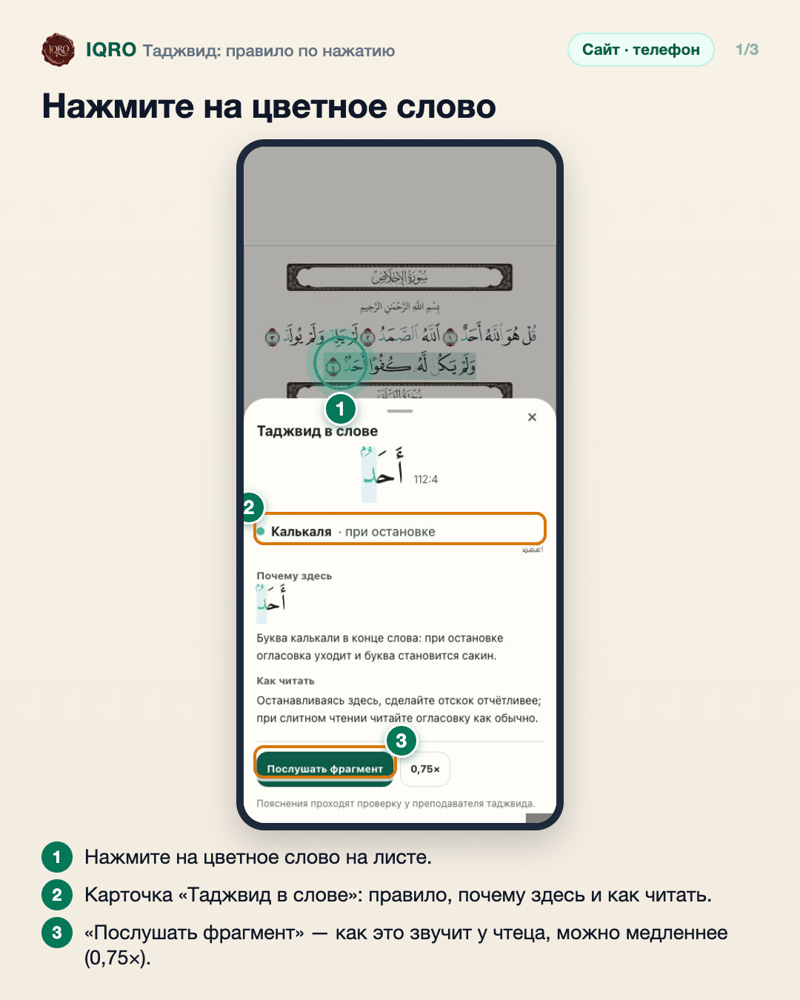
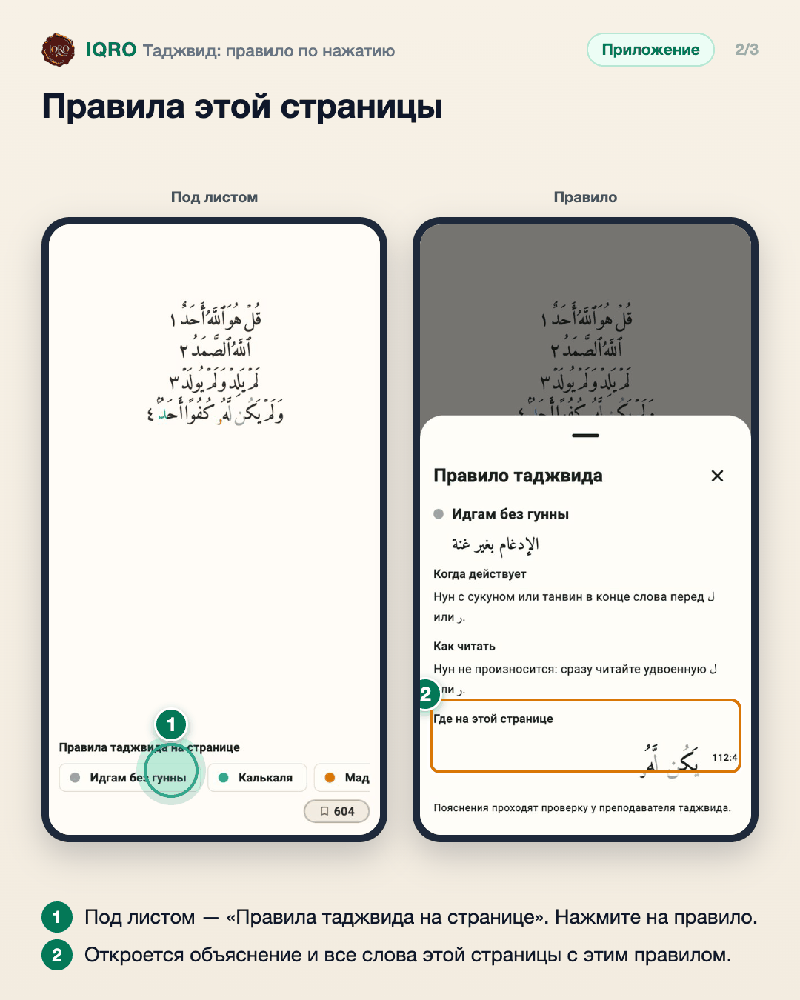
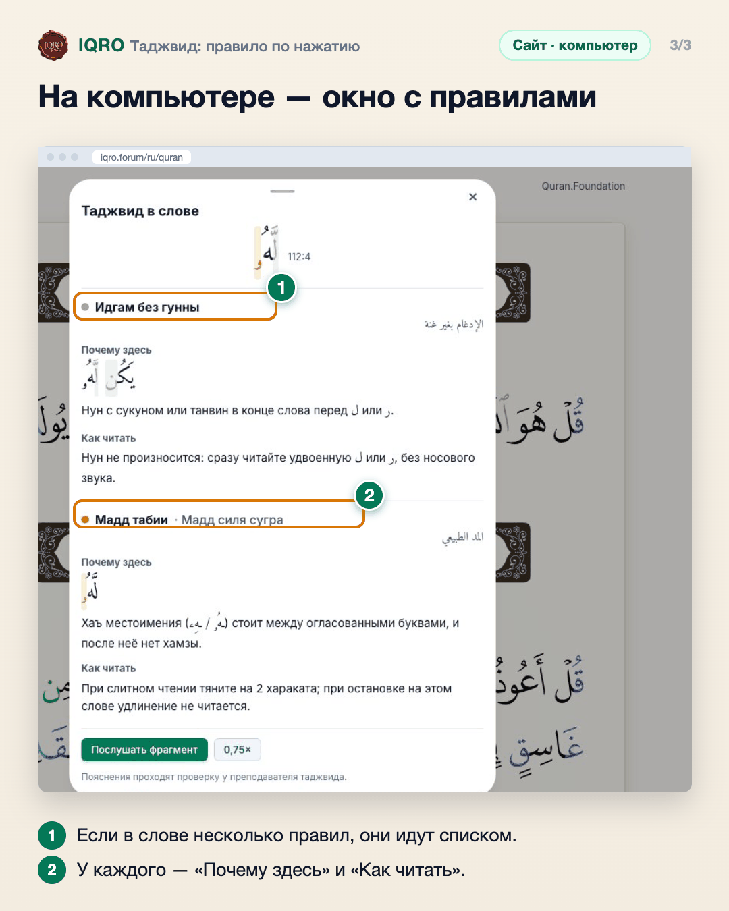

# Таджвид: правило по нажатию

В Мусхафе с цветным таджвидом можно нажать на любое цветное слово и узнать, какое это правило, почему оно здесь и как читать. Под листом — список правил этой страницы.

**Где найти:** «Коран» → режим «Мусхаф» с вариантом «QCF V4 Tajweed» (цветные буквы).

**Сайт и приложение:** одинаково на сайте и в приложении; на компьютере карточка открывается окном посреди экрана.

## Нажмите на цветное слово

Цвет букв подсказывает правило таджвида. Нажмите на цветное слово — снизу откроется карточка «Таджвид в слове»: название правила, почему оно действует именно здесь и как читать. Кнопка «Послушать фрагмент» проигрывает это место голосом чтеца.

## Правила этой страницы

Под листом собраны все правила таджвида, которые встречаются на странице. Нажмите на любое — откроется объяснение: когда действует, как читать и где на этой странице оно встречается.

## На компьютере — окно с правилами

В одном слове бывает несколько правил — карточка покажет все: здесь «Идгам без гунны» и «Мадд таби‘и». Пояснения проходят проверку у преподавателя таджвида.

---

Основа снимков: снимки сессии таджвида (октябрь 2026) из общей папки заметок.
