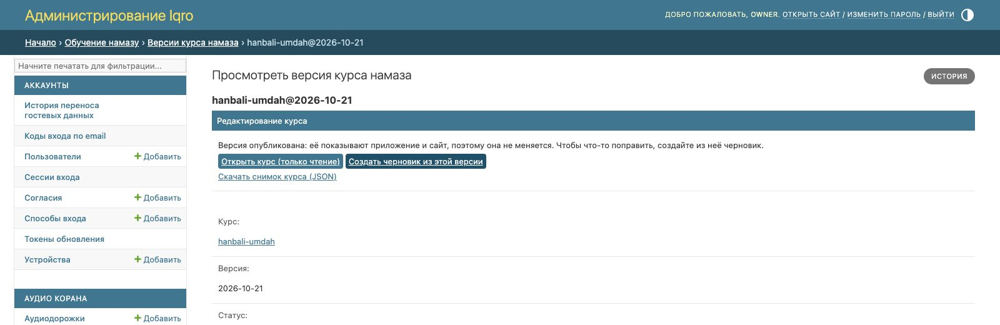
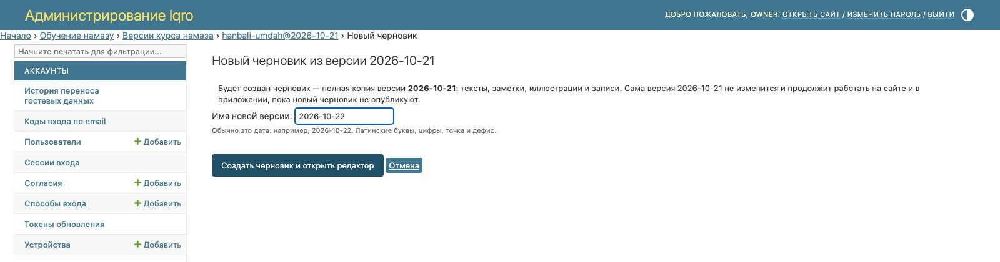
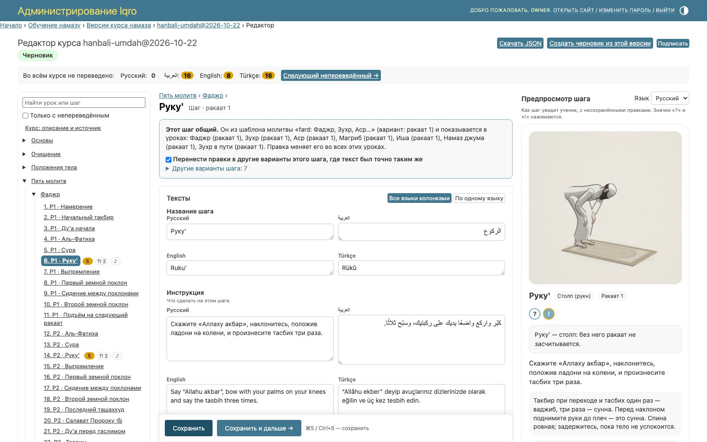
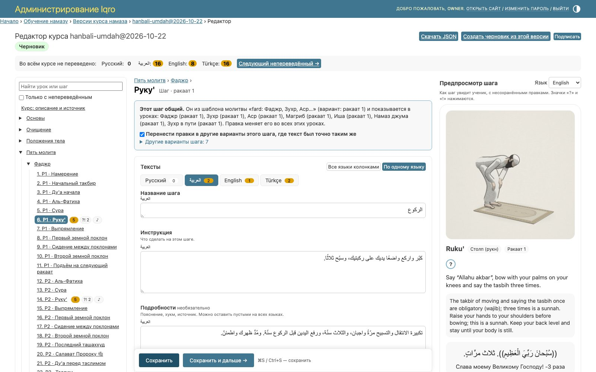
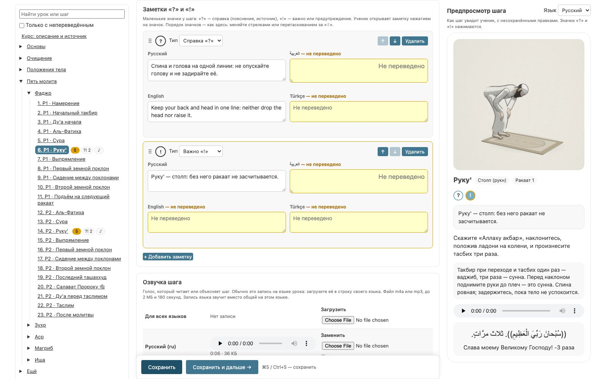
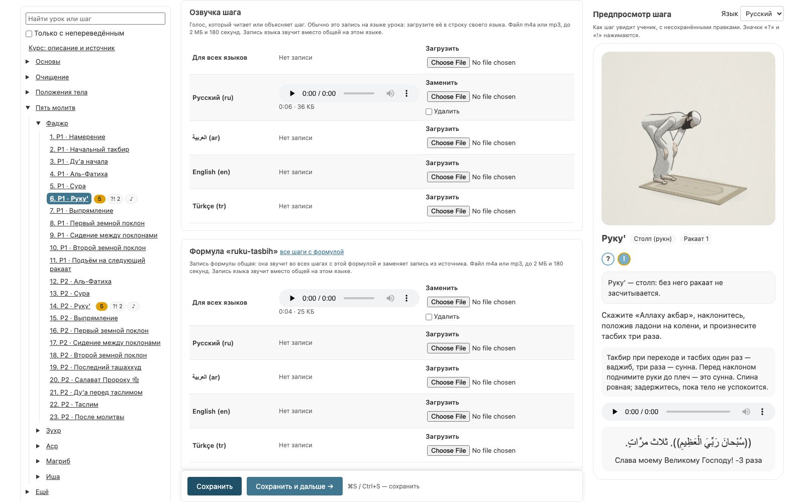
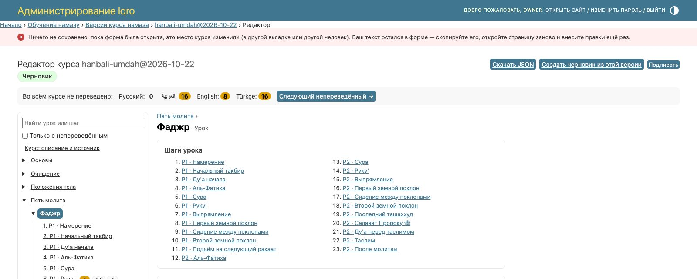
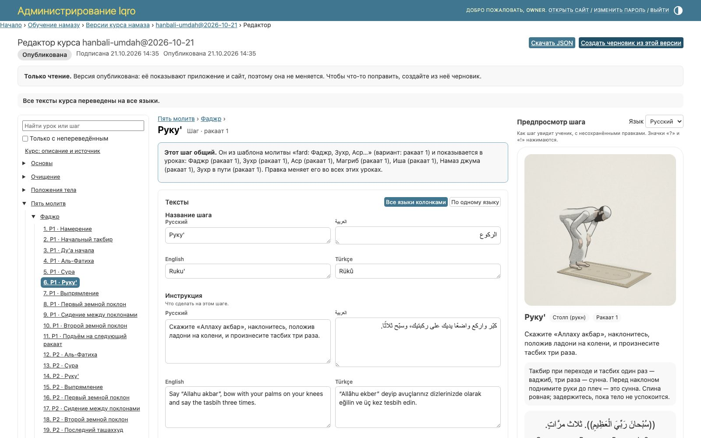

# Редактор курса «Обучение намазу» в админке

Владелец правит курс сам, без git и разработчика: тексты на всех языках проекта, заметки «?» и «!» у шагов, озвучку шагов и свои записи формул. Править можно только черновик. Цикл «черновик → подпись → публикация» и неизменность опубликованных версий сохраняются.

Код: `services/backend/src/quran_backend/modules/salah/editor.py` (чистые функции над снимком), `editor_admin.py` (страницы админки), шаблоны `templates/admin/salah/salahcourseversion/editor*.html`, скрипт и стили `static/salah/editor.{js,css}`. Тесты: `services/backend/tests/test_salah_editor.py`.

## Где он

«Обучение намазу» → «Версии курса» → версия. Вверху страницы версии — блок «Редактирование курса»:

- у неподписанного черновика — кнопка «Открыть редактор курса»;
- у подписанной, опубликованной или отозванной версии — причина, по которой она только читается, кнопки «Открыть курс (только чтение)» и «Создать черновик из этой версии»;
- у любой версии — «Скачать снимок курса (JSON)».

В списке версий есть колонка «Редактор».

## Новый черновик

«Создать черновик из этой версии» делает полную копию: тексты, заметки, иллюстрации и записи. Файлы в хранилище не копируются: объекты неизменяемы, поэтому черновик ссылается на те же. Исходная версия не меняется; опубликованная продолжает работать на сайте и в приложении, пока не опубликуют новую.

Имя версии по умолчанию — сегодняшняя дата (`2026-10-22`; если она занята — `2026-10-22-2`). Допустимы латинские буквы, цифры, точка и дефис.

## Устройство страницы

- **Слева — содержание курса**: курс → разделы → уроки → шаги. Оранжевое число у пункта — сколько текстов там не переведено; «?! 2» — заметки; «♪» — есть запись. Поиск по названию и флажок «Только с непереведённым».
- **Сверху — счётчик по языкам** «Во всём курсе не переведено» и кнопка «Следующий непереведённый →».
- **В центре — форма** выбранного места курса.
- **Справа — предпросмотр шага** так, как его увидит ученик, на выбранном языке и с ещё не сохранёнными правками. Значки «?» и «!» в предпросмотре нажимаются.

Языки берутся из `settings.LANGUAGES` бэкенда (сейчас ar, en, ru, tr), русский идёт первым. Новый язык в настройках сразу получает поля во всех формах и строку в счётчике.

### Тексты

| Место | Поля |
|---|---|
| Курс | источник курса (`source_title`) |
| Раздел | название |
| Урок | название, краткое описание |
| Шаг | название, инструкция, подробности (необязательно) |

«Все языки колонками» показывает языки рядом, «По одному языку» — вкладки языков со счётчиком «не переведено» на каждой. Пустой перевод подсвечен оранжевым и подписан «не переведено». Подробности можно оставить пустыми на всех языках; если же они есть хоть на одном, остальные считаются непереведёнными. Поле растёт вместе с текстом; у длинного текста виден счётчик знаков.

### Шаги молитв общие

Шаги молитв хранятся в шаблонах (`fard`, `nafl`, `eid`, `kusuf`, `janazah`): «Руку'» Фаджра и «Руку'» Зухра — один и тот же шаг шаблона. Редактор показывает урок так, как его проходит ученик («Р1 · Руку'», «Р2 · Руку'»), и над формой предупреждает: «Этот шаг общий» — со списком уроков и ракаатов, где он показывается.

Один шаг в шаблоне бывает в нескольких вариантах (например, в первом ракаате с подробностями, в остальных — без). Флажок «Перенести правки в другие варианты этого шага, где текст был точно таким же» (включён по умолчанию):

- текст поля переносится в вариант, только если там он совпадал с прежним на всех языках, — правка опечатки дойдёт везде, а различающийся текст не затрётся;
- заметки и записи переносятся только в варианты с теми же словами шага (название и инструкция).

После сохранения сообщение говорит, сколько вариантов изменилось.

### Заметки «?» и «!»

У шага — список заметок. У каждой тип «Справка «?»» или «Важно «!»» и текст на всех языках. Порядок значков у шага — порядок в списке: стрелки ↑ ↓ или перетаскивание за «⠿». «+ Добавить заметку» добавляет пустую; заметка, оставленная пустой на всех языках, не сохраняется. «Удалить» спрашивает подтверждение, если в заметке есть текст.

На сайте заметка открывается по значку у названия шага во всплывающей подсказке под ним, в приложении — в нижнем листе. Закрывается по Esc, по нажатию вне подсказки, кнопкой «Закрыть» и при переходе на другой шаг. В режиме «Практика» заметок нет, как и инструкции.

### Записи

На странице шага два вида записей:

- **Озвучка шага** — голос, который читает или объясняет шаг. Обычно она на языке урока: загружается в строку своего языка. Строка «Для всех языков» — общая запись; запись языка звучит вместо неё на этом языке.
- **Формулы шага** — своя запись формулы (например, такбира). Она общая: звучит во всех шагах с этой формулой и заменяет запись из «Хисн аль-Муслим» или Корана. То же доступно в разделе «Формулы: записи» дерева.

Файл: m4a или mp3, до 2 МБ и до 3 минут. Сервер не верит типу, присланному браузером: проверяет сигнатуру файла и читает его `ffprobe` (контейнер, наличие звука, длительность). Выбранный файл можно прослушать до сохранения; сохранённый — прямо в таблице, с длительностью и размером. «Заменить» загружает новый файл под новым ключом, «Удалить» убирает запись из черновика. Запись, на которую больше ничто не ссылается, удаляется из снимка и из черновика; объект в хранилище остаётся (он неизменяем и может принадлежать другой версии).

Записи хранятся в R2 тем же механизмом, что иллюстрации (`SalahMediaAsset`, ключ `salah/<курс>/<версия>/<key>-<sha256[:12]>.<ext>`).

## Сохранение без потери данных

- «Сохранить» записывает правки места в снимок черновика и сразу пересобирает документы курса по языкам. «Сохранить и дальше →» переходит к следующему месту дерева. ⌘S / Ctrl+S — сохранить.
- Непереведённое сохраняется: черновик можно переводить постепенно. Подписать его нельзя, пока что-то не переведено.
- Ошибки (слишком длинный текст, тип заметки, плохой файл записи) показываются у поля, ничего не сохраняется, а набранный текст остаётся в форме. Файлы записей после ошибки нужно выбрать заново — браузер их не сохраняет.
- Если это место курса изменили в другой вкладке или другой человек, пока форма была открыта, сохранение отказывает и оставляет набранный текст в форме — ничего не перезаписывается.
- Уход со страницы с несохранёнными правками браузер переспрашивает; внизу видно «Есть несохранённые правки».

## Подпись и публикация

Кнопки в шапке редактора:

- «Подписать» — у неподписанного черновика. Сначала проверяется, что всё переведено (иначе — счётчик по языкам), затем весь снимок (`validate_snapshot`: ссылки на формулы, медиа и записи, типы заметок). Подпись закрепляет текст: подписанный черновик только читается.
- «Опубликовать» — у подписанного черновика. Предыдущая версия отзывается, документы собираются с отметкой публикации, сайт получает событие ревалидации.

Действия «Подписать» и «Опубликовать» в списке версий работают так же, с теми же проверками.

## Права

| Право | Что даёт |
|---|---|
| `salah.view_salahcourseversion` | открыть редактор и скачать JSON (только чтение) |
| `salah.change_salahcourseversion` | править неподписанный черновик, подписать, опубликовать |
| `salah.add_salahcourseversion` | «Создать черновик из этой версии» |

## Снимок в git

Правки из админки живут в базе. Чтобы снимок в репозитории (`salah/data/hanbali-umdah-v1.json`) не отставал, «Скачать JSON» и закоммитить файл: формат тот же. Записи, загруженные в админке, указаны в `media[]` с путём `media/<key>.<ext>`, которого в git нет, — импорт такие файлы пропускает, а в базе они уже есть.
