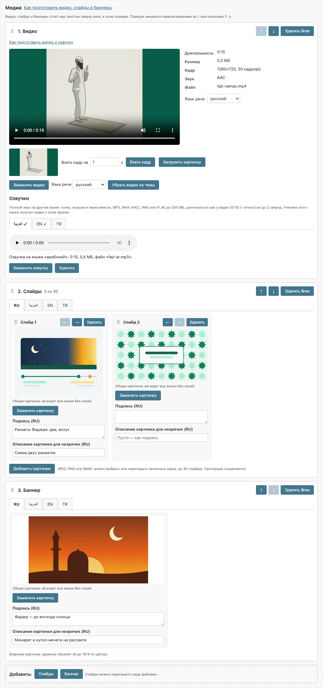
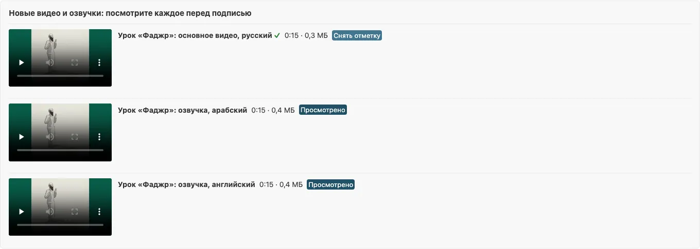
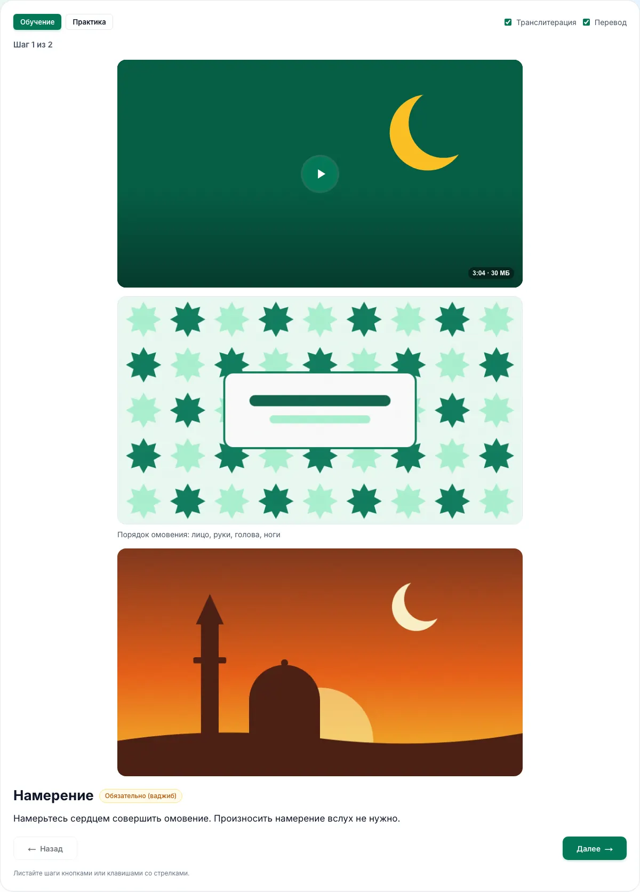
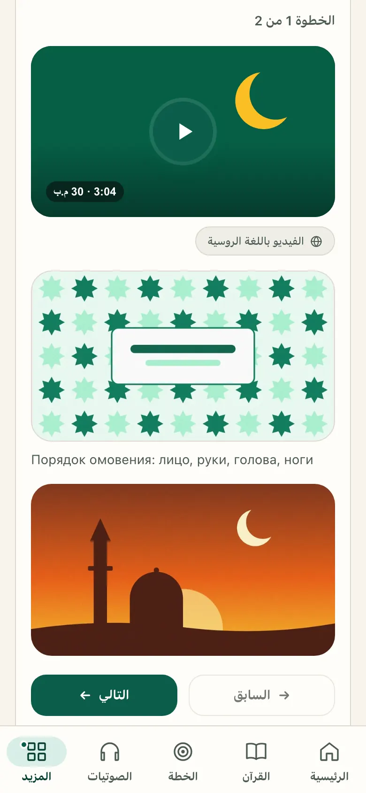
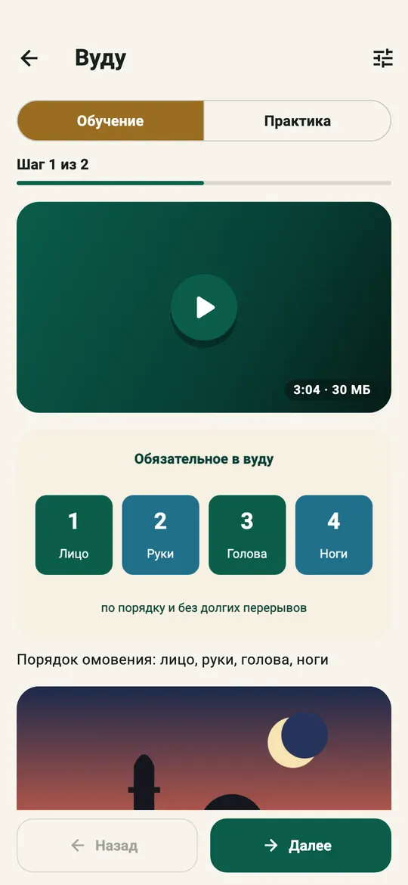
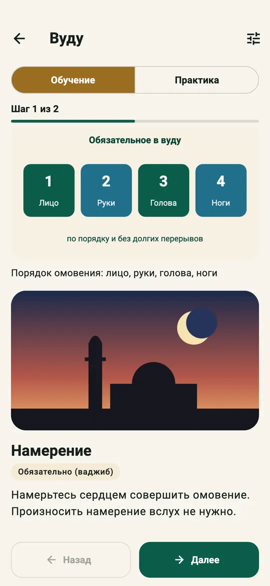

# Медиа уроков курса «Обучение намазу»

Владелец добавляет к урокам курса намаза видео, слайды и баннер так же, как к урокам таджвида
([docs/tajweed/course.md](../tajweed/course.md), «Медиа уроков») и к темам тематических курсов
([docs/courses/README.md](../courses/README.md), «Видео и озвучки» и «Медиа темы»).

## К чему крепится медиа: к уроку

В курсе намаза три уровня: раздел → урок → шаг.

| Уровень | Почему не он / почему он |
|---|---|
| Раздел | Только заголовок и список уроков; своей страницы у раздела нет ни на сайте, ни в приложении. |
| Шаг | У шага уже есть квадратная иллюстрация (кадр 3D-сцены), озвучка и формулы, а экран шага — одна поза. Шаги молитв общие для всех молитв с тем же шаблоном: видео «Руку'» попало бы во все ракааты и молитвы. Видео на 5 минут на экране одной позы не к месту. |
| **Урок** | Своя страница на сайте (`/salah/<урок>`) и свой экран в приложении; урок — то же, что урок таджвида и тема тематического курса. Урок-молитва (Фаджр, Зухр…) — отдельный объект снимка, хотя шаги берёт из шаблона: медиа Фаджра не попадают в Зухр. |

Решение: медиа принадлежат **уроку конкретной версии** — у урока-статьи, урока по шагам и урока-молитвы.
У урока одно видео (с озвучками по языкам), сколько угодно блоков слайдов и баннеров, всего до
10 блоков, в порядке автора.

## Снимок версии

Блоки хранятся в снимке черновика, в `lessons[].media` — в том же виде, что у уроков таджвида:

```text
lessons[].media? = [
  {"id": "video", "type": "video",
   "video"?: {sha256, object_key, bytes, duration_ms, width, height, fps, spoken_language,
              original_name,
              poster: {object_key, small_object_key, width, height},
              dubs: {"<язык>": {sha256, object_key, bytes, duration_ms, audio_original_name, …}}}},
  {"id": "<12 hex>", "type": "slides" | "banner",
   "slides": [{"id", "image": Pic, "images": {"<язык>": Pic}, "caption": {"<язык>": str},
               "alt": {"<язык>": str}}]}
]
Pic = {object_key, small_object_key, width, height, sha256}
```

- Без медиа ключа `media` у урока нет: снимки и контрольные суммы прежних версий не меняются,
  `schema_version` снимка остаётся `1`.
- Блок видео без `video` — место для видео, ещё не загруженного; ученики его не видят.
- Файлы лежат в R2 под неизменяемыми ключами тематических курсов (`courses/videos/…`,
  `courses/posters/…`, `courses/slides/…`, `courses/banners/…`) и не удаляются: удалённый из черновика
  файл может принадлежать опубликованной версии. Таблица `SalahMediaAsset` для них не нужна: всё,
  что знает о файле документ, лежит в снимке.
- «Создать черновик из этой версии» копирует снимок целиком, а с ним и медиа: видео, озвучки, слайды,
  баннеры, подписи. Опубликованная, отозванная и подписанная версии только читаются.
- «Скачать JSON» выгружает снимок с медиа; импорт из git принимает их как есть (файлы уже в R2).
- Проверка снимка (`validate_snapshot`, и при каждом сохранении черновика): `media` — список до
  10 блоков `video`, `slides`, `banner`, видео не больше одного, у слайдов и баннера — список `slides`.

## Документ курса

`GET /api/v1/salah/courses/{slug}?language=…` — у урока необязательное поле `media`:

```text
lessons[].media? = [
  {"type": "video",  "video": Video},
  {"type": "slides", "slides": Slide[]},
  {"type": "banner", "image": Image, "caption": string, "alt": string, "dir": "ltr" | "rtl"}
]
Video  = {url, bytes, duration_ms, width, height, spoken_language,
          poster: {url, small_url, width, height}}
Image  = {url, small_url, width, height}
Slide  = {image: Image, caption: string, alt: string, dir: "ltr" | "rtl"}
```

- Формат блоков тот же, что у тематических курсов и таджвида
  ([docs/courses/README.md](../courses/README.md), «Медиа темы»).
- Видео в уроке одно. Сервер уже выбрал файл для языка документа так же, как в тематических курсах:
  озвучку этого языка, если она есть (тогда `spoken_language` — язык документа), иначе основное
  видео с его `spoken_language` (`""` — без речи). Картинки слайдов — своя картинка языка, если автор
  её загрузил, иначе общая; `alt` без текста автора — подпись.
- Урок без медиа поля не имеет (как `notes` и `audio` у шага), клиент считает `[]`.
  `schema_version` документа остаётся `1`: прежние клиенты поле не видят.
- Медиа урока не входят в `media` документа: там только квадратные картинки шагов.

## Админка

Редактор версии → урок. Под формой урока — блок «Медиа», общий с таджвидом и тематическими курсами
(`courses/lesson_media_admin.py`, шаблон `admin/lesson_media/media.html`):

- добавить, упорядочить (⠿ или ↑ ↓) и удалить видео, слайды и баннер;
- видео: загрузить файл (проверка `ffprobe`, переупаковка без пережатия, обложка), выбрать язык речи
  и обложку, загрузить озвучки других языков — сервер склеивает картинку видео с озвучкой;
- слайды и баннер: подпись и описание (alt) на каждом языке, своя картинка языка для картинки с текстом.



Медиа меняются только в неподписанном черновике. Каждое изменение сразу записывается в снимок,
проверяется целиком и пересобирает документы, как сохранение текста. Форма текстов урока и кнопки
структуры курса не считают изменение медиа чужой правкой: их ревизия медиа не учитывает.

## Подпись

Версия курса намаза подписывается владельцем (религиозная проверка), поэтому новые видео и
озвучки отмечаются, как у таджвида:

- вверху редактора черновика — список «Новые видео и озвучки»: файлы, которых ученики не получали
  с опубликованной версией (по sha256 файла, который получит ученик на каждом языке), с плеером и
  кнопкой «Просмотрено»;
- «Подписать» (в редакторе и действием в списке версий) отказывает, пока не отмечен каждый новый файл;
- отметки хранятся у версии (`SalahCourseVersion.watched_videos`); слайды и баннеры отмечать не нужно,
  они видны в редакторе урока.



## Клиенты

Сайт и приложение рисуют медиа урока теми же компонентами, что тематические курсы и таджвид:
сайт — `components/courses/LessonMedia.tsx`, приложение — `LessonMediaView` и `LessonVideo`
(`lib/features/courses`).

- Медиа стоят на **первом шаге урока**, над его картинкой и текстом — как у таджвида на первом шаге.
  Шаги, их номера и прогресс не меняются: отдельного шага для медиа нет.
- В режиме «Практика» медиа нет, как и инструкции шага.
- Уход с первого шага (и с урока) ставит видео на паузу. Место в видео запоминается под
  `courses.position.<курс>` по уроку, как в тематических курсах.
- Приложение кэширует картинки слайдов и баннеров для офлайна вместе с документом курса
  (`LessonMediaPrefetcher`, как у таджвида и тематических курсов). Видео — только онлайн.

| Сайт, компьютер | Сайт, телефон (ar) | Приложение |
|---|---|---|
|  |  |   |
