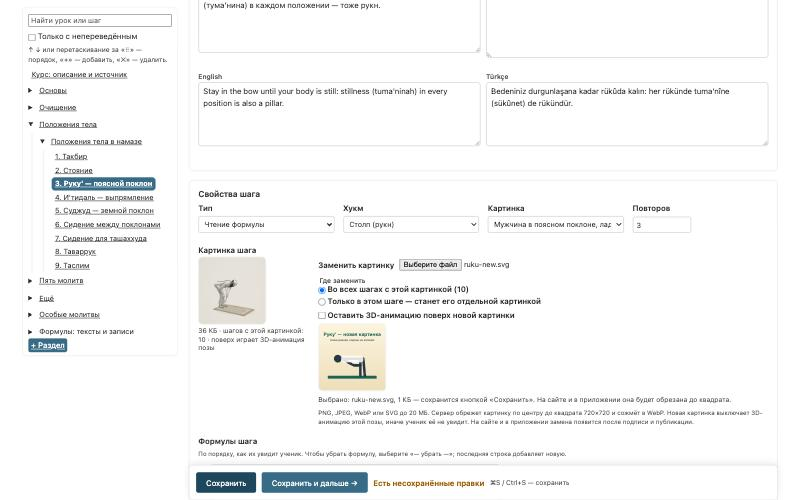
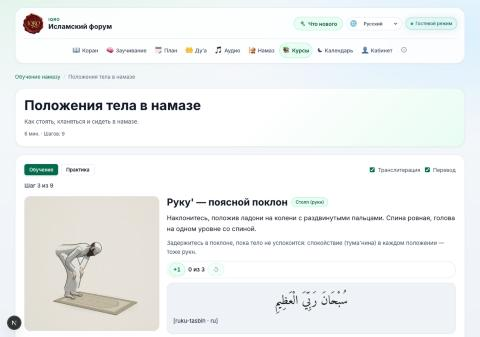
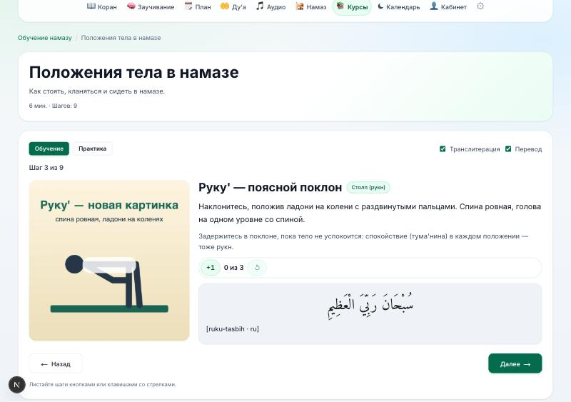

# Как заменить картинку позы в курсе «Обучение намазу»

Картинки поз (такбир, стояние, руку', суджуд и другие) хранятся в данных курса, а не в приложении. После публикации новая картинка появляется на сайте и в приложении сама, обновлять приложение не нужно.

## Коротко

1. Админка → «Версии курса намаза» → опубликованная версия → **«Создать черновик из этой версии»**. Имя — дата, например `2026-10-28`.
2. В редакторе черновика слева откройте шаг с нужной позой, например «Положения тела» → «Руку' — поясной поклон».
3. Блок **«Свойства шага» → «Картинка шага»**: там видна текущая картинка и сколько шагов её показывают.
4. **«Заменить картинку»** → выберите файл PNG, JPEG, WebP или SVG (до 20 МБ). Новая картинка сразу видна в блоке и в предпросмотре справа.
5. Где заменить:
   - **«Во всех шагах с этой картинкой»** — обычный выбор: поза поменяется везде, во всех молитвах;
   - **«Только в этом шаге»** — если другая картинка нужна одному шагу.
6. Нажмите **«Сохранить»**. Сервер сам обрежет картинку по центру до квадрата и сожмёт её.
7. Проверьте остальные правки и нажмите **«Подписать»**, затем **«Опубликовать»**. Через несколько минут новая картинка будет на сайте и в приложении.

## Про 3D-анимацию

У восьми поз поверх картинки на сайте и в приложении играет схематичная 3D-анимация. Когда вы загружаете свою картинку, анимация этой позы выключается, иначе ученики увидят анимацию, а не вашу картинку. Остальные позы анимацию сохраняют.

Отметку **«Оставить 3D-анимацию поверх новой картинки»** ставьте только для нового кадра самой анимации.

| До замены: 3D-анимация | После публикации: новая картинка |
| --- | --- |
|  |  |

## Если что-то не так

- **Нет кнопки «Заменить картинку».** Версия опубликована или уже подписана, а такие версии не меняются. Создайте новый черновик (шаг 1).
- **«Файл не похож на картинку».** Сохраните картинку заново как PNG и загрузите ещё раз.
- **«SVG не удалось нарисовать».** Откройте SVG в редакторе и сохраните его как PNG.
- **На сайте старая картинка.** Нужно, чтобы черновик был подписан и опубликован. Опубликованная версия показывается в течение нескольких минут; обновите страницу.
- **Все картинки сразу.** Страница версии → «Иллюстрации» → «Открыть иллюстрации». Там таблица всех картинок курса с той же загрузкой.

Подробнее о редакторе — [admin-editor.md](admin-editor.md), раздел «Картинка шага».
