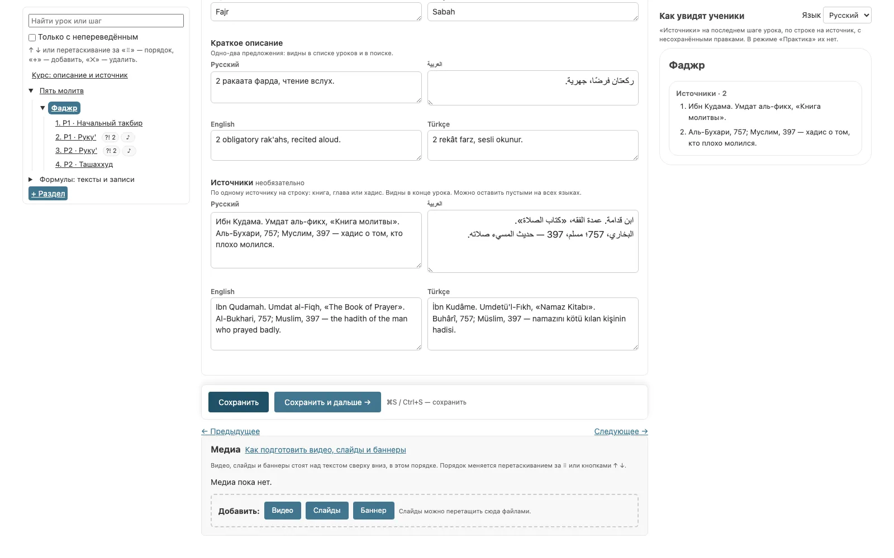
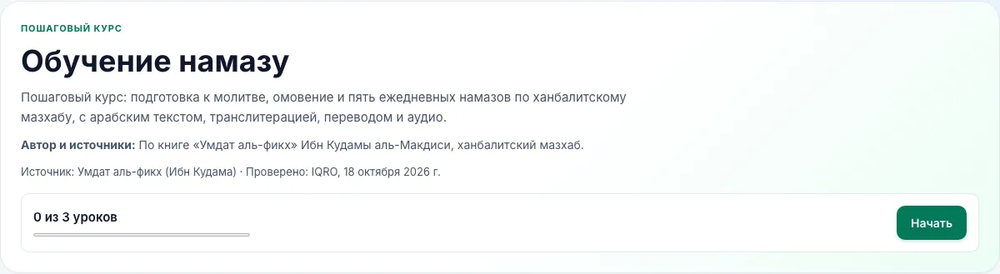
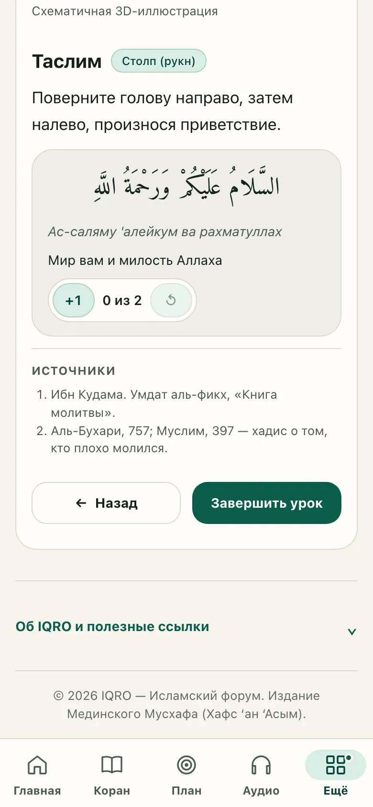
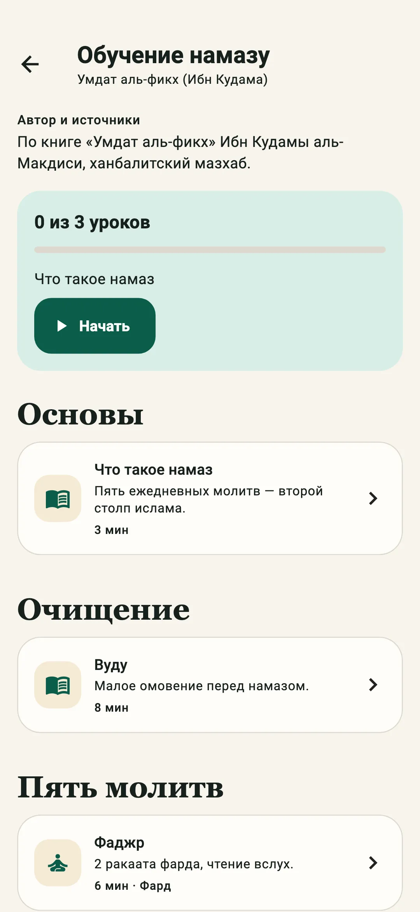
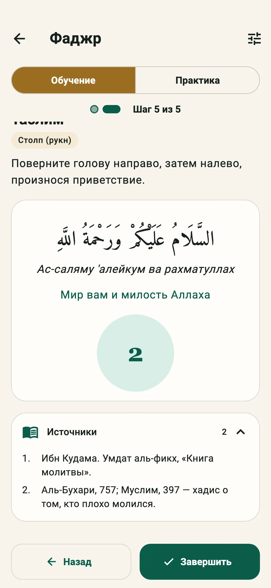

# Источники курса «Обучение намазу»

Ученик видит, на что опирается курс, так же, как в тематических курсах
([docs/courses/README.md](../courses/README.md)):

- у курса — блок «Автор и источники»;
- у урока — список «Источники» в конце урока.

То же устроено в курсе «Таджвид» ([docs/tajweed/course.md](../tajweed/course.md), «Источники»).

## Почему у урока, а не у раздела

Источники крепятся к уроку. У урока есть своя страница, и ученик читает его от начала до конца,
как тему тематического курса. У раздела страницы нет: это только заголовок над списком уроков на
главной курса.

`course.source_title` («Умдат аль-фикх (Ибн Кудама)») и `course.methodology` остаются как были.
Это название книги в строке «Источник» под заголовком курса. «Автор и источники» — отдельный
свободный текст: кто составил курс, по каким книгам и изданиям, кто проверял.

## Снимок версии

Оба поля необязательные и лежат в снимке черновика (`SalahCourseVersion.snapshot`):

```text
course.source?      = {ru: string, en: string, ar: string, tr: string}   // до 300 знаков
lessons[].sources?  = {ru: string, en: string, ar: string, tr: string}   // до 2000 знаков, источник на строку
```

- Пустое на всех языках поле в снимок не пишется: снимки, собранные раньше, остаются валидными
  без изменений.
- «Создать черновик из этой версии» копирует снимок целиком, вместе с источниками.
- Порядок строк — порядок, в котором ученик видит источники. Пустые строки пропускаются.

## Подпись

Источники не обязательны для подписи, как в тематических курсах (решение владельца, 25.10.2026;
то же для таджвида). Правило то же, что у подписи источника формулы:

- поле, пустое на всех языках, подписи не мешает;
- если поле заполнено хотя бы на одном языке, остальные языки считаются непереведёнными:
  они видны в счётчике «не переведено», и подпись ждёт перевода.

## Документ курса

`GET /api/v1/salah/courses/{slug}?language=…`:

```text
course.source?     = string     // «Автор и источники» на языке документа
lessons[].sources? = string[]   // по источнику на элемент, по порядку
```

- Пустого поля в документе нет, как `media` у урока и `notes` у шага. Клиент считает `""` и `[]`
  и тогда блок не показывает.
- `schema_version` остаётся `1`: прежние клиенты поля не видят. Документы опубликованных версий,
  собранные раньше, полей не имеют и остаются валидными.

## Админка

Редактор черновика ([admin-editor.md](admin-editor.md)):

- «Курс» — поле «Автор и источники» на всех языках;
- урок — поле «Источники» на всех языках, по источнику на строку.

Справа — «Как увидят ученики»: блок «Автор и источники» главной курса и список «Источники» конца
урока, на выбранном языке и с ещё не сохранёнными правками.

## Клиенты

Сайт и приложение показывают одно и то же тем же компонентом, что и тематические курсы:

- главная курса — «Автор и источники» под описанием, если `course.source` не пустой;
- урок — «Источники» на последнем шаге, под его содержимым, если `lessons[].sources` не пустой.
  Нумерованный список, по строке на источник. В режиме «Практика» блока нет, как и инструкции.

Сайт: `components/courses/CourseSources.tsx`. Приложение: `lib/features/courses/course_sources.dart`.

## Скриншоты

Редактор черновика: урок и «Как увидят ученики».



Сайт: главная курса и последний шаг урока на телефоне.




Приложение: главная курса и последний шаг урока.



