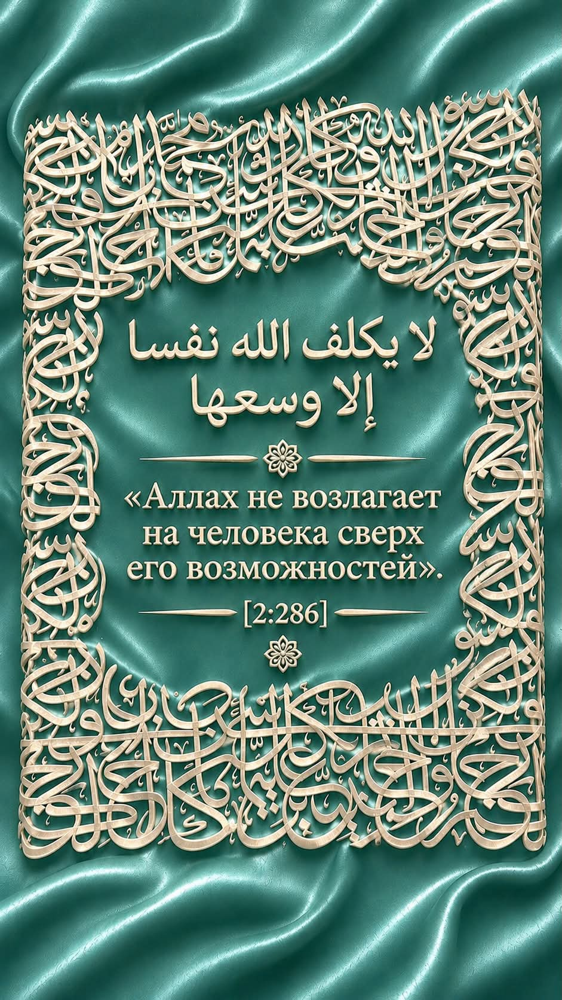
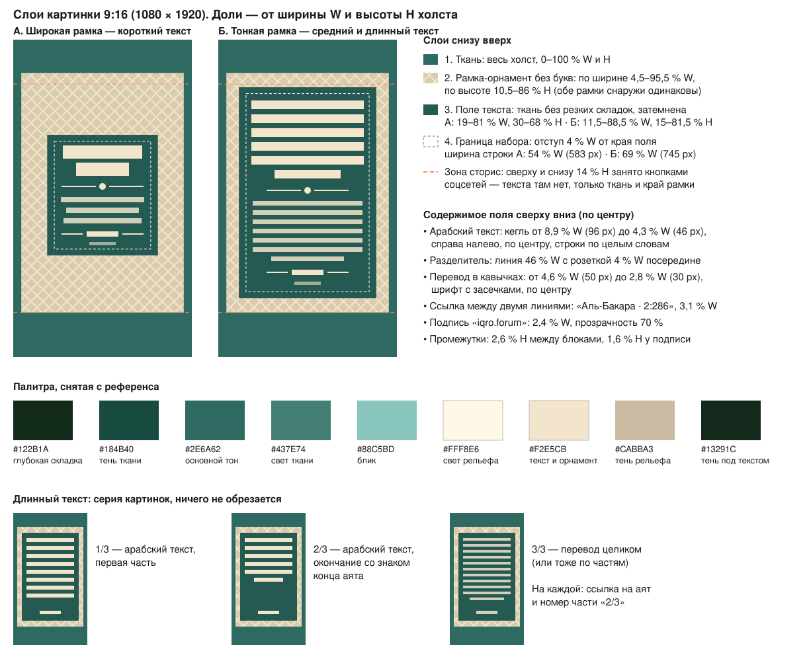

# Картинка «Поделиться» в стиле референса: техническое задание

Дата: 17 ноября 2026. Состояние: решения владельца приняты (раздел 11), ждём заготовки. Кода в этой работе нет — только документ.

Запрос владельца: «когда мы делимся аятом или ду‘а, картинка была в стиле как в референсе: рамка, шрифт текста и так далее».

| Референс | Схема новой картинки |
| --- | --- |
|  |  |

## Коротко для владельца

**Что получится.** Вертикальная картинка для сторис: бирюзовый шёлк, рельефная рамка цвета слоновой кости, в центре — аят или ду‘а арабским текстом, под ним линия с розеткой, перевод в кавычках шрифтом с засечками, ниже ссылка на аят. Одинаково в приложении и на сайте.

**Три вещи, в которых я отступаю от референса, и почему.**

1. **Рамка — без букв.** Вязь на референсе только похожа на арабское письмо: нейросеть нарисовала завитки в форме букв, но слов там нет, это бессмыслица. Человек, читающий по-арабски, увидит это сразу. Ставить бессмысленное «письмо» вокруг аята Корана нельзя: оно выглядит как искажённый текст рядом со Словом Аллаха. Предлагаю рамку той же фактуры (объёмная, слоновая кость на шёлке), но из растительного и геометрического узора — без единой буквы. Настоящая каллиграфия осмысленного текста возможна, но её должен написать каллиграф, нейросеть этого не умеет (подробности — в разделе 3.1).
2. **Арабский текст — как в Мусхафе.** На референсе аят набран обычным шрифтом и без огласовок. У нас аят будет в письме Мусхафа, с огласовками и знаком конца аята, ровно как в источнике.
3. **Длинный текст не обрезается.** Сегодня длинный перевод на картинке обрывается многоточием. В новой картинке текст сначала уменьшается, а если не помещается и так — делится на несколько картинок с пометкой «1/3, 2/3, 3/3». Текст Корана не обрывается никогда.

**Что нужно от вас.**

- Решения по вопросам уже приняты — они записаны в [разделе 11](#11-решения-владельца).
- Сгенерировать 3 картинки-заготовки (шёлк с рамкой и пустым центром) по готовым подсказкам из [раздела 10.3](#103-подсказки-для-генерации). Остальные цвета ткани я получу из них сам, программно.

**Сколько работы.** Около 8–9 рабочих дней после ваших ответов и заготовок: приложение, сайт, проверка на телефонах, картинки-инструкции. Сборка приложения вырастет примерно на 2,5 МБ (с 64 до 66–67 МБ). Всё работает без интернета.

---

## 1. Как сейчас

### 1.1. Где кнопка

| Что | Приложение | Сайт |
| --- | --- | --- |
| Аят | меню аята → «Поделиться аятом» (`ayah_action_sheet.dart`, `reader_screen.dart`) | под листом Мусхафа рядом с номером аята, в текстовом режиме — у каждого аята (`QuranPage.tsx` → `AyahShareDialog.tsx`) |
| Ду‘а | значок «Поделиться» под каждым ду‘а (`dua_screen.dart`) | тот же значок (`useDuaActions.tsx` → `ContentShareDialog.tsx`) |
| Что происходит | сразу открывается системное окно «Поделиться» с картинкой и текстом, без предпросмотра | окно с предпросмотром и кнопками «Скопировать ссылку», «Скачать картинку», «Поделиться» |

Делиться можно только одним аятом; нескольких аятов подряд сейчас нет.

### 1.2. Чем рисуется

| | Приложение | Сайт |
| --- | --- | --- |
| Файл | `clients/iqro_mobile/lib/core/share/content_share.dart` (`ShareCard`, `renderShareCard`) | `services/web/lib/share-card.ts` (`renderShareCard`, `drawCard`) |
| Техника | виджет Flutter рисуется за экраном и снимается в картинку | рисование на `<canvas>` в браузере |
| Размер | 540×675 логических точек, плотность ×2 → **1080×1350 (4:5)** | то же |
| Формат | PNG | PNG |
| Сервер | не участвует, работает офлайн | не участвует |
| Отправка | `share_plus`: файл `iqro.png` + текст сообщения | Web Share с файлом, либо скачивание |

Сайт — построчный перенос карточки приложения: те же числа и цвета, записанные дважды.

### 1.3. Что на картинке

Тёмно-зелёный градиент (`#0B4A3C` → `#062A22`), тонкая золотая рамка (`#E2B665`), сверху сургучная печать IQRO и заголовок, в центре арабский текст, ниже перевод, источник, золотая линия и «www.iqro.forum».

| Данные | Аят | Ду‘а |
| --- | --- | --- |
| Заголовок | «Аль-Бакара · 2:255» | «Название главы · #75» |
| Арабский текст | слова в цветном шрифте таджвида (Мусхаф QF 19, QCF V4) на светлой «бумаге» `#FFFCF7`; запасной вариант — Amiri Quran цветом слоновой кости | Amiri Quran (сайт — Amiri), с огласовками |
| Перевод | выбранный перевод, не более 6 строк, дальше «…» | смысл на языке интерфейса, не более 6 строк |
| Источник | нет (имя переводчика убрано, PR #184) | источники ду‘а мелкой строкой, до 2 строк |
| Транслитерация | нет | нет |
| Подпись | печать 44 pt вверху, «www.iqro.forum» внизу | то же |
| QR | нет | нет |
| Только в тексте сообщения | ссылка «Читать в IQRO: …» | число повторений, ссылка |

Языки: ru, en, tr, ar (перевод и заголовок на языке интерфейса; при арабском интерфейсе у ду‘а смысла нет). Тёмная и светлая тема на картинку не влияют: она всегда одна.

Нынешние картинки: [аят 2:255 из приложения](../images/ayah-share-tajweed-2026-11-03/5-app-after-2-255.jpg), [с сайта](../images/ayah-share-tajweed-2026-11-03/2-web-after-2-255.jpg), [короткий аят 112:1](../images/ayah-share-tajweed-2026-11-03/3-web-after-112-1.jpg), [запасной вид без шрифта Мусхафа](../images/ayah-share-tajweed-2026-11-03/6-app-fallback-2-255.jpg), [окно ду‘а на сайте](../guides/dua-share/src/dialog-phone.jpg), [сайт и приложение рядом](../guides/ayah-share/3-result.png).

### 1.4. Что в нынешней картинке не так (выяснилось при разборе)

- Аят всегда рисуется шрифтом таджвида (Мусхаф 19), а не выбранным Мусхафом, как в читалках после PR #239.
- Перевод длиннее 6 строк обрывается многоточием (видно на 2:255).
- В запасном режиме (шрифт Мусхафа не загрузился) и у длинных ду‘а арабский текст может быть обрезан: в приложении стоит предел 14 строк с многоточием, на сайте — после уменьшения до 14 px.
- Формат 4:5 в сторис даёт поля сверху и снизу.

Новая картинка закрывает все четыре пункта; отдельно их чинить не нужно.

### 1.5. Тесты сейчас

Приложение: `test/core/content_share_test.dart` (карточка рисуется в PNG), `test/features/ayah_share_test.dart`. Сайт: `lib/share-card.test.ts` (переносы строк, заголовок). Сравнения картинок с эталоном нет.

---

## 2. Целевой вид

Основной холст — **1080×1920 (9:16)**. Все размеры ниже — доли ширины W и высоты H, чтобы те же правила годились для других форматов. В скобках — пиксели для 1080×1920. Замеры сняты с референса (941×1672).

### 2.1. Слои снизу вверх

| № | Слой | Положение | Чем сделан |
| --- | --- | --- | --- |
| 1 | Ткань | весь холст | готовая картинка-заготовка |
| 2 | Рамка-орнамент без букв | 4,5–95,5 % W; 10,5–86 % H (на референсе 4–96,7 % и 10,1–85 %) | часть той же заготовки |
| 3 | Поле текста | рамка А: 19–81 % W, 30–68 % H; рамка Б: 11,5–88,5 % W, 15–81,5 % H | часть заготовки + программное затемнение |
| 4 | Арабский текст | в границе набора, по центру | текст, шрифт Мусхафа |
| 5 | Разделитель с розеткой | под арабским текстом | векторный рисунок (SVG) |
| 6 | Перевод | под разделителем | текст, шрифт с засечками |
| 7 | Ссылка между двумя линиями | под переводом | текст + векторные линии |
| 8 | Подпись | под ссылкой, на месте нижней розетки референса | текст |

Две рамки при одинаковом внешнем размере:

- **А, широкая** — как на референсе: полоса орнамента 14,5 % W по бокам, 19,5 % H сверху и 18 % H снизу. Поле занимает около четверти картинки. Для коротких текстов.
- **Б, тонкая** — полоса 7 % W по бокам и 4,5 % H сверху и снизу. Поле занимает около половины картинки. Для средних и длинных текстов.

Рамку выбирает программа по длине текста (раздел 4).

### 2.2. Поле и безопасные отступы

- Граница набора: 4 % W (43 px) внутрь от края поля со всех сторон. Ширина строки: А — 54 % W (583 px; на референсе 54,7 %), Б — 69 % W (745 px).
- Зона сторис: верхние и нижние 14 % H (270 px) в Instagram, WhatsApp и Telegram закрыты именем автора и полем ответа. Текста там нет; рамка начинается с 10,5 % H, то есть под кнопки может попасть только край орнамента.
- Блок текста стоит по центру поля по вертикали.

### 2.3. Блоки поля (сверху вниз)

| Блок | Кегль | Межстрочный | Выравнивание | Примечание |
| --- | --- | --- | --- | --- |
| Арабский текст | от 8,9 % W (96 px) до 4,3 % W (46 px) | 1,75 кегля (шрифты Мусхафа), 1,9 (Amiri Quran) | по центру, справа налево | на референсе ≈ 5 % H, две строки с шагом 5,8 % H |
| Разделитель | линия 46 % W толщиной 0,35 % W (4 px), сужается к концам; розетка 4 % W (44 px) посередине | — | по центру | отступ 2,6 % H сверху и снизу |
| Перевод | от 4,6 % W (50 px) до 2,8 % W (30 px) | 1,32 | по центру, слева направо | в кавычках языка: «…» для ru и tr, “…” для en |
| Ссылка | 3,1 % W (34 px) | — | по центру, по бокам линии по 14 % W | отступ 2,6 % H сверху |
| Подпись | 2,4 % W (26 px), прозрачность 70 % | — | по центру | отступ 1,6 % H сверху |

Что стоит в ссылке и подписи:

| | Аят | Ду‘а |
| --- | --- | --- |
| Ссылка | «Аль-Бакара · 2:286» (решение 6) | источник: «Крепость мусульманина, № 75», «Коран, 2:126» (как строка под ду‘а в приложении) |
| Подпись | iqro.forum | iqro.forum |
| Номер части | «2/3» справа от ссылки, если картинок несколько | то же |

Название главы ду‘а на картинку не идёт: оно длинное и спорит с текстом; оно остаётся в сообщении. Число повторений — тоже только в сообщении, как сейчас.

### 2.4. Палитра (снята с референса)

| Назначение | Цвет |
| --- | --- |
| Ткань, основной тон | `#2E6A62` |
| Ткань, тень | `#184B40` |
| Ткань, глубокая складка | `#122B1A` |
| Ткань, свет | `#437E74` |
| Ткань, блик | `#88C5BD` |
| Текст и орнамент | `#F2E5CB` |
| Рельеф, свет | `#FFF8E6` |
| Рельеф, тень | `#CABBA3` |
| Тень под текстом | `#13291C` |
| Поле текста после затемнения (цель) | `#245A52` |

### 2.5. «Тиснение» текста

Текст не объёмный, как рамка, а «выдавленный»: ровная заливка и две тени. Одинаково для арабского, перевода, линий и розетки:

- заливка `#F2E5CB`;
- тёмная тень: сдвиг вправо-вниз (0,19 % W; 0,28 % W) = (2 px; 3 px), размытие 0,37 % W (4 px), цвет `#13291C`, плотность 55 %;
- светлая кромка: сдвиг (−1 px; −1 px), размытие 1 px, цвет `#FFF8E6`, плотность 60 %.

Для мелкого текста (подпись, перевод мельче 34 px) светлая кромка отключается, тень остаётся: иначе буквы «мылятся».

---

## 3. Решения по содержанию

### 3.1. Рамка: орнамент вместо псевдовязи

**Что на референсе.** Рамка составлена из фигур, похожих на буквы сулюса, но это не слова: нейросеть воспроизводит «вид письма», не умея писать. Среди завитков попадаются начертания, похожие на «الله», вперемешку с несуществующими буквами.

**Почему так нельзя.** Рядом с аятом такая рамка читается как арабский текст, а он бессмысленный. Арабоязычный человек увидит это сразу; для приложения о Коране это и ошибка вкуса, и вопрос уважения к тексту. Кроме того, получатель не сможет отличить в картинке настоящий аят от «украшения».

**Варианты замены.**

| Вариант | Что это | Цена | Риск |
| --- | --- | --- | --- |
| **1. Орнамент без букв (рекомендую)** | та же объёмная рамка цвета слоновой кости, но из растительного узора (ислими: побеги, листья, пальметты) и геометрии (звёзды, плетёнка) | владелец генерирует по подсказке; я проверяю и готовлю файлы | нейросеть может всё равно «подмешать» буквы — каждую заготовку проверяем глазами, с буквами не берём |
| 2. Настоящая каллиграфия | осмысленный текст, написанный каллиграфом: например басмала или «سبحان الله وبحمده», повторённые по рамке | нужен каллиграф или купленная проверенная векторная работа; каждую рамку вычитывает знающий арабский | нейросетью не сделать; рамка из слов Корана при обрезке картинки соцсетью режет священный текст |
| 3. Смешанный | орнамент по сторонам и один проверенный каллиграфический медальон (басмала) сверху | медальон — готовая проверенная работа | меньше, чем у 2 |

Рекомендация: вариант 1 сейчас. Вариант 3 можно добавить позже как отдельный стиль, когда будет проверенная каллиграфия.

Правило приёмки заготовок: на картинке нет ни одной фигуры, похожей на букву, цифру, слово или подпись; нет лиц, людей, животных; центр пустой.

### 3.2. Арабский текст: письмо Мусхафа, огласовки, знак конца аята

**Аят.** Рисуется в начертании Мусхафа, выбранного пользователем, тем же механизмом, что в читалках (PR #239: `mushaf_script.dart` в приложении, `lib/mushaf-script.ts` на сайте), со знаком конца аята из того же шрифта. Весь текст — одним цветом слоновой кости, как на референсе.

Особенности по Мусхафам:

| Мусхаф (QF ID) | Как рисуем на ткани |
| --- | --- |
| QCF V1 (2), QCF V2 (1), Uthmani Hafs (4), KFGQPC Hafs (5), IndoPak (6, 7), QPC Nastaleeq (14, 15) | шрифт Мусхафа, заливка цветом слоновой кости |
| QPC Hafs Tajweed (16) | тот же шрифт UthmanicHafs без цветовых правил |
| QCF V4 Tajweed (19) | цветной шрифт рисует буквы своим чёрным и не перекрашивается (выяснено в PR #184). На ткани берём те же слова в одноцветном шрифте QCF V2 (1); соответствие слов V4 и V2 проверить на этапе 2 |
| Картинки слов (10, 11, 12) | шрифта нет; берём KFGQPC Hafs (5) |
| Шрифт не пришёл за 4 секунды (нет сети, страница не в кэше) | встроенный Amiri Quran и текст `text_uthmani` — как сейчас |

Следствие: **цвета таджвида на новой картинке пропадают** (решение 4). Сохранить их можно только на светлой «бумажной» вставке, как сейчас, но это ломает стиль референса.

**Ду‘а.** Amiri Quran с огласовками — он уже встроен в приложение; на сайте для картинки подключается тот же файл, чтобы результат совпадал. Аяты внутри ду‘а в скобках ﴿ ﴾ остаются как в источнике.

**Шрифт перевода** (с засечками; кириллица, латиница, турецкие буквы ğ, ş, ı, İ, ç, ö, ü; лицензия шрифта должна разрешать встраивание):

| Шрифт | Лицензия | Оценка |
| --- | --- | --- |
| **PT Serif (рекомендую)** | SIL OFL 1.1 | ближе всех к референсу, сделан в первую очередь для кириллицы, спокойный; после обрезки до нужных букв ≈ 70–90 КБ на начертание |
| Noto Serif | SIL OFL 1.1 | самый полный набор знаков, чуть суше |
| Source Serif 4 | SIL OFL 1.1 | современнее, тоньше; хуже держит тень на ткани |
| Cormorant Garamond | SIL OFL 1.1 | наряднее, но тонкие штрихи теряются в мелком кегле |

Нужны два начертания PT Serif: обычное для перевода и полужирное для ссылки (курсив не нужен). Итого 2 файла, ≈ 0,15–0,2 МБ.

**Арабский интерфейс.** Название суры и источник ду‘а по-арабски — тем же Amiri Quran (уже встроен). Цифры в ссылке — как сейчас в приложении для этого языка. Перевода у ду‘а нет; у аята перевод показывается, только если пользователь его выбрал.

### 3.3. Шёлк и рельеф: техника

Шёлк со складками и объёмную рамку нельзя получить шрифтом или простыми эффектами. Варианты:

| | (а) Готовые картинки-заготовки + текст поверх | (б) Всё рисуется кодом (вектор) | (в) Картинку делает сервер |
| --- | --- | --- | --- |
| Суть | ткань с рамкой — готовый файл; приложение и сайт набирают поверх текст с «тиснением» | складки и рельеф строятся градиентами и шумом | сервер собирает картинку и отдаёт файл |
| Похоже на референс | да | нет: получится плоская стилизация | да |
| Офлайн | да | да | **нет** |
| Вес в сборке | ≈ 2–2,5 МБ | почти ноль | ноль |
| Нагрузка на сервер | нет | нет | на каждую картинку; при маленьком бюджете сервера нежелательно |
| Одинаково в приложении и на сайте | фон совпадает точно, текст — с точностью до сглаживания | трудно: два разных рисовальщика | совпадает точно |
| Работа | 8–9 дней | 12+ дней и результат хуже | 8–10 дней + шрифты Мусхафа и арабская вёрстка на сервере |

**Рекомендация: (а).** Это единственный вариант, который и похож на референс, и работает без интернета, и не грузит сервер.

Как устроены заготовки:

- Заготовка — **цельная картинка** «ткань + рамка + пустое поле» на каждый формат и каждую толщину рамки. Растягиваемые рамки (9-patch) не подходят: складки шёлка и узор при растяжении ломаются.
- Нужны 3 заготовки-мастера: 9:16 с широкой рамкой, 9:16 с тонкой, 4:5 с тонкой (решение 2).
- Остальные цвета ткани я получаю из бирюзового мастера программно (поворот оттенка ткани, рамка остаётся слоновой кости) — владельцу не нужно генерировать каждый цвет, и рамка во всех цветах будет одна и та же.
- В поле текста программно накладывается мягкое затемнение, чтобы блики шёлка не мешали читать (раздел 9.1).
- Хранение: WebP, качество 85, 1080×1920 ≈ 200–300 КБ за файл.

Вес в сборке приложения (сейчас AAB около 64 МБ, папка `assets` — 6,9 МБ):

| Что | Вес |
| --- | --- |
| 3 мастера × 3 цвета (решение 3) = 9 файлов | ≈ 2,0–2,5 МБ |
| PT Serif, 2 начертания, обрезанные | ≈ 0,2 МБ |
| Розетка и линии (SVG) | < 10 КБ |
| **Итого** | **≈ 2,3–2,7 МБ → AAB 66–67 МБ** |

Запасной путь, если вес важен: в сборке только бирюза (≈ 0,8 МБ), остальные цвета приложение один раз скачивает с сайта и хранит; без интернета доступна бирюза. Рекомендую всё-таки положить в сборку: проще и надёжнее.

На сайте те же файлы лежат в `services/web/public/share-card/` и грузятся только при открытии окна «Поделиться».

---

## 4. Вёрстка для текста разной длины

### 4.1. Общие правила

- Арабский текст: всегда справа налево, по центру, переносы только между словами. Знак конца аята не отрывается от последнего слова. Никаких растяжек (кашида), разрядки между буквами, искусственного жирного и наклона.
- Перевод (ru, en, tr): слева направо, по центру, перенос по словам без переноса внутри слова.
- **Многоточие и обрезка запрещены** для арабского текста и для перевода. Не помещается — уменьшаем, затем делим на картинки.
- Короткие строки уравновешиваются: две строки делятся так, чтобы длины были близки (на референсе 4 слова + 2 слова — так делать не будем, будет 3 + 3), последняя строка не короче трети первой.
- Если перевода нет (арабский интерфейс, перевод не выбран) — разделитель и перевод пропускаются, арабский текст встаёт по центру поля.

### 4.2. Порядок подбора

1. **Рамка А, крупно.** Арабский 96 px, перевод 50 px. Не помещается — уменьшаем оба шагом 2 px до нижней границы рамки А: арабский 72 px, перевод 40 px.
2. **Рамка Б.** Арабский от 80 до 46 px, перевод от 44 до 30 px, уменьшаются вместе и пропорционально.
3. **Серия картинок** в рамке Б. Сначала арабский текст (одна или несколько картинок), затем перевод (одна или несколько). Кегль в серии — самый крупный из 46–64 px (перевод 30–40 px), при котором число картинок минимально.
4. **Предел серии — 6 картинок** (решение 8). Если нужно больше, окно «Поделиться» предлагает отправить ссылкой и текстом и объясняет почему.

### 4.3. Где делить текст на картинки

- Арабский аят: только между словами; предпочтительно после знака остановки (ۖ ۗ ۚ ۛ ۙ ۘ), если он есть в последней четверти картинки. Несколько аятов — предпочтительно на границе аятов.
- Ду‘а: предпочтительно на границе предложения или после скобки ﴾.
- Перевод: на границе предложения, иначе между словами; открывающая кавычка на первой части, закрывающая на последней.
- Части выравниваются по объёму: последняя картинка не короче трёх строк.
- На каждой части: ссылка на аят, номер части «2/3», подпись. Сообщение и ссылка отправляются один раз, со всей серией.
- Проверка: части, склеенные обратно, дают исходный текст без изменений (раздел 9.2).

### 4.4. Типовые случаи (ожидание; уточняется на золотых снимках)

| Случай | Пример | Результат |
| --- | --- | --- |
| Короткий аят | 112:1, 94:5 | 1 картинка, рамка А |
| Средний аят | 1:7, 2:186, 2:286 целиком (на референсе только его начало) | 1 картинка, рамка Б |
| Аят аль-Курси | 2:255, 50 слов | 1 картинка в рамке Б мелким кеглем либо 2 (арабский / перевод) |
| Самый длинный аят | 2:282, 128 слов, русский перевод ≈ 1 700 знаков | 3–4 картинки: арабский на 2, перевод на 1–2 |
| Несколько аятов подряд | 2:285–286 | один абзац со знаками конца аятов, ссылка «Аль-Бакара · 2:285–286»; правила те же |
| Короткое ду‘а | «Крепость мусульманина», № 1 | 1 картинка, рамка А или Б |
| Длинное ду‘а | № 75 (с аятом аль-Курси), ду‘а истихары | 2–3 картинки |
| Арабский интерфейс, ду‘а | любое | только арабский текст и источник |

Отправка нескольких аятов подряд — новая возможность, которой сейчас нет ни в приложении, ни на сайте (решение 9). ТЗ её допускает, но в основной объём работ она не входит.

---

## 5. Форматы

| Формат | Размер | Для чего | Рекомендация |
| --- | --- | --- | --- |
| **9:16** | 1080×1920 | сторис и статусы Instagram, WhatsApp, Telegram | основной, по умолчанию |
| 4:5 | 1080×1350 | лента Instagram, сообщения в мессенджерах (в переписке высокая картинка показывается обрезанной до нажатия) | принят вторым (решение 2); это нынешний формат |
| 1:1 | 1080×1080 | лента, аватарки каналов | не делать сейчас: поле для текста слишком мало |

- Формат выбирается переключателем в окне «Поделиться»; последний выбор запоминается.
- Файл: **JPEG, качество 90–92**, цель — не тяжелее 700 КБ на картинку. PNG с фотографическим шёлком весил бы 2,5–4 МБ, и мессенджеры всё равно пережимают. Замечание для реализации: Flutter сам умеет сохранять только PNG, для JPEG понадобится пакет кодирования (например `image`, работа в фоновом потоке). Если на среднем телефоне подготовка картинки окажется дольше 1,5 секунды — остаёмся на PNG.
- Имя файла: `iqro-2-286.jpg`, для серии `iqro-2-282-1.jpg`, `…-2.jpg`.
- Цветовой профиль sRGB, без прозрачности.

---

## 6. Варианты оформления

- Картинка не зависит от тёмной или светлой темы приложения — как сейчас. Вместо «тёмной темы» есть тёмный цвет ткани.
- Предлагаемые цвета (решение 3), рамка и текст везде слоновой кости:

| Цвет | Основной тон | Контраст с текстом `#F2E5CB` |
| --- | --- | --- |
| Бирюза (референс), по умолчанию | `#2E6A62` | 5,0 : 1 (в затемнённом поле 6,3 : 1) |
| Изумруд (фирменный зелёный IQRO) | `#0B4A3C` | ≈ 8 : 1 |
| Полночь (тёмно-синий, «тёмная тема») | `#1B2A4A` | ≈ 11 : 1 |
| Бордо | `#5E1F2B` | ≈ 10 : 1 |

- Рекомендация: бирюза + изумруд + полночь (3 цвета). Бордо — по желанию.
- Цвет выбирается кружками в окне «Поделиться»; последний выбор запоминается.
- Светлая ткань с тёмным текстом не предлагается: она требует другого рельефа и других теней, это отдельный стиль.

---

## 7. Подпись

- На референсе подписи нет. Сейчас на картинке есть печать IQRO вверху и «www.iqro.forum» внизу.
- Предложение: **одна строка «iqro.forum»** внутри рамки, под ссылкой на аят, на месте нижней розетки референса; 2,4 % W (26 px), прозрачность 70 %. Она в 3,5 раза мельче арабского текста и не спорит с ним; внутри рамки её не закроют кнопки сторис и не отрежут при кадрировании.
- Красная сургучная печать на картинку не идёт: красное пятно на бирюзе перетягивает внимание с аята. Замена — одноцветный знак IQRO цвета слоновой кости слева от адреса (решение 5), если такой знак есть или будет нарисован.
- Имя переводчика на картинке не показывается (решение PR #184 остаётся). Источник ду‘а стоит в строке ссылки.
- QR-кода нет: в сторис он не нажимается, а место занимает. Ссылка уходит в тексте сообщения, как сейчас.

---

## 8. Паритет приложения и сайта

Правило проекта: обе стороны дают одинаковую картинку. Сейчас это достигается тем, что числа переписаны дважды; в новой картинке чисел намного больше, поэтому источник должен быть один.

**Общее (один раз на обе стороны):**

- `docs/share-card/layout.json` — единственный источник размеров: доли из раздела 2, кегли и шаги из раздела 4, цвета, тени, список форматов и цветов ткани. Приложение и сайт получают из него свои константы генератором; тест на каждой стороне проверяет, что сгенерированный файл не устарел.
- Одни и те же файлы заготовок, розетки, шрифтов (PT Serif, Amiri Quran) — копируются в `clients/iqro_mobile/assets/share_card/` и `services/web/public/share-card/` одной командой.
- Один и тот же набор примеров для золотых снимков (раздел 9.3).
- Алгоритм подбора и деления текста (раздел 4) описан как последовательность шагов с числами; обе реализации проходят общий набор примеров «текст → число картинок, рамка, кегль».

**Приложение (`clients/iqro_mobile`):**

- `ShareCard` рисуется заново: заготовка фоном, затемнение поля, текст с тенями (`TextStyle.shadows`), розетка.
- Составитель серии: текст → список картинок.
- Арабский текст аята — через провайдеры выбранного Мусхафа из PR #239 вместо шрифта таджвида.
- **Новое окно предпросмотра** перед системным «Поделиться»: картинка (или лента из нескольких), выбор формата и цвета, кнопка «Поделиться». Сейчас предпросмотра в приложении нет.
- Отправка нескольких файлов через `share_plus`.
- Строки интерфейса на 4 языках: формат, цвет ткани, «Картинка 2 из 3», сообщение о слишком длинном тексте.

**Сайт (`services/web`):**

- `lib/share-card.ts` рисуется заново на `<canvas>`: заготовка, затемнение, текст с тенями (`shadowColor`, `shadowBlur`), розетка.
- Тот же составитель серии.
- Арабский текст аята — через `lib/mushaf-script.ts`.
- В окне `ContentShareDialog` — те же переключатели формата и цвета, лента картинок, скачивание всех файлов.
- Те же строки на 4 языках.

**Что значит «одинаково».** Фон совпадает точно (один файл). Текст рисуют разные движки (Skia в приложении, браузер на сайте), поэтому сглаживание букв отличается на уровне пикселей. Критерий: совпадают рамка, кегль, число строк и число картинок; границы каждого блока расходятся не больше чем на 1 % W. Разбивка на строки сверяется на общем наборе примеров.

---

## 9. Доступность и корректность

### 9.1. Контраст

- Текст `#F2E5CB` на основном тоне ткани `#2E6A62` — 5,0 : 1; на свету ткани `#437E74` — 3,8 : 1; на блике `#88C5BD` — 1,6 : 1 (не читается).
- Требование: в поле текста контраст **не ниже 4,5 : 1** в любой точке под буквами. Достигается так: в подсказке — «центр без складок и бликов»; программно — мягкое затемнение поля на 20–30 % с растушёванным краем; при подготовке заготовки — автоматическая проверка, что после затемнения контраст в каждой точке поля не ниже 4,5 : 1. Заготовка, не прошедшая проверку, не принимается.
- Тень под текстом — дополнительная страховка, а не замена контрасту.
- Минимальные кегли: арабский 46 px, перевод 30 px на 1080 px ширины — это около 15 и 10 типографских пунктов на экране телефона. Мельче не делаем, делим на картинки.
- На сайте у предпросмотра остаётся текстовое описание (`alt`), а текст сообщения отправляется вместе с картинкой — для тех, кто не видит изображение.

### 9.2. Точность текста

Текст на картинке нельзя сравнить побайтно с источником напрямую, поэтому проверяется путь текста до рисования:

- Строка, которая передаётся в рисование, **побайтно равна** строке из источника (`text_uthmani` аята, `arabic_text` ду‘а). Тест сравнивает хеши.
- Для шрифтов Мусхафа: список слов аята (их идентификаторы и коды знаков) равен списку слов этого аята в данных страницы; число слов совпадает; знак конца аята на месте.
- Для серии: части, склеенные через пробел, дают исходную строку; ни одно слово не потеряно и не повторено.
- Запрещено на всём пути: нормализация Unicode (NFC, NFKC), удаление или перестановка огласовок, замена букв «для красоты» (алиф-васла, малые алифы, я/алиф максура), добавление кашиды, разрядка, смена регистра, «умные» кавычки внутри арабского текста.
- Шрифт должен содержать все знаки строки: если хотя бы одного знака нет (квадратик), картинка этим шрифтом не рисуется, берётся следующий по цепочке из раздела 3.2. Тест прогоняет все 6 236 аятов и все ду‘а через проверку покрытия шрифтом (без рисования).
- Перевод передаётся как есть; добавляются только внешние кавычки.

### 9.3. Тесты

Золотые снимки (эталонные картинки, с которыми сравнивается результат) — на обеих сторонах, из одного набора данных:

1. Короткий аят с переводом — 112:1, ru, рамка А, бирюза.
2. Аят со снимка референса — 2:286 целиком, ru, рамка Б.
3. Аят аль-Курси — 2:255, en.
4. Самый длинный аят — 2:282, ru, серия (все части).
5. Короткое ду‘а с источником — tr (проверка турецких букв).
6. Длинное ду‘а — № 75, ru, серия.
7. Арабский интерфейс, ду‘а без перевода.
8. Формат 4:5 и цвет «полночь» — один снимок на сочетание.

Кроме снимков:

- общий набор «текст → рамка, кегль, число картинок» (раздел 8);
- проверки точности текста (раздел 9.2);
- проверка контраста поля для каждой заготовки (раздел 9.1);
- вес файла не больше 700 КБ, время подготовки на среднем телефоне не больше 1,5 секунды;
- ручная приёмка: владелец и человек, читающий по-арабски, смотрят снимки 1–7 на телефоне; проверка на любом Android и на iPhone (Safari), а не на одном тестовом устройстве.

---

## 10. План работ

### 10.1. Этапы

| № | Этап | Кто | Оценка |
| --- | --- | --- | --- |
| 0 | Ответы на вопросы; генерация 3 заготовок по подсказкам | владелец | 1–2 вечера |
| 1 | Приёмка заготовок (нет букв, пустой центр, контраст), доводка до 1080×1920, цвета ткани, сжатие; розетка и линии в SVG; обрезка PT Serif; `layout.json` | Claude | 1 день |
| 2 | Приложение: новая карточка, составитель серии, шрифт выбранного Мусхафа, окно предпросмотра, тесты | Claude | 3 дня |
| 3 | Сайт: то же на canvas, переключатели в окне, тесты | Claude | 2 дня |
| 4 | Золотые снимки с обеих сторон, сверка, проверка на телефонах, приёмка владельцем | Claude + владелец | 1,5 дня |
| 5 | Картинки-инструкции `docs/guides/ayah-share` и `dua-share` заново | Claude | 0,5 дня |
| 6 | По желанию: несколько аятов подряд | Claude | 1,5–2 дня |
| | **Итого без этапа 6** | | **8–9 дней** |

Порядок выпуска: приложение и сайт выходят вместе (паритет); для приложения нужен новый выпуск в Google Play после 1.0.10.

### 10.2. Ресурсы

| Ресурс | Сколько | Кто делает |
| --- | --- | --- |
| Заготовка 9:16, широкая рамка, бирюза | 1 | владелец генерирует, Claude готовит |
| Заготовка 9:16, тонкая рамка, бирюза | 1 | владелец, Claude |
| Заготовка 4:5, тонкая рамка, бирюза (если нужен 4:5) | 1 | владелец, Claude |
| Те же заготовки в других цветах | 2 цвета × 3 | Claude, программно из бирюзовых |
| Розетка (8 лепестков, как на референсе) и линия-разделитель | 2 SVG | Claude рисует кодом |
| PT Serif Regular и Bold, обрезанные до ru/en/tr | 2 файла | Claude |
| Amiri Quran | уже есть | — |
| Шрифты Мусхафов | уже есть (грузятся как в читалках) | — |
| Одноцветный знак IQRO — не нужен (решение 5) | 1 SVG | владелец даёт исходник или Claude обводит печать |

### 10.3. Подсказки для генерации

Общие требования к результату: без букв и без какого-либо текста; пустой гладкий центр; рамка целиком в кадре, ровная и симметричная; разрешение не меньше 1080×1920 (для 4:5 — 1080×1350). Если генератор принимает «чего не должно быть» отдельным полем — вставьте туда строку Negative. Если рамка вышла кривой или с «буквами» — просто повторите генерацию; я отберу лучшие.

**1. Широкая рамка, 9:16 (как на референсе)**

```text
Vertical 9:16 image. Background: teal-green silk satin fabric (#2E6A62) with soft flowing folds near the edges of the image. On the fabric lies a wide rectangular ornamental frame made of raised ivory-coloured (#F2E5CB) relief, like carved ivory or embossed plaster, with soft shadows on the silk. The frame is built ONLY from Islamic floral arabesque (islimi): intertwined vines, leaves, palmettes, and geometric star interlace. The frame band is wide: about 15% of the image width on the left and right, and about 19% of the image height on the top and bottom. The frame is perfectly symmetrical, with straight outer edges, and is fully inside the image, with a margin of plain silk around it (about 10% at the top, 14% at the bottom, 5% at the sides). The centre inside the frame is completely EMPTY: smooth, flat, evenly lit teal silk with no folds, no highlights, no ornament, no objects. Soft studio light from the top left, photorealistic 3D render, high detail. Absolutely no letters, no calligraphy, no writing, no script-like shapes, no numbers, no words anywhere.
```

**2. Тонкая рамка, 9:16 (для длинных текстов)**

```text
Vertical 9:16 image. Background: teal-green silk satin fabric (#2E6A62) with soft flowing folds near the edges of the image. On the fabric lies a thin rectangular ornamental border made of raised ivory-coloured (#F2E5CB) relief, like carved ivory, with soft shadows on the silk. The border is built ONLY from a repeating Islamic floral arabesque: a single row of intertwined vines, leaves and small palmettes, with a small rosette in each corner. The border band is narrow: about 7% of the image width on the left and right, and about 4.5% of the image height on the top and bottom. The border is perfectly symmetrical with straight edges, fully inside the image, with a margin of plain silk around it (about 10% at the top, 14% at the bottom, 5% at the sides). The large centre inside the border is completely EMPTY: smooth, flat, evenly lit teal silk with no folds, no highlights, no ornament, no objects. Soft studio light from the top left, photorealistic 3D render, high detail. Absolutely no letters, no calligraphy, no writing, no script-like shapes, no numbers, no words anywhere.
```

**3. Тонкая рамка, 4:5 (если нужен второй формат)**

```text
Vertical 4:5 image. Background: teal-green silk satin fabric (#2E6A62) with soft flowing folds near the edges of the image. On the fabric lies a thin rectangular ornamental border made of raised ivory-coloured (#F2E5CB) relief, like carved ivory, with soft shadows on the silk. The border is built ONLY from a repeating Islamic floral arabesque: a single row of intertwined vines, leaves and small palmettes, with a small rosette in each corner. The border band is narrow: about 7% of the image width on every side. The border is perfectly symmetrical with straight edges, fully inside the image, with an even margin of plain silk of about 4% around it. The large centre inside the border is completely EMPTY: smooth, flat, evenly lit teal silk with no folds, no highlights, no ornament, no objects. Soft studio light from the top left, photorealistic 3D render, high detail. Absolutely no letters, no calligraphy, no writing, no script-like shapes, no numbers, no words anywhere.
```

**Negative (в отдельное поле, если оно есть)**

```text
letters, text, words, calligraphy, Arabic script, writing, script-like shapes, numbers, signature, watermark, logo, people, faces, animals, hands, objects in the centre, folds in the centre, strong highlights in the centre, crooked frame, cropped frame, asymmetry
```

Другие цвета ткани генерировать не нужно. Если всё же захочется отдельную генерацию — в подсказке меняется только описание ткани: `deep emerald green silk (#0B4A3C)`, `midnight blue silk (#1B2A4A)`, `burgundy silk (#5E1F2B)`.

---

## 11. Решения владельца

Приняты 17 ноября 2026.

| № | Вопрос | Решение |
| --- | --- | --- |
| 1 | Чем заменить псевдовязь в рамке | узор без букв |
| 2 | Форматы | 9:16 (основной) и 4:5 |
| 3 | Цвета ткани | бирюза (по умолчанию), изумруд, тёмно-синий |
| 4 | Цвета таджвида на картинке | убрать, весь арабский текст цвета слоновой кости |
| 5 | Подпись | мелко «iqro.forum» под ссылкой, без знака |
| 6 | Ссылка на аят | «Аль-Бакара · 2:286» |
| 7 | Рамка | две: широкая для коротких текстов, тонкая для длинных, выбор автоматический |
| 8 | Очень длинный текст | серия до 6 картинок, дальше — ссылкой и текстом |
| 9 | Несколько аятов подряд | не сейчас, отдельной задачей |
| 10 | Старая зелёная картинка | убрать, новая её заменяет |
| 11 | Как передаются заготовки | владелец генерирует сам, где ему удобно: шёлк с рамкой и пустым центром одной картинкой; Claude ставит их по умолчанию |

Нужные заготовки (бирюза): 9:16 с широкой рамкой, 9:16 с тонкой рамкой, 4:5 с тонкой рамкой. Подсказки — в разделе 10.3; годятся для любого генератора.

Технические решения исполнителя: шрифт перевода PT Serif; файл JPEG (или PNG, если JPEG окажется медленным на телефоне); все цвета ткани лежат в сборке приложения; QR-кода на картинке нет; имя переводчика не показывается.
