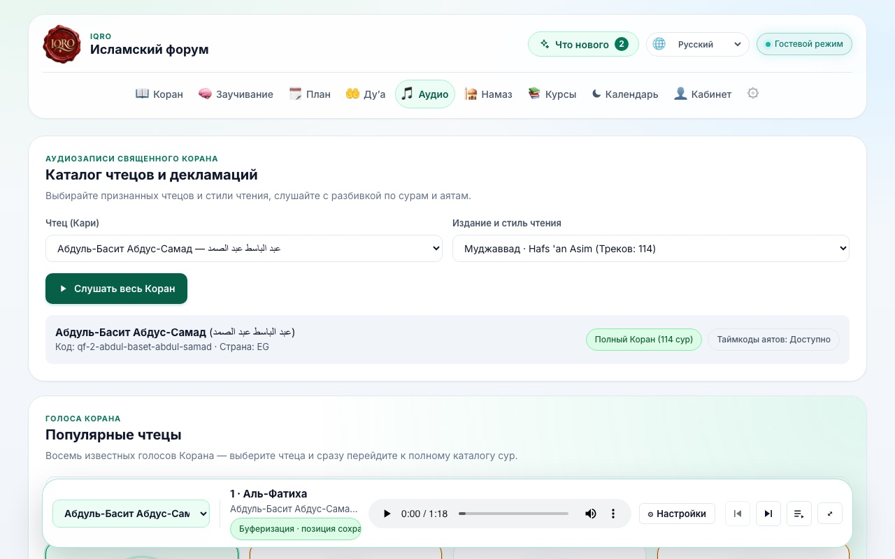
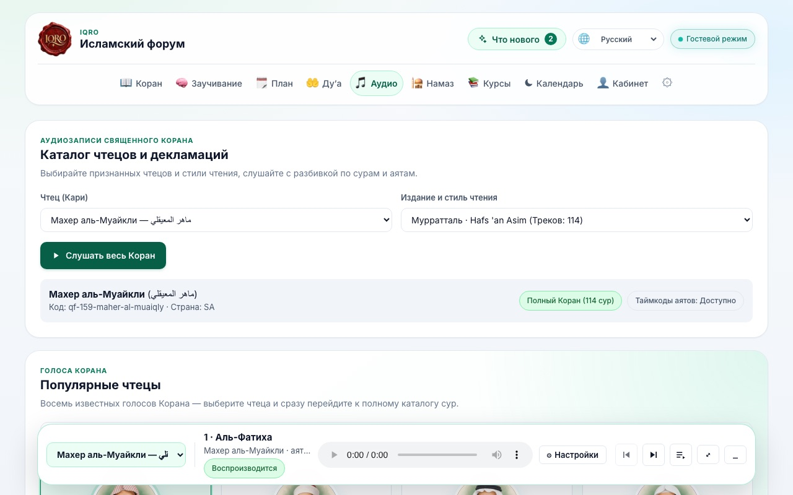
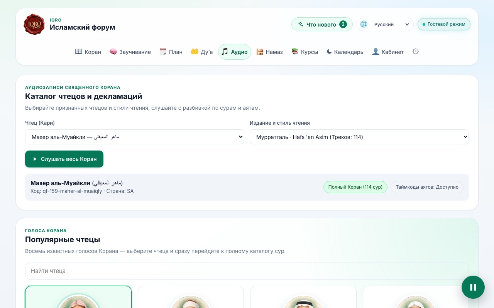
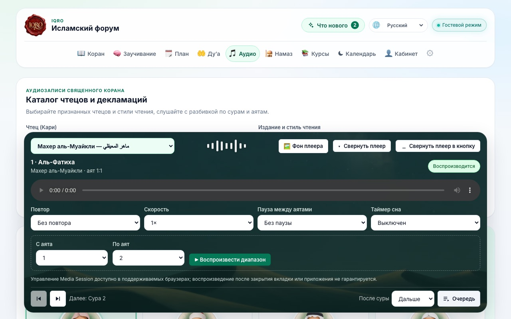
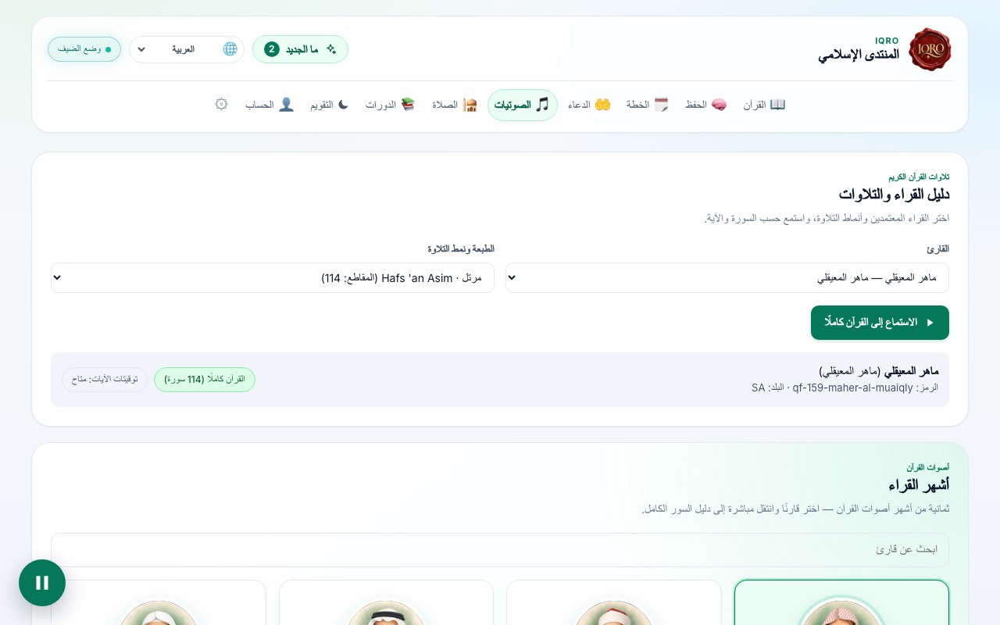

# Сворачивание плеера на десктопе (3 ноября 2026)

Просьба владельца: «на десктопе так же нужна возможность сворачивать плеер». На телефоне и
планшете (≤ 768 px) полоска плеера уже сворачивается в круглую кнопку
([web-mobile-player-parity-2026-10-22.md](web-mobile-player-parity-2026-10-22.md)). Теперь
так же умеет настольный док `global-audio-player` (≥ 769 px).

Код: `services/web/lib/audio-player-context.tsx` (состояние и разметка), стили —
`services/web/app/globals.css` (блок «The dock folded into a 60 px round button»), подписи —
`lib/messages/{ru,en,ar,tr}.ts` (`player.foldDock`, `player.unfoldDock`). Телефонная полоска
(`lib/mini-player.ts`, `components/MobileAudioPlayer.tsx`, `app/mobile.css`) не менялась.

## Как работает

- В доке есть кнопка «Свернуть плеер в кнопку» (иконка «—»): в компактном доке — последняя в
  ряду кнопок, в развёрнутом — в шапке рядом с «Свернуть плеер», там с подписью.
- Свёрнутый док — круг 60 px цвета primary в правом нижнем углу (24 px от краёв), в арабском —
  в левом. В круге — play или pause, как на телефоне: pause, пока идёт звук. Нажатие (мышью,
  Enter или пробелом) возвращает док в том виде, в каком он был: компактным или развёрнутым.
- `<audio>` и всё тело дока остаются в DOM, они только скрыты стилями и закрыты `inert`.
  Поэтому звук, позиция, очередь и выбор чтеца не прерываются. Фон развёрнутого плеера на время
  свёрнутого состояния снимается (картинка и видео не грузятся впустую) и возвращается при
  разворачивании.
- Выбор запоминается: при переходах по сайту провайдер плеера не перемонтируется, а для
  перезагрузки и новых вкладок флаг хранится в `localStorage` под ключом
  `iqro_desktop_player_folded_v1` (`"1"` — свёрнут; при разворачивании ключ удаляется). Если
  хранилище недоступно, док остаётся свёрнутым до конца визита.
- Под свёрнутым доком у страницы остаётся отступ 92 px (вместо 112/190), чтобы кнопка не
  закрывала конец страницы.

## Доступность

- Обе кнопки — настоящие `<button>` с `aria-label` и `title` на языке сайта:
  ru «Свернуть плеер в кнопку» / «Показать плеер», en «Fold the player into a button» /
  «Show the player», ar «طي المشغل إلى زر» / «إظهار المشغل», tr «Oynatıcıyı düğmeye küçült» /
  «Oynatıcıyı göster».
- Фокус не теряется: после сворачивания он на круглой кнопке, после разворачивания — на кнопке
  «Свернуть». У круглой кнопки видимое кольцо фокуса.
- Док по-прежнему `role="region"` с подписью «Закреплённый аудиоплеер Корана».
- Анимации (появление круга 240 мс, подъём дока 280 мс) отключаются при
  `prefers-reduced-motion: reduce`.
- RTL: круг стоит у конца строки (`inset-inline-end`), стрелка play смотрит по направлению
  чтения, как на телефоне.

## Проверка

`services/web/e2e/desktop-player-fold.spec.ts`: сворачивание и разворачивание без паузы и с
тем же элементом `<audio>` и позицией, фокус, размер и место круга, отступ страницы; сохранение
при переходе на другую страницу и после перезагрузки; развёрнутый док; арабский с
`reduced-motion`; на ширине телефона кнопки нет.

## Скриншоты

1280 × 800. «До» — iqro.forum (main), «после» — ветка этой правки.

