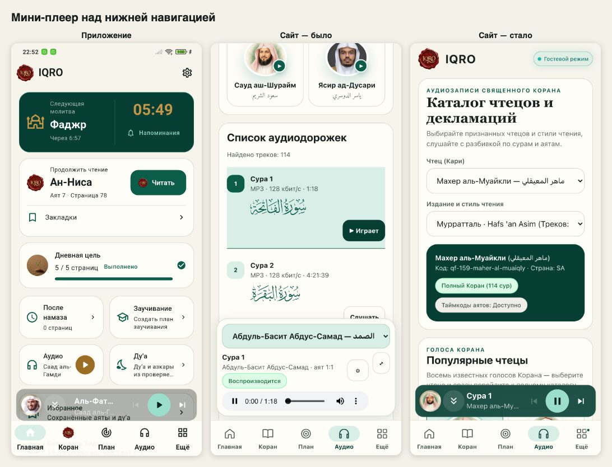
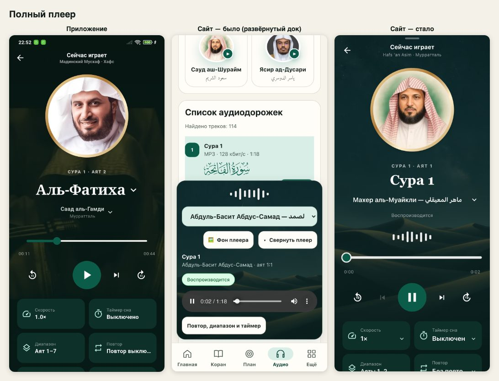
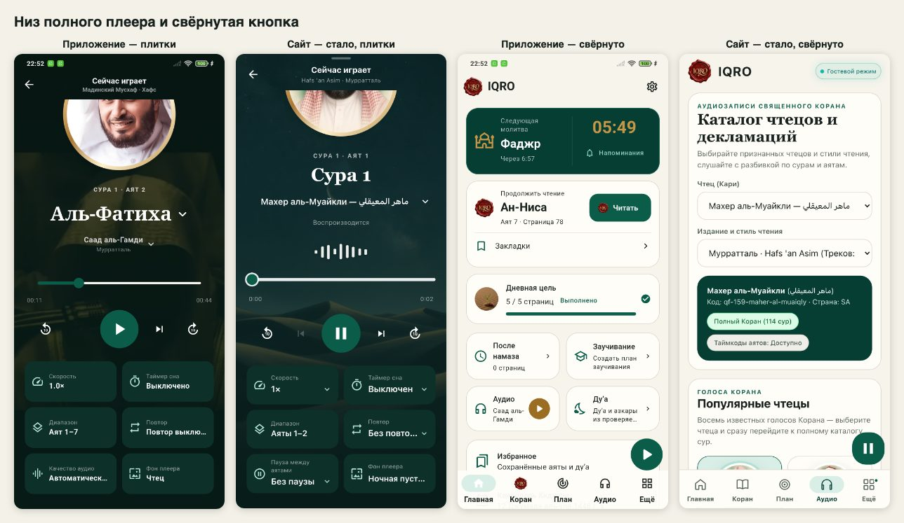
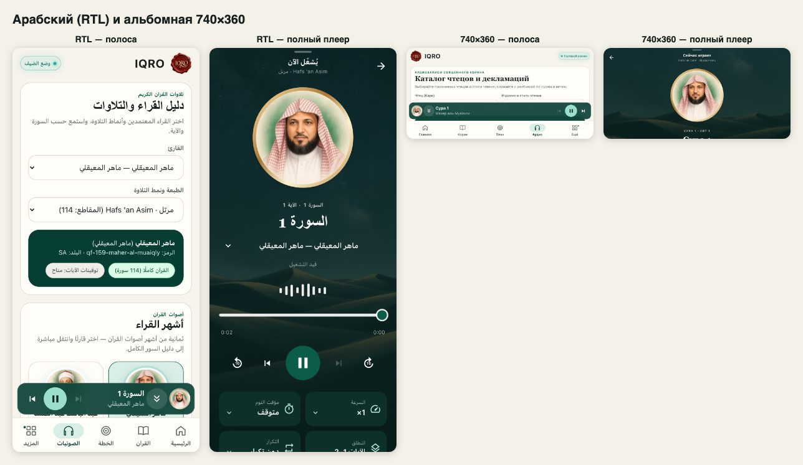

# Мини-плеер на телефоне: приложение и сайт (22 октября 2026)

Эталон — Flutter-приложение: `clients/iqro_mobile/lib/features/audio/mini_player.dart`
(`IqroMiniPlayer`, `_CollapsiblePlayer`), размещение в `lib/app/app_shell.dart`,
полный экран `lib/features/audio/player_screen.dart`. Сайт: `services/web/lib/audio-player-context.tsx`,
`components/MobileAudioPlayer.tsx`, `components/SegmentedAudioPlayer.tsx`, стили в `app/mobile.css`.

## Снятые размеры приложения

| Элемент | Приложение | Сайт после правки |
| --- | --- | --- |
| Полоса мини-плеера | высота 66, скругление 17, отступы 10 по бокам и 6 сверху, фон `#030F0C` 32 %, рамка белая 16 % | то же: 66 × (100 % − 20 px), скругление 17, `--mobile-ink` 90 % с размытием, рамка белая 16 % |
| Положение | `bottom: 72` над `NavigationBar`, не перекрывает кнопки навигации | `bottom: calc(var(--mobile-nav-space) + 6px)`, spacer 72 px под полосу, safe-area учтена через `--mobile-nav-space` |
| Состав полосы | обложка 44, кнопка «свернуть» 44 (двойная стрелка вниз), название + чтец, кнопки prev / play / next 48 × 48 (иконки 23, play 25, фон `#9BDECB`) | тот же порядок и размеры; обложка и текст — одна кнопка «Открыть плеер» |
| Свёрнутое состояние | круг 60 × 60 цвета primary с иконкой play/pause у конца строки; тап разворачивает полосу | то же, анимация 420 мс ширины/высоты/скругления (17 → 26), под `prefers-reduced-motion` без анимации |
| Тап по полосе | `context.push('/player')` — полноэкранный плеер поверх навигации | полноэкранный слой `role="dialog"`, выезжает снизу за 320 мс, навигация и страница под ним `inert` |
| Полный плеер: шапка | стрелка «назад», «Сейчас играет» + подзаголовок | то же, подзаголовок — риваят/стиль записи (`album`) |
| Полный плеер: тело | обложка 210, «Сура N · аят M», название суры, чтец с шевроном, слайдер + время, replay-10 / prev / play 72 / next / forward-10, плитки 2 × N: скорость, таймер сна, диапазон, повтор, качество, фон | обложка 210, «Сура N · аят M», название, чтец (на /audio — выбор чтеца), эквалайзер, слайдер + время, те же пять кнопок, плитки: скорость, таймер сна, повтор, пауза между аятами (вместо качества — на сайте нет вариантов качества), диапазон, фон плеера |
| Фон и эквалайзер | фон плеера (картинка/видео под скримом), эквалайзер только при скрытых контролах | фон плеера под скримом, эквалайзер над слайдером пока идёт воспроизведение |
| Тап по телу | `GestureDetector` на всём экране: тап по пустому месту прячет контролы (`AnimatedOpacity` 250 мс), остаются фон без скрима и эквалайзер; второй тап возвращает | тап по пустому месту тела прячет шапку, подписи, транспорт и плитки за 250 мс (`inert`), скрим уходит, остаются фон, обложка и эквалайзер; возвращает тап в любом месте (невидимая кнопка «Показать элементы управления» для клавиатуры и ридеров); Esc по-прежнему закрывает |
| Закрытие | системная «назад» | стрелка «Назад», Esc, свайп вниз по шапке (≥ 96 px или быстрый жест), смена маршрута |
| Prev / next | следующая сура той же записи, пропуск отсутствующих сур | следующая/предыдущая сура той же записи через `GET /recitations/{id}/surahs/{n}`; если суры нет — текст ошибки в подзаголовке полосы |
| Звонок, сворачивание | audio_service, фокус ОС | как и раньше: Media Session, ничего не меняли |

## Решения

- Порог «телефон» — тот же, что у нижней навигации сайта: `max-width: 768px`. В альбомной ориентации
  телефонов шире 768 px (390 × 844, 412 × 915 повёрнутые) сайт целиком переходит в настольную раскладку,
  и плеер остаётся прежним настольным доком; на 740 × 360 (альбомная 360 × 740) работает мобильная полоса.
- Серверный HTML содержит настольный док; на ширине ≤ 768 px он скрыт стилями, и после гидратации
  вместо него монтируется мобильная полоса. Так нет вспышки большого дока и сдвига раскладки.
- Элемент `<audio>` и вся логика воспроизведения остаются в `SegmentedAudioPlayer`: мобильные вид
  и жесты — это новые слоты разметки того же компонента (`presentation: "mini" | "full"`), поэтому
  раскрытие и сворачивание не прерывают звук и не теряют позицию.
- Выбор чтеца на /audio, фон плеера и эквалайзер — те же компоненты, что в настольном доке.
- Тёмной темы у сайта нет; полный плеер, как и в приложении, всегда тёмный (`color-scheme: dark`),
  полоса — тёмно-изумрудная на любой странице.
- Настольный док (≥ 769 px) не менялся.
- Закрытие полного плеера — состояние машины (`lib/mini-player.ts`): `full → closing → bar`. Размер контейнера
  задаётся классом состояния (`is-full`/`is-closing` — лист на весь экран, иначе полоса 66 px), «closing» завершается
  по `animationend` анимации `mobile-player-sink` с запасным таймером; тап по полосе во время закрытия возвращает
  `full` и отменяет отложенное закрытие, `inert` со страницы снимается при любом выходе из листа (23.10.2026).

## Не перенесено

- Выбор суры из полного плеера (шеврон у названия) и выбор качества аудио.
- Пропуск сур, которых нет в записи: сайт не знает покрытие записи в контексте плеера.

## Скриншоты (приложение — было — стало)

Снято 22 октября 2026: приложение на Redmi Note 7, сайт «было» — iqro.forum в Chromium 390 × 844,
«стало» — ветка этой правки на том же размере.

